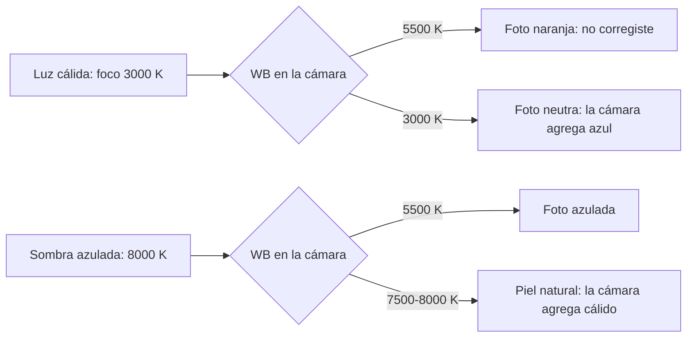

# Balance de blancos y temperatura de color

Parte de: [[30-Fotografia/04 Luz y color/_Índice Luz y color|Luz y color]]

> [!info] Cómo avanzar
> `progreso`: **pendiente** → **viendo** (estudiando) → **visto** (contestaste la autoevaluación sin abrir las respuestas) → **dominado** (hiciste el laboratorio o lo aplicaste de verdad).

## Contenido

### Qué es
La **temperatura de color** describe qué tan cálida (naranja) o fría (azul) es una fuente de luz, y se mide en **kelvin (K)**. Valores bajos = luz cálida; valores altos = luz fría. Referencias aproximadas:

| Fuente | Kelvin aprox. |
|---|---|
| Vela | 1,800–2,000 K |
| Foco incandescente o LED "cálido" | 2,700–3,200 K |
| Sol de mañana o tarde (hora dorada) | 3,000–4,000 K |
| Sol de mediodía / flash | 5,000–5,600 K |
| Día nublado | 6,000–7,000 K |
| Sombra con cielo azul | 7,000–9,000 K o más |

El **balance de blancos** (WB) es la corrección que hace la cámara para que lo blanco se vea blanco bajo esa luz. Nuestro cerebro lo hace solo; la cámara necesita que se lo indiquen o que lo adivine (AWB).

### Cómo funciona
Cuando pones un valor en K en la cámara, le dices **"la luz de esta escena es de X kelvin; neutralízala"**. Por eso funciona "al revés" de la intuición:

- Foto **naranja** en interior con focos cálidos → **baja** el valor de K (por ejemplo, de 5500 a ≈ 3000 K) o elige el preset "Incandescente".
- Piel **azulada** en sombra profunda a mediodía → **sube** el valor (≈ 7000–8000 K) o elige el preset "Sombra".
- Además de K existe el **tinte** (eje verde–magenta), útil con fluorescentes o LED baratos que meten verde.

**RAW y balance de blancos**: en RAW el balance es solo una **etiqueta** guardada con el archivo; los datos del sensor no se alteran. Lo cambias después sin pérdida. En JPEG/HEIF se "hornea": corregir mucho después degrada colores. Ver [[RAW vs JPEG y HEIF]].

### Ejemplo
**Cena con focos cálidos y el iPhone**: la app nativa usa balance automático y suele dejar un toque cálido a propósito (ambiente). Si quieres neutral, edítalo en Fotos (control "Calidez") o dispara ProRAW y ajústalo en el revelado. Con una app manual (por ejemplo la cámara Profesional de Lightroom móvil) puedes fijar el WB por preset o personalizado apuntando a una superficie neutra.

**a6700 en una sesión con luz mezclada**: fija un WB manual con una tarjeta gris o una hoja blanca (balance personalizado) para que todas las fotos de la serie coincidan; si disparas RAW, toma una foto de la tarjeta al inicio y sincroniza el ajuste a todas al editar.

Ejercicio: a la misma escena en interior con foco cálido, toma fotos en la a6700 con WB en 2800, 4000, 5500 y 7500 K. Observa cómo **bajar** K enfría la foto. Repite al atardecer: con 5500 K se ve dorado; con AWB, la cámara tiende a "quitar" ese dorado.

### Cuándo usarlo y cuándo no
- **AWB**: rápido y bastante bueno en luz de día; tiende a fallar con una sola fuente muy cálida o con escenas dominadas por un color (pasto, pared roja).
- **Preset o K manual**: series con luz constante, interiores, para que el color no salte entre fotos. Indispensable en video y time-lapse.
- **Personalizado con tarjeta gris**: producto, ropa, arte; cuando el color tiene que ser fiel.
- **No neutralices todo**: el balance es también una decisión creativa.

### Errores comunes
1. **Corregir siempre a neutro un atardecer**: matas el motivo de la foto. La luz dorada **es** el tema; deja WB en "Luz día" o ≈ 5500 K, o incluso más cálido.
2. **Subir K esperando una foto más fría**: es al revés; mayor K en la cámara = foto más cálida.
3. **Mezclar fuentes sin decidir cuál es la principal**: una ventana (≈ 6000 K) y un foco (≈ 3000 K) no se pueden neutralizar juntos; elige la luz que ilumina al sujeto o apaga una.
4. **Confiar en la pantalla del celular con True Tone o modo nocturno**: altera cómo ves el color; edita en un monitor neutro.

### Para profundizar
- [Understanding White Balance (Cambridge in Colour)](https://www.cambridgeincolour.com/tutorials/white-balance.htm)
- [A Background on Color Perception (Cambridge in Colour)](https://www.cambridgeincolour.com/tutorials/color-perception.htm)
- [Understanding RAW Files (Cambridge in Colour)](https://www.cambridgeincolour.com/tutorials/RAW-file-format.htm)

## Ejercicios

Resuélvelos en papel o en la herramienta; la solución está plegada.

> [!question]- Tomas en interior con focos cálidos y la foto sale naranja. ¿Subes o bajas el valor de K en la app?
> **Bajas** los K (p. ej. a ~3000 K) para que la cámara agregue azul y neutralice.

> [!question]- Sombra profunda a mediodía y la piel se ve azulada. ¿Qué ajuste aproximado pruebas?
> Subir a **~7000 K** (preset Sombra), lo que agrega calidez.

## Autoevaluación

Contesta primero en voz alta o en papel; luego despliega la respuesta.

> [!question]- ¿Qué es la temperatura de color y en qué unidad se mide?
> Una forma de describir el tono de una fuente de luz, en **kelvin (K)**. Valores bajos = luz cálida (foco incandescente ≈2700–3200 K); medios ≈5000–5600 K luz de día; altos = sombra o cielo nublado (≈6500 K y más), más azulada.

> [!question]- ¿Qué hace el balance de blancos?
> Compensa el tono de la luz para que los blancos se vean neutros. Si pones 3200 K bajo luz de foco, neutralizas el naranja.

> [!question]- ¿Por qué el balance de blancos no importa tanto en RAW?
> Porque en RAW se guarda como dato y lo cambias en el revelado sin pérdida. En JPEG/HEIF queda "horneado".

> [!question]- Error común: corregir siempre a neutro un atardecer. ¿Por qué puede ser mala idea?
> Le quitas el ambiente cálido que te hizo tomar la foto. El balance también es una decisión creativa.

## Práctica

- [[Práctica Foto 06 - Balance de blancos y horas de luz]]

