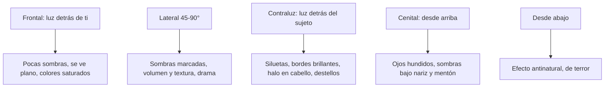

# Dirección de la luz

Parte de: [[30-Fotografia/04 Luz y color/_Índice Luz y color|Luz y color]]

> [!info] Cómo avanzar
> `progreso`: **pendiente** → **viendo** (estudiando) → **visto** (contestaste la autoevaluación sin abrir las respuestas) → **dominado** (hiciste el laboratorio o lo aplicaste de verdad).

## Contenido

### Qué es
La **dirección de la luz** es el ángulo desde el que la luz principal llega al sujeto respecto a la cámara. Es lo que decide **dónde caen las sombras**, y las sombras son las que dan forma, textura y volumen. La misma cara, el mismo objeto y la misma calle cambian por completo si la luz viene de frente, de lado o de atrás.

### Cómo funciona

- **Frontal**: la luz sale de detrás de la cámara. Ilumina todo de forma pareja; buena para documentar o para piel con textura que no quieres resaltar, pero aplana el volumen. Con sol directo, la gente entrecierra los ojos.
- **Lateral**: la luz llega de un costado (45° a 90°). Revela textura (piedra, madera, arrugas) y modela el rostro. Es la base de los esquemas de retrato clásicos (ver [[Esquemas de iluminación de retrato]]).
- **Contraluz**: la luz viene de detrás del sujeto hacia la cámara. Si mides para el fondo, obtienes una silueta; si mides para la cara (y compensas +1 o rellenas con reflector), obtienes un borde de luz en el cabello y una piel suave. Cuidado con destellos y pérdida de contraste.
- **Cenital**: sol de mediodía. En retratos es mala porque las cuencas de los ojos quedan en sombra (los "ojos de mapache") y aparecen sombras duras bajo nariz y mentón. En paisaje aplana el relieve.

### Ejemplo
**No puedes mover el sol, pero puedes moverte tú y mover al sujeto**:
1. **Gira al sujeto** respecto al sol: de frente (plano), 45° (modelado), de espaldas (contraluz). Mismo lugar, tres fotos distintas.
2. **Cambia tu posición**: rodea al sujeto en lugar de que él se mueva.
3. **Espera la hora**: a media mañana o tarde el sol baja y se vuelve lateral; en hora dorada es casi horizontal. Ver [[Hora dorada y hora azul]].
4. **Bloquea y redirige**: a mediodía, mete al sujeto bajo un árbol o un portal (luz de sombra abierta) y usa un reflector para mandar luz desde el lado que quieras. Ver [[Modificadores de luz (difusor, reflector y softbox)]].
5. **En interior**, la ventana es tu fuente: sienta a la persona de frente, a 45° o de lado a la ventana.

Ejercicio con el iPhone (3x) o la a6700 con un 50 mm: retrato junto a una ventana en tres posiciones (la persona de frente a la ventana, a 45° y de perfil a ella). Luego un objeto con textura (una piña, una piedra) con luz frontal y lateral. Compara cómo aparece la textura.

### Cuándo usarlo y cuándo no
- **Frontal**: fotos de documentos, catálogos sencillos, retratos donde quieres suavizar textura (combinada con luz suave).
- **Lateral**: retrato con carácter, comida (desde atrás-lateral), paisaje con relieve, arquitectura.
- **Contraluz**: atardeceres, siluetas, cabello iluminado, líquidos y hojas translúcidas.
- **Evita** la cenital dura en retratos; si no hay opción, gorra fuera, busca sombra o un difusor arriba del sujeto.

### Errores comunes
1. **Poner siempre el sol a tu espalda** (la regla vieja): fotos correctas pero planas y con ojos entrecerrados.
2. **Contraluz sin compensar**: la cara sale negra. Toca la cara para medir, compensa o rellena.
3. **Ignorar la luz reflejada**: una pared verde o un piso rojo tiñen la piel; fíjate en el color de las superficies cercanas.
4. **Pensar en la dirección e ignorar la calidad**: luz lateral dura y luz lateral suave dan resultados muy distintos. Ver [[Luz dura y luz suave]].

### Para profundizar
- [Making the Most of Natural Light in Photography (Cambridge in Colour)](https://www.cambridgeincolour.com/tutorials/natural-light-photography.htm)
- [Portrait Lighting with One Light (Cambridge in Colour)](https://www.cambridgeincolour.com/tutorials/portrait-lighting.htm)

## Autoevaluación

Contesta primero en voz alta o en papel; luego despliega la respuesta.

> [!question]- ¿Qué efecto tiene la luz frontal, lateral y de contraluz?
> **Frontal**: aplana y muestra color, oculta texturas. **Lateral**: revela volumen y textura. **Contraluz**: siluetas, bordes brillantes y atmósfera.

> [!question]- ¿Por qué la luz cenital (desde arriba) es mala para retratos?
> Proyecta sombras en los ojos ("ojos de mapache") y bajo la nariz y el mentón.

> [!question]- ¿Cómo cambias la dirección de la luz si no puedes mover el sol?
> Te mueves tú o mueves al sujeto, rebotas con un reflector, o esperas otra hora del día.

## Práctica

- [[Práctica Foto 05 - Retrato con luz de ventana y reflector casero]]

