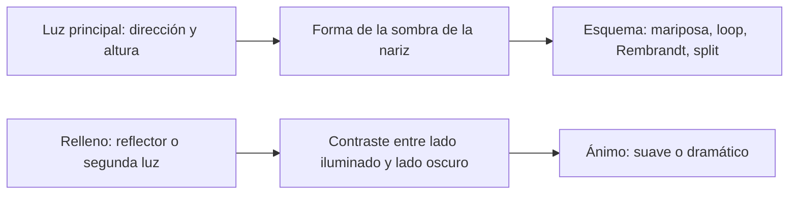

# Esquemas de iluminación de retrato

Parte de: [[30-Fotografia/04 Luz y color/_Índice Luz y color|Luz y color]]

> [!info] Cómo avanzar
> `progreso`: **pendiente** → **viendo** (estudiando) → **visto** (contestaste la autoevaluación sin abrir las respuestas) → **dominado** (hiciste el laboratorio o lo aplicaste de verdad).

## Contenido

### Qué es
Un **esquema de iluminación de retrato** es una forma reconocible de colocar la **luz principal** (key light) respecto a la cara, definida por **la forma de la sombra de la nariz** y por qué parte del rostro queda iluminada. Cada esquema transmite algo distinto: frescura, glamour, misterio, dramatismo. Los cinco clásicos son, de más plano a más dramático por la posición lateral de la luz:

- [[Iluminación mariposa]]: luz de frente y arriba; sombra pequeña bajo la nariz.
- [[Iluminación clamshell]]: mariposa más un relleno desde abajo; muy plana y favorecedora.
- [[Iluminación loop]]: luz a 30–45° y algo arriba; sombra de nariz en forma de "lazo" hacia la mejilla.
- [[Iluminación Rembrandt]]: luz a ≈ 45° y más arriba; triángulo de luz en la mejilla del lado oscuro.
- [[Iluminación split]]: luz a 90°; media cara iluminada y media en sombra.

### Cómo funciona
Tres conceptos explican todos los esquemas:



1. **Luz principal**: su posición horizontal (de frente a lateral) y su altura (a nivel de ojos o más arriba) decide el esquema. Basta girarla o girar la cabeza del sujeto unos grados para pasar de uno a otro.
2. **Luz de relleno**: ilumina las sombras sin crear sombras propias (un reflector, una pared blanca o una luz débil cerca de la cámara). No cambia el esquema; cambia el **contraste**.
3. **Relación de contraste**: la diferencia en pasos entre el lado iluminado y el lado en sombra. 1 paso de diferencia = el lado claro tiene el doble de luz (2:1, suave); 2 pasos = 4:1 (marcado); 3 pasos = 8:1 (dramático). Más relleno = menos pasos de diferencia.

Otros apoyos: la **luz de contorno** (rim) detrás del sujeto para separarlo del fondo y la **luz de fondo**. La calidad (dura o suave) se elige aparte: ver [[Luz dura y luz suave]].

### Ejemplo
**Sin equipo**, con una ventana y una cartulina blanca:
1. Sienta a la persona a 1 m de la ventana (sin sol directo) y tú ponte de espaldas a la pared.
2. Gira a la persona poco a poco desde estar de frente a la ventana hasta tenerla de perfil. Observa la sombra de la nariz: pasarás por mariposa (frente), loop, Rembrandt y split.
3. Agrega la cartulina del lado opuesto a la ventana y acércala o aléjala para controlar el contraste.
Con el iPhone usa la 3x y toca el ojo para medir; con la a6700 un 50 mm a f/2–f/2.8 con detección de ojos. Ver [[Práctica Foto 05 - Retrato con luz de ventana y reflector casero]].

Ejercicio: arma una "hoja de esquemas" con 5 fotos de la misma persona, una por esquema, y anota el ángulo aproximado de la ventana y la distancia del reflector en cada una.

### Cuándo usarlo y cuándo no
- **Mariposa y clamshell**: belleza, maquillaje, retratos corporativos favorecedores.
- **Loop**: el comodín; casi cualquier retrato.
- **Rembrandt**: retratos con carácter, arte, editorial.
- **Split**: drama, misterio, música, personajes.
- **No son leyes**: son un vocabulario para describir y repetir resultados. En exteriores o en eventos no siempre puedes controlarlos; busca el más parecido que te dé la luz disponible.

### Errores comunes
1. **Mover solo la luz y no la cabeza**: a veces basta girar la cara del sujeto 10° para corregir el esquema.
2. **Olvidar la altura**: con la luz a la altura de los ojos no aparecen las sombras que definen loop y Rembrandt.
3. **Relleno tan fuerte como la principal**: aparece una segunda sombra de nariz y el esquema se pierde.
4. **No revisar los ojos**: cada esquema debe dejar al menos un brillo (catchlight) en los ojos, si no la mirada se ve apagada.

### Para profundizar
- [Portrait Lighting with One Light (Cambridge in Colour)](https://www.cambridgeincolour.com/tutorials/portrait-lighting.htm)
- [Portrait Lighting with Two Lights: Fill Light (Cambridge in Colour)](https://www.cambridgeincolour.com/tutorials/portrait-fill-light.htm)

## Subtemas

- [[Iluminación Rembrandt]]
- [[Iluminación loop]]
- [[Iluminación split]]
- [[Iluminación mariposa]]
- [[Iluminación clamshell]]

## Autoevaluación

Contesta primero en voz alta o en papel; luego despliega la respuesta.

> [!question]- ¿Qué define un esquema de iluminación de retrato?
> La posición de la luz principal respecto a la cara y la sombra que dibuja la nariz. Cada esquema tiene un "carácter": suave, dramático, glamoroso.

> [!question]- ¿Qué es la luz de relleno y cómo se relaciona con el contraste?
> Una luz secundaria (o reflector) que aclara las sombras. Menos relleno = más contraste y drama.

> [!question]- ¿Puedes hacer estos esquemas sin equipo?
> Sí: una ventana es una softbox natural. Cambias el esquema moviendo a la persona y su cara respecto a la ventana, y usas una cartulina blanca de relleno.

## Práctica

- [[Práctica Foto 05 - Retrato con luz de ventana y reflector casero]]

## Progreso de los subtemas

```base
filters:
  and:
    - file.inFolder("30-Fotografia/04 Luz y color/Esquemas de iluminación de retrato")
    - file.name != "Esquemas de iluminación de retrato"
views:
  - type: table
    name: Progreso
    order:
      - file.name
      - progreso
      - nivel
```
