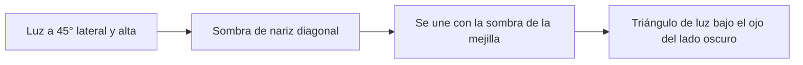

# Iluminación Rembrandt

Parte de: [[Esquemas de iluminación de retrato]]

> [!info] Cómo avanzar
> `progreso`: **pendiente** → **viendo** (estudiando) → **visto** (contestaste la autoevaluación sin abrir las respuestas) → **dominado** (hiciste el laboratorio o lo aplicaste de verdad).

## Contenido

### Qué es
La **iluminación Rembrandt** debe su nombre al pintor holandés, que la usaba en muchos de sus retratos. Se reconoce por un **pequeño triángulo de luz en la mejilla del lado en sombra**, formado porque la sombra de la nariz se une con la sombra de la mejilla. El resto de ese lado queda oscuro. Transmite profundidad, carácter y un aire clásico o pictórico.

Es parte de los [[Esquemas de iluminación de retrato]].

### Cómo funciona
**Dónde va la luz principal**: aproximadamente a **45° hacia un lado** del sujeto y **por encima de la altura de los ojos** (apuntando un poco hacia abajo, ≈ 30–45°). Desde esa posición:
- El lado cercano a la luz queda iluminado.
- La sombra de la nariz baja en diagonal y **se une** con la sombra de la mejilla del lado oscuro.
- Entre ambas sombras queda atrapado el triángulo de luz bajo el ojo.

**Reglas del triángulo** (orientativas): no más ancho que el ojo ni más largo que la nariz, y el ojo del lado oscuro debe recibir luz (si no, se ve hundido y sin vida).

La diferencia con la [[Iluminación loop]] es que en loop la sombra de la nariz es pequeña y **no toca** la sombra de la mejilla; en Rembrandt sí la toca y cierra el triángulo. Con la luz todavía más lateral (90°) llegas a la [[Iluminación split]].

**Contraste**: el esquema clásico es dramático (3 pasos o más entre lados). Si quieres suavizarlo, añade un reflector del lado oscuro sin borrar el triángulo.

### Ejemplo
**Con una ventana en casa** (sin sol directo):
1. Coloca a la persona a 1 m de la ventana, girada unos 45° respecto a ella.
2. Si la ventana es baja, la luz llega horizontal; baja la persiana inferior o cubre la parte baja con una cartulina para que la luz venga **desde arriba**.
3. Pide que gire la cabeza poco a poco **alejándose** de la ventana hasta que aparezca el triángulo en la mejilla opuesta.
4. Fotografía desde el lado de la sombra para que domine el lado oscuro (más dramático).

Con el iPhone usa la 3x y compensa −0.3 a −0.7 EV para mantener las sombras profundas; con la a6700, modo M, mide en la mejilla iluminada y usa un fondo oscuro para reforzar el ánimo. Con una sola lámpara LED o flash con softbox, colócala a 45° y elevada por encima de la cabeza.

Ejercicio: toma tres fotos variando solo la altura de la luz (a nivel de ojos, un poco arriba, muy arriba) y observa cuándo aparece el triángulo y cuándo el ojo empieza a perder luz.

### Cuándo usarlo y cuándo no
- **Sí**: retratos con carácter, personas mayores, músicos, artistas, retrato artístico en blanco y negro, fotos con ambiente cinematográfico.
- **Con cuidado**: rostros con mucha textura o acné (la luz lateral resalta relieves); suaviza con una fuente más grande o algo de relleno.
- **No**: retratos corporativos alegres, fotos de producto de belleza o cuando quieres un aspecto fresco y abierto (usa loop o mariposa).

### Errores comunes
1. **El triángulo no aparece**: la luz está muy de frente o muy baja; muévela más hacia el lado y súbela, o gira la cabeza del sujeto alejándola de la luz.
2. **El triángulo es demasiado grande** (media mejilla iluminada): la luz está demasiado frontal; muévela más lateral o gira la cara hacia el otro lado.
3. **El ojo del lado oscuro queda negro**: la luz está demasiado lateral o alta; bájala un poco o agrega relleno suave.
4. **Relleno excesivo**: el triángulo se diluye y se convierte en un loop plano.

### Para profundizar
- [Portrait Lighting with One Light (Cambridge in Colour)](https://www.cambridgeincolour.com/tutorials/portrait-lighting.htm)
- [Portrait Lighting with Two Lights: Fill Light (Cambridge in Colour)](https://www.cambridgeincolour.com/tutorials/portrait-fill-light.htm)

## Autoevaluación

Contesta primero en voz alta o en papel; luego despliega la respuesta.

> [!question]- ¿Cómo se reconoce la iluminación Rembrandt?
> Un **triángulo de luz** en la mejilla del lado de sombra, bajo el ojo, formado porque se unen la sombra de la nariz y la de la mejilla.

> [!question]- ¿Dónde va la luz principal?
> Aproximadamente a 45° del sujeto y algo por encima de la altura de los ojos.

> [!question]- Error común: el triángulo no aparece o es muy grande. ¿Qué ajustas?
> Gira un poco la cara o mueve la luz: si no hay triángulo, la luz está muy de frente (es loop); si el ojo de sombra queda oscuro, la luz está demasiado lateral.

## Práctica

- [[Práctica Foto 05 - Retrato con luz de ventana y reflector casero]]

