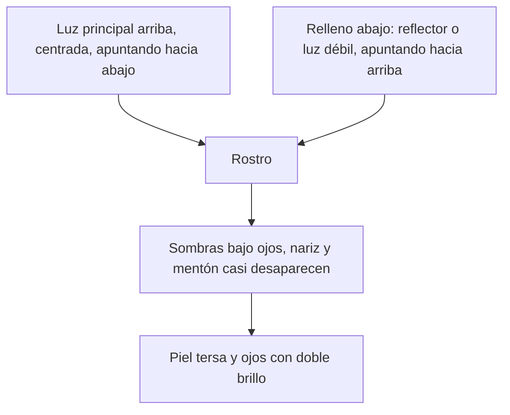

# Iluminación clamshell

Parte de: [[Esquemas de iluminación de retrato]]

> [!info] Cómo avanzar
> `progreso`: **pendiente** → **viendo** (estudiando) → **visto** (contestaste la autoevaluación sin abrir las respuestas) → **dominado** (hiciste el laboratorio o lo aplicaste de verdad).

## Contenido

### Qué es
La **iluminación clamshell** (concha) combina **dos fuentes frente al rostro, una arriba y una abajo**, que se abren como las dos valvas de una almeja con la cara en medio. La de arriba es la principal (una [[Iluminación mariposa]]) y la de abajo es un relleno, normalmente un reflector o una luz más débil. El resultado es un rostro muy luminoso, con sombras mínimas, piel suave y doble brillo en los ojos.

Es parte de los [[Esquemas de iluminación de retrato]].

### Cómo funciona

- La luz de arriba define pómulos y mandíbula como en la mariposa.
- La fuente de abajo **rellena** las sombras que deja la de arriba: ojeras, la sombra bajo la nariz y bajo el mentón.
- La proporción entre ambas controla el contraste: un reflector blanco da relleno suave (≈ 1–2 pasos menos que la principal); una segunda luz te deja ajustarlo con precisión. Si la de abajo iguala a la de arriba, la cara se ve plana y artificial.
- Cuanto más **grandes y cercanas** las fuentes, más suave el resultado.

**Para qué se usa**: belleza y maquillaje (las ojeras desaparecen y la piel se ve uniforme), *headshots* de actores y corporativos, fotos de producto cosmético junto a la cara, y videos tipo tutorial o entrevista frente a cámara. Es el esquema más "favorecedor" de los clásicos y el menos dramático.

### Ejemplo
**Clamshell improvisado en casa**:
1. **Luz de arriba**: una ventana alta, una lámpara LED con difusor o una softbox, colocada encima de tu cabeza y apuntando a la cara a ≈ 1 m, inclinada hacia abajo.
2. **Relleno de abajo**: la persona sostiene en su regazo una cartulina blanca, un tablero de unicel o el reflector plateado de un parasol de auto, inclinado hacia su cara. También sirve una mesa blanca frente a ella.
3. Tú disparas por el hueco entre ambas fuentes, a la altura de los ojos: iPhone 3x o a6700 con un 50 mm a f/4–f/5.6 para que todo el rostro quede nítido.
4. Mueve el reflector de abajo más cerca o más lejos y observa cómo desaparecen las ojeras.

**Para video** con la Osmo Pocket 4P o el iPhone: el mismo montaje es ideal para grabarte hablando a cámara; combínalo con el micrófono DJI Mic Mini 2 para un setup de tutorial sencillo.

Ejercicio: toma tres fotos, (1) solo luz de arriba, (2) arriba + cartulina blanca, (3) arriba + reflector plata. Compara ojeras, cuello y brillo en los ojos.

### Cuándo usarlo y cuándo no
- **Sí**: belleza, maquillaje, retratos corporativos, perfiles para redes, videos de tutoriales o reuniones, personas que quieren verse descansadas.
- **No**: retratos con carácter o volumen marcado; ahí la falta de sombras se ve plana. Para eso, loop o Rembrandt.
- **Alternativa ligera**: si solo tienes una fuente, una mariposa con un reflector blanco grande en la mesa ya es un clamshell básico.

### Errores comunes
1. **Relleno de abajo igual o más fuerte que la luz de arriba**: luz de "linterna bajo la barbilla", efecto inquietante. El de abajo siempre más débil.
2. **Fuentes demasiado separadas o lejos**: las sombras regresan y se pierde el efecto concha.
3. **Reflejos dobles excesivos en lentes**: si la persona usa anteojos, inclina ligeramente las fuentes o los anteojos.
4. **Brillo en la piel**: con tanta luz frontal, la piel grasosa brilla; usa polvo matificante o una fuente más difusa.

### Para profundizar
- [Portrait Lighting with Two Lights: Fill Light (Cambridge in Colour)](https://www.cambridgeincolour.com/tutorials/portrait-fill-light.htm)
- [Portrait Lighting with One Light (Cambridge in Colour)](https://www.cambridgeincolour.com/tutorials/portrait-lighting.htm)

## Autoevaluación

Contesta primero en voz alta o en papel; luego despliega la respuesta.

> [!question]- ¿Qué es la iluminación clamshell (concha)?
> Una luz frontal alta y otra luz o reflector debajo, frente a la cara, como una concha abierta. Las sombras quedan muy suaves.

> [!question]- ¿Para qué se usa?
> Retrato de belleza y productos cosméticos: piel uniforme y brillo en los ojos.

> [!question]- ¿Cómo la improvisas en casa?
> Ventana o lámpara rebotada al frente y arriba, y la persona sosteniendo una cartulina blanca a la altura del pecho.

## Práctica

- [[Práctica Foto 05 - Retrato con luz de ventana y reflector casero]]

