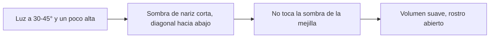

# Iluminación loop

Parte de: [[Esquemas de iluminación de retrato]]

> [!info] Cómo avanzar
> `progreso`: **pendiente** → **viendo** (estudiando) → **visto** (contestaste la autoevaluación sin abrir las respuestas) → **dominado** (hiciste el laboratorio o lo aplicaste de verdad).

## Contenido

### Qué es
La **iluminación loop** (lazo) crea una **sombra pequeña de la nariz que cae hacia abajo y hacia un lado**, sobre la mejilla, con forma de lazo o gota, **sin tocar** la sombra de la mejilla. El rostro se ve iluminado casi por completo, con algo de volumen. Es el esquema más usado porque favorece a casi todos los rostros.

Es parte de los [[Esquemas de iluminación de retrato]].

### Cómo funciona
**Posición de la luz principal**: entre **30° y 45°** hacia un lado de la cámara y **ligeramente por encima** de los ojos.

**Por qué es la más usada**:
- Da **volumen** (la cara no se ve plana como con luz frontal) sin dramatismo excesivo.
- Funciona en la mayoría de formas de cara: estiliza caras redondas y no endurece las angulosas.
- Es **tolerante**: si la persona gira un poco la cabeza, sigue viéndose bien. En eventos y sesiones con movimiento eso es oro.
- Se logra con una sola fuente y un reflector.

**Loop vs Rembrandt**: la diferencia está en la sombra de la nariz. En loop es corta y queda separada de la sombra de la mejilla; en [[Iluminación Rembrandt]] se alarga y se une con ella, dejando el triángulo de luz. Pasas de una a otra moviendo la luz unos grados más hacia el lado y más arriba (o girando la cara del sujeto alejándola de la luz).

**Contraste**: típicamente 1 a 2 pasos entre lados, con un reflector del lado opuesto.

### Ejemplo
**Retrato tipo "perfil profesional" (LinkedIn) en casa**:
1. Ventana grande sin sol directo; la persona a ≈ 1 m, girada unos 30–45° respecto a la ventana.
2. Reflector blanco o cartulina del lado opuesto, a 60–100 cm, para que la sombra no sea profunda.
3. Fondo liso a 1.5–2 m detrás de la persona.
4. iPhone en 3x a la altura de los ojos, o a6700 con 50 mm a f/2.8, AF-C con detección de ojos, ISO lo más bajo que permita ≈ 1/200 s.
5. Busca la pequeña sombra de nariz que apunta a la comisura de la boca. Si toca la mejilla, gira la cara un poco hacia la ventana.

**En exteriores**: a media mañana o tarde, coloca a la persona de modo que el sol (o la zona más brillante del cielo en un día nublado) quede a 30–45° y algo alto.

Ejercicio: toma la misma pose con la ventana a 15°, 30°, 45° y 60° respecto a la cara. Identifica en cuál deja de ser loop y empieza a ser Rembrandt.

### Cuándo usarlo y cuándo no
- **Sí**: retratos corporativos, familiares, bodas, graduaciones, fotos de perfil, retratos casuales. Es tu punto de partida por defecto.
- **Mejor otro esquema** si quieres glamour (mariposa o clamshell) o drama fuerte (Rembrandt o split).

### Errores comunes
1. **Luz a nivel de los ojos**: la sombra de la nariz sale horizontal hacia la oreja y se ve rara; súbela un poco.
2. **Luz demasiado lateral**: se vuelve Rembrandt sin querer, o split.
3. **Sombra hacia el lado equivocado**: si la persona gira la cabeza hacia el lado opuesto a la luz, la sombra se alarga. Pide giros pequeños hacia la luz.
4. **Sin relleno con luz dura**: la sombra de la nariz se vuelve una mancha negra; difumina la fuente o rellena.

### Para profundizar
- [Portrait Lighting with One Light (Cambridge in Colour)](https://www.cambridgeincolour.com/tutorials/portrait-lighting.htm)
- [Portrait Lighting with Two Lights: Fill Light (Cambridge in Colour)](https://www.cambridgeincolour.com/tutorials/portrait-fill-light.htm)

## Autoevaluación

Contesta primero en voz alta o en papel; luego despliega la respuesta.

> [!question]- ¿Cómo se ve la iluminación loop?
> La sombra de la nariz forma un pequeño lazo hacia la comisura de la boca, sin tocar la sombra de la mejilla.

> [!question]- ¿Por qué es la más usada?
> Favorece a casi todos los rostros, da volumen sin drama y se logra fácil (luz a 30–45° y un poco arriba).

> [!question]- ¿Qué diferencia la loop de la Rembrandt?
> En la loop las sombras de nariz y mejilla **no se unen**; en la Rembrandt sí, y forman el triángulo.

## Práctica

- [[Práctica Foto 05 - Retrato con luz de ventana y reflector casero]]

