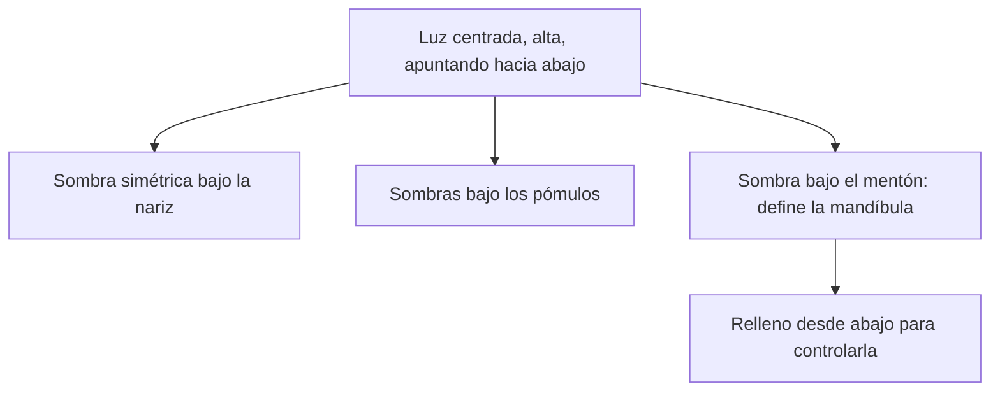

# Iluminación mariposa

Parte de: [[Esquemas de iluminación de retrato]]

> [!info] Cómo avanzar
> `progreso`: **pendiente** → **viendo** (estudiando) → **visto** (contestaste la autoevaluación sin abrir las respuestas) → **dominado** (hiciste el laboratorio o lo aplicaste de verdad).

## Contenido

### Qué es
La **iluminación mariposa** (también llamada **Paramount**, por el estudio de Hollywood que la popularizó con sus estrellas de los años 30) coloca la luz principal **de frente y por encima** del rostro. Produce una **sombra pequeña y simétrica bajo la nariz**, con forma de mariposa, además de pómulos marcados y una sombra bajo el mentón. Es el esquema clásico del glamour y la belleza.

Es parte de los [[Esquemas de iluminación de retrato]].

### Cómo funciona
**Posición de la luz principal**: centrada respecto a la cara (justo arriba y detrás de la cámara) y elevada, apuntando hacia abajo ≈ 30–45°.

- Al venir de frente, ilumina ambos lados por igual (rostro simétrico, terso).
- Al venir de arriba, marca la estructura ósea: pómulos, mandíbula, cuello.
- Si la luz está demasiado alta, aparecen ojeras y ojos hundidos; si está muy baja, la sombra de la nariz desaparece y se vuelve luz frontal plana.

**¿A quién favorece?** Rostros con pómulos definidos, caras ovaladas o en forma de corazón, y estilos de **belleza, maquillaje, moda y glamour**. También estiliza caras anchas porque las sombras bajo los pómulos "afinan". Con rostros muy delgados o con ojos profundos puede acentuar demasiado las cuencas.

**Combinación habitual**: un **reflector o luz de relleno desde abajo** (a la altura del pecho, inclinado hacia la cara) para suavizar las sombras bajo el mentón, la nariz y los ojos. Esa combinación tiene nombre propio: [[Iluminación clamshell]].

### Ejemplo
**Mariposa con luz natural**: a media mañana en un día nublado o con el sol alto y difuminado, coloca a la persona de frente a la zona más brillante del cielo, con la barbilla ligeramente levantada. Bajo un toldo o portal, la luz viene de arriba y adelante, como una mariposa suave.

**En casa con una lámpara**:
1. Lámpara LED con difusor (o softbox) justo arriba de tu cabeza, apuntando a la cara, a ≈ 1 m.
2. Ajusta la altura hasta ver la sombra pequeña bajo la nariz, centrada, sin tocar el labio.
3. Fotografía desde debajo de la luz con el iPhone 3x o la a6700 con 50 mm a f/4 (para que ojos y boca queden nítidos).
4. Agrega una cartulina blanca a la altura del pecho para abrir las sombras.

Ejercicio: toma 3 fotos variando la altura de la lámpara (baja, media, alta) y otra 3 sin y con reflector abajo. Observa la sombra de la nariz y las ojeras.

### Cuándo usarlo y cuándo no
- **Sí**: retratos de belleza, fotos de maquillaje, moda, glamour, headshots de actores, retratos femeninos clásicos, fotos de perfil "limpias".
- **Con cuidado**: personas con ojos hundidos o arrugas bajo los ojos (usa relleno o baja un poco la luz).
- **No**: cuando quieres volumen lateral o drama (loop, Rembrandt, split). Tampoco funciona bien si el sujeto gira mucho la cabeza: pierde la simetría.

### Errores comunes
1. **Luz demasiado alta**: ojos de mapache y sombra larga de nariz que toca el labio.
2. **Luz descentrada**: la sombra de la nariz se ladea y se convierte en un loop.
3. **Sin relleno con luz dura**: el cuello queda negro bajo el mentón y la cara "flota".
4. **Barbilla baja**: la sombra bajo el mentón se come el cuello; pide levantar ligeramente la barbilla.

### Para profundizar
- [Portrait Lighting with One Light (Cambridge in Colour)](https://www.cambridgeincolour.com/tutorials/portrait-lighting.htm)
- [Portrait Lighting with Two Lights: Fill Light (Cambridge in Colour)](https://www.cambridgeincolour.com/tutorials/portrait-fill-light.htm)

## Autoevaluación

Contesta primero en voz alta o en papel; luego despliega la respuesta.

> [!question]- ¿Qué es la iluminación mariposa (Paramount)?
> Luz principal frontal y alta, centrada sobre la cámara, que proyecta una pequeña sombra en forma de mariposa bajo la nariz.

> [!question]- ¿A qué tipo de rostro y estilo favorece?
> Resalta pómulos; clásica en retrato de belleza y glamour.

> [!question]- ¿Con qué se combina normalmente para controlar sombras bajo el mentón?
> Con un reflector debajo de la cara (que lleva a [[Iluminación clamshell]]).

## Práctica

- [[Práctica Foto 05 - Retrato con luz de ventana y reflector casero]]

