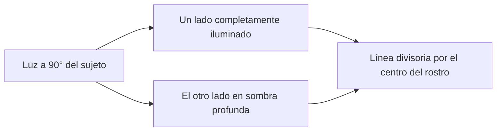

# Iluminación split

Parte de: [[Esquemas de iluminación de retrato]]

> [!info] Cómo avanzar
> `progreso`: **pendiente** → **viendo** (estudiando) → **visto** (contestaste la autoevaluación sin abrir las respuestas) → **dominado** (hiciste el laboratorio o lo aplicaste de verdad).

## Contenido

### Qué es
La **iluminación split** (dividida) ilumina **exactamente media cara** y deja la otra mitad en sombra, con la línea divisoria pasando por la nariz, la boca y el mentón. Es el esquema más dramático de los clásicos. Transmite **misterio, tensión, dualidad o fuerza**; se usa mucho en retratos de músicos, personajes "duros" y carteles de cine.

Es parte de los [[Esquemas de iluminación de retrato]].

### Cómo funciona
**Posición de la luz principal**: a **90°** del sujeto, a un costado, aproximadamente a la altura de la cabeza.

- Con la cara mirando a cámara y la luz exactamente al costado, la nariz proyecta su sombra sobre la otra mitad y la divide.
- El ojo del lado oscuro a veces recibe un poco de luz que pasa por encima del puente de la nariz; puede ser deseable para que la mirada no se pierda.
- **Contraste**: típicamente muy alto (3 pasos o más). Para suavizar, agrega un relleno débil del lado oscuro, pero si lo subes demasiado deja de ser split.
- Con una luz dura (sol directo, foco desnudo) la línea es tajante; con una luz suave (ventana grande) la transición es gradual pero el efecto se mantiene.

Es el extremo lateral de la secuencia: si mueves la luz desde la [[Iluminación Rembrandt]] (45°) hasta 90°, el triángulo de la mejilla desaparece y llegas al split.

### Ejemplo
**Con una ventana**:
1. Sienta a la persona **de perfil a la ventana** (la ventana a su derecha o izquierda), a 50–100 cm de ella.
2. Que mire a la cámara; tú te colocas frente a ella, con la ventana a 90° de su cara.
3. Cubre o evita superficies claras del lado opuesto (paredes blancas rellenan); si hace falta, pon una cartulina **negra** de ese lado para profundizar la sombra.
4. Mide sobre el lado iluminado (puntual o tocando esa mejilla en el iPhone) y compensa −0.3 a −0.7 EV para que la sombra se quede negra.

Con la a6700 y un 50 mm, f/2.8 y fondo oscuro; en blanco y negro el efecto se potencia. Con la Osmo Pocket 4P puedes hacer un clip corto de video con el mismo esquema para una entrevista "de suspenso".

Ejercicio: toma la misma persona en split con (1) ventana con cortina (suave) y (2) lámpara desnuda (dura). Luego repite girando la cara 15° hacia la luz y observa cómo se transforma en Rembrandt.

### Cuándo usarlo y cuándo no
- **Sí**: retratos dramáticos, conceptos de dualidad, retrato masculino con carácter, fotos para portadas o carteles, blanco y negro.
- **También** para resaltar la forma del rostro y la textura de barba o piel cuando es parte del mensaje.
- **No**: retratos corporativos, familiares, de belleza o cuando el cliente quiere verse amable. Exagera asimetrías e imperfecciones.

### Errores comunes
1. **Luz un poco adelantada**: aparece el triángulo de Rembrandt; muévela más al costado.
2. **Paredes blancas del lado oscuro**: rellenan sin querer y la foto pierde fuerza; usa negro o aléjate de ellas.
3. **Sobreexponer el lado iluminado** por medir el promedio de la escena: mide en la mejilla iluminada.
4. **Perder por completo el ojo oscuro** cuando necesitas conexión con la mirada: deja pasar un poco de luz o un relleno muy débil.

### Para profundizar
- [Portrait Lighting with One Light (Cambridge in Colour)](https://www.cambridgeincolour.com/tutorials/portrait-lighting.htm)
- [Understanding Camera Metering (Cambridge in Colour)](https://www.cambridgeincolour.com/tutorials/camera-metering.htm)

## Autoevaluación

Contesta primero en voz alta o en papel; luego despliega la respuesta.

> [!question]- ¿Qué es la iluminación split (dividida)?
> La luz llega a 90° del sujeto e ilumina solo la mitad de la cara; la otra mitad queda en sombra.

> [!question]- ¿Qué transmite?
> Drama, misterio, fuerza. Es común en retratos masculinos o de carácter.

> [!question]- ¿Cómo la logras con una ventana?
> Coloca a la persona de perfil a la ventana con la cara mirando a la cámara, sin reflector.

## Práctica

- [[Práctica Foto 05 - Retrato con luz de ventana y reflector casero]]

