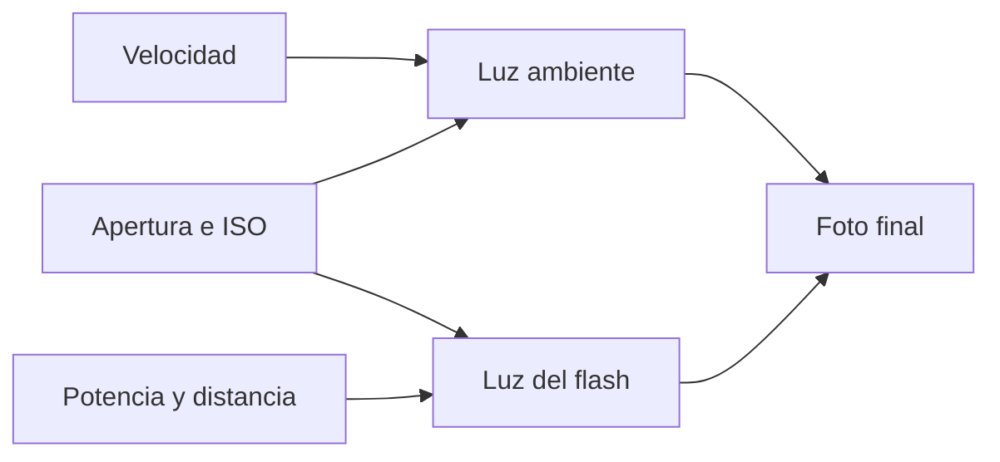

# Flash (TTL, manual, rebotado y alta velocidad)

Parte de: [[30-Fotografia/04 Luz y color/_Índice Luz y color|Luz y color]]

> [!info] Cómo avanzar
> `progreso`: **pendiente** → **viendo** (estudiando) → **visto** (contestaste la autoevaluación sin abrir las respuestas) → **dominado** (hiciste el laboratorio o lo aplicaste de verdad).

## Contenido

### Qué es
Un **flash** es un destello de luz muy intenso y muy corto (del orden de milésimas de segundo o menos). Sirve para iluminar donde no hay luz, rellenar sombras de día o congelar movimiento. La Sony a6700 **no tiene flash integrado**: usa flashes externos en su zapata (Multi Interface Shoe) o disparados a distancia.

Modos y técnicas clave:
- **TTL** (*through the lens*): el flash lanza un predestello, la cámara mide a través del lente y calcula la potencia. Rápido para eventos donde la distancia cambia.
- **Manual**: tú fijas la potencia (1/1, 1/2, 1/4… 1/128). Resultado constante; ideal en estudio o cuando el sujeto no cambia de distancia.
- **Rebotado**: apuntas la cabeza del flash a techo o pared para que la luz regrese desde una superficie grande.
- **Alta velocidad (HSS)**: permite usar el flash con velocidades más rápidas que la de sincronización.

### Cómo funciona
**Dos exposiciones en una foto**: la luz ambiente la controlan la velocidad, la apertura y el ISO; la luz del flash la controlan la **potencia del flash, la apertura, el ISO y la distancia**, pero **no la velocidad**, porque el destello es más corto que el tiempo de obturación.

Por eso con flash puedes oscurecer el fondo (velocidad más rápida) sin cambiar al sujeto, o dejar que el fondo se ilumine con una velocidad lenta (sincronización lenta).

**Velocidad de sincronización**: el obturador de plano focal tiene dos cortinillas. Por encima de cierta velocidad (en la a6700, **1/160 s**) la segunda cortinilla empieza a cerrar antes de que la primera termine de abrir y el sensor nunca está completo descubierto; un destello normal dejaría una franja negra. **HSS** soluciona esto haciendo que el flash emita pulsos rápidos durante todo el recorrido; a cambio pierde mucha potencia. Úsalo para retratos a f/1.8 a pleno sol (necesitas 1/2000 s o más).

**Ley del inverso del cuadrado**: si duplicas la distancia flash–sujeto, la luz cae a **1/4** (2 pasos). Por eso el fondo lejano se oscurece con flash directo.

**Rebote**: el techo blanco se vuelve una fuente enorme y la luz llega desde arriba y de lado: suave y natural, sin la sombra dura detrás de la persona ni ojos rojos. Exige más potencia (más recorrido) y un techo neutro y no muy alto.

### Ejemplo
**Fiesta en interior con la a6700 y un flash TTL compatible**:
1. Modo M: 1/100 s, f/4, ISO 800 para que el ambiente se vea un poco (no fondo negro).
2. Flash en TTL, cabeza apuntando al techo y ligeramente hacia atrás; si tiene tarjeta de rebote, sácala para un brillo en los ojos.
3. Ajusta la **compensación del flash** (−0.7 a +0.7) según la piel.

**Retrato a contraluz al mediodía**: activa HSS, f/2, 1/2000 s, flash con difusor o softbox pequeña cerca del sujeto como relleno.

**¿El "flash" del iPhone es real?** Es un **LED** (True Tone), no un tubo de xenón: mucho menos potente y más largo, más parecido a una linterna que se enciende un instante. Sirve para relleno a corta distancia; para más alcance o luz suave, mejor un LED portátil rebotado o luz de ventana.

Ejercicio: con un flash manual, fotografía a una persona a 1 m y a 2 m con la misma potencia y apertura. Comprueba que a 2 m sale ≈ 2 pasos más oscura. Luego duplica la potencia dos veces (o abre 2 pasos) para compensar.

### Cuándo usarlo y cuándo no
- **TTL**: eventos, bodas, situaciones cambiantes.
- **Manual**: estudio, producto, flashes fuera de cámara, series consistentes.
- **Rebotado**: interiores con techo blanco; es la mejora más grande para fotos de fiesta.
- **HSS**: aperturas abiertas a pleno sol o congelar movimiento con relleno.
- **No** uses flash directo y frontal si puedes evitarlo: sombras duras, piel brillante y fondos negros. Tampoco donde está prohibido (museos, ceremonias).

### Errores comunes
1. **Flash directo de frente**: aplana y crea sombra dura en la pared. Rebota o difunde.
2. **Pasar de 1/160 s sin HSS**: aparece una franja negra.
3. **Esperar que la velocidad aclare al sujeto con flash**: solo aclara el ambiente.
4. **Rebotar en techo de madera o pared de color**: dominante de color en la piel.
5. **Olvidar que el flash consume pilas y recicla**: en ráfagas largas se queda sin carga; baja potencia o sube ISO.

### Para profundizar
- [Camera Flash, Part 1: Light Quality & Appearance (Cambridge in Colour)](https://www.cambridgeincolour.com/tutorials/camera-flash.htm)
- [Camera Flash, Part 2: Flash Ratios & Exposure (Cambridge in Colour)](https://www.cambridgeincolour.com/tutorials/camera-flash-2.htm)
- [Guía de ayuda α6700 (Sony)](https://helpguide.sony.net/ilc/2320/v1/en/)

## Autoevaluación

Contesta primero en voz alta o en papel; luego despliega la respuesta.

> [!question]- ¿Qué diferencia hay entre flash TTL y manual?
> **TTL** mide con un predestello y ajusta la potencia automáticamente. **Manual** usa la potencia que fijas (1/1, 1/2, 1/4…): consistente, ideal en estudio.

> [!question]- ¿Por qué rebotar el flash en techo o pared?
> Convierte una fuente pequeña y dura en una grande y suave, y cambia la dirección de la luz para que no quede plana.

> [!question]- ¿Qué es la sincronización de alta velocidad (HSS)?
> Un modo en que el flash emite pulsos para permitir velocidades más rápidas que la de sincronía normal, útil a pleno sol con aperturas abiertas. Cuesta potencia.

> [!question]- ¿El "flash" del iPhone es un flash real?
> Es una luz LED de baja potencia y muy pequeña (luz dura y plana). Mejor usa luz disponible, una lámpara rebotada o el modo Noche.

