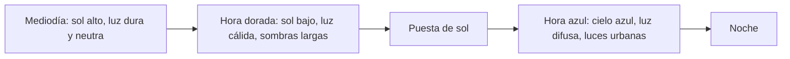

# Hora dorada y hora azul

Parte de: [[30-Fotografia/04 Luz y color/_Índice Luz y color|Luz y color]]

> [!info] Cómo avanzar
> `progreso`: **pendiente** → **viendo** (estudiando) → **visto** (contestaste la autoevaluación sin abrir las respuestas) → **dominado** (hiciste el laboratorio o lo aplicaste de verdad).

## Contenido

### Qué es
- **Hora dorada**: el periodo poco después del amanecer y poco antes del atardecer, cuando el sol está bajo en el horizonte (aproximadamente por debajo de 6° de altura). La luz es cálida, suave y lateral, con sombras largas.
- **Hora azul**: el periodo de crepúsculo cuando el sol ya está **por debajo** del horizonte (aproximadamente entre 4° y 8° bajo él). El cielo se vuelve azul profundo y uniforme, y las luces artificiales de la ciudad se encienden y equilibran con el cielo.

A pesar del nombre, no duran una hora: dependen de la latitud y de la época del año.

### Cómo funciona

Cuando el sol está bajo, su luz atraviesa **más atmósfera**. El aire dispersa más los tonos azules (por eso el cielo de día es azul) y lo que llega directo es más naranja y menos intenso. Además, la luz llega casi horizontal: lateral al sujeto, con sombras largas que marcan relieve.

En la hora azul ya no hay luz solar directa: solo el cielo iluminado por debajo del horizonte, una fuente enorme, suave y fría. Su brillo baja rápido, así que necesitarás tripié o ISO alto.

**En México** (zona tropical y subtropical) el sol sale y se pone con un ángulo más vertical que en latitudes altas: la hora dorada y el crepúsculo son **más cortos** que en, por ejemplo, Europa del norte. Llega con 30 minutos de anticipación y no te confíes.

### Ejemplo
**Plan de una salida al atardecer con tu equipo**:
1. **Consulta horarios**: la app Clima del iPhone muestra salida y puesta del sol; sitios como timeanddate dan también el crepúsculo civil (sol hasta 6° bajo el horizonte), que se aproxima a la hora azul. Hay apps especializadas que además muestran la dirección del sol en un mapa.
2. **45 min antes de la puesta**: retratos con luz lateral dorada (iPhone 3x o a6700 con 50 mm). Balance de blancos en luz día para conservar lo cálido. Ver [[Balance de blancos y temperatura de color]].
3. **En la puesta**: silueta o contraluz, compensación −1 EV para saturar el cielo. Ver [[Compensación de exposición]].
4. **10–30 min después**: hora azul en la ciudad con tripié. a6700 a f/8, ISO 100, varios segundos de exposición; la Pocket 4P o el iPhone en modo Noche también funcionan bien.

Ejercicio: elige un mismo encuadre urbano y tómalo cada 10 minutos desde 30 min antes hasta 30 min después de la puesta. Compara color del cielo, balance de las luces de la calle y nivel de ruido.

### Cuándo usarlo y cuándo no
- **Hora dorada**: retratos, paisaje con relieve, arquitectura cálida, comida al aire libre.
- **Hora azul**: paisaje urbano, arquitectura iluminada, autos con estelas, fotos de producto con fondo de ciudad.
- **No dependas solo de ellas**: los días nublados dan luz suave todo el día; el mediodía sirve para fotos gráficas con sombras duras o para interiores.
- Un horizonte despejado al oeste u oriente es clave; los edificios o montañas te "roban" los últimos minutos.

### Errores comunes
1. **Irte justo cuando el sol se mete**: los mejores colores del cielo y la hora azul vienen después.
2. **Llegar tarde y sin plan**: la luz cambia minuto a minuto; ten el encuadre listo antes.
3. **Neutralizar el balance de blancos con AWB**: la cámara quita el dorado que viniste a buscar.
4. **Hora azul a pulso con ISO bajo**: fotos movidas. Lleva tripié o apóyate.

### Para profundizar
- [Making the Most of Natural Light in Photography (Cambridge in Colour)](https://www.cambridgeincolour.com/tutorials/natural-light-photography.htm)
- [timeanddate — cómo usar la calculadora del sol](https://www.timeanddate.com/sun/help)

## Autoevaluación

Contesta primero en voz alta o en papel; luego despliega la respuesta.

> [!question]- ¿Qué es la hora dorada?
> El periodo cerca de la salida y la puesta del sol, con luz baja, cálida y suave y sombras largas.

> [!question]- ¿Qué es la hora azul y qué fotos favorece?
> El rato antes del amanecer y después del atardecer en que el cielo queda azul profundo. Ideal para ciudad con luces encendidas, pues el cielo y las luces artificiales quedan equilibrados.

> [!question]- ¿Cómo sabes a qué hora ocurren en tu ciudad?
> Con apps de efemérides o el clima del celular (hora de salida/puesta del sol). Su duración cambia con la latitud y la época del año.

## Práctica

- [[Práctica Foto 06 - Balance de blancos y horas de luz]]

