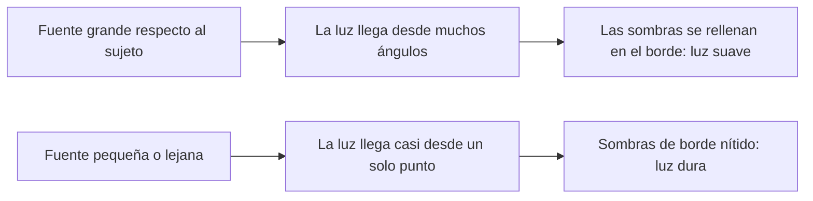

# Luz dura y luz suave

Parte de: [[30-Fotografia/04 Luz y color/_Índice Luz y color|Luz y color]]

> [!info] Cómo avanzar
> `progreso`: **pendiente** → **viendo** (estudiando) → **visto** (contestaste la autoevaluación sin abrir las respuestas) → **dominado** (hiciste el laboratorio o lo aplicaste de verdad).

## Contenido

### Qué es
La **calidad de la luz** describe cómo es la transición entre la zona iluminada y la sombra.
- **Luz dura**: sombras con borde nítido, alto contraste, brillos marcados. Ejemplo: sol directo a mediodía, flash sin modificar, foco desnudo.
- **Luz suave**: sombras con transición gradual, contraste suave, textura de piel disimulada. Ejemplo: día nublado, ventana sin sol directo, softbox grande cerca del sujeto.

### Cómo funciona
Lo que decide la dureza es el **tamaño aparente** de la fuente **en relación con el sujeto**, no la potencia ni el precio de la lámpara.

- El **sol** es enorme, pero está tan lejos que en el cielo se ve diminuto: luz muy dura.
- Un **cielo nublado** convierte todo el cielo en la fuente: luz muy suave.
- Una **softbox** de 60 cm a 1 m del rostro es suave; la misma a 4 m se vuelve más dura, porque desde la cara se ve más pequeña.
- **Difundir** (pasar la luz por tela o papel) y **rebotar** (dirigirla a una pared o techo) agrandan la fuente aparente y suavizan.

Regla práctica: **acerca la fuente para suavizar, aléjala para endurecer**. Acercarla también aumenta su intensidad (ley del inverso del cuadrado; ver [[Flash (TTL, manual, rebotado y alta velocidad)]]).

### Ejemplo
**Suavizar el sol del mediodía en un retrato** (opciones de menos a más equipo):
1. **Busca sombra abierta**: bajo un árbol frondoso, un portal o la sombra de un edificio, con el cielo abierto al frente. La luz que llega es la del cielo, grande y suave.
2. **Difusor**: un compañero sostiene el difusor (la tela translúcida del reflector 5 en 1) entre el sol y la cara, lo más cerca posible sin salir en cuadro.
3. **Reflector** para rellenar sombras si el sol queda detrás del sujeto (contraluz + relleno).
4. **Flash de relleno** con poca potencia, si tienes uno.
Ver [[Modificadores de luz (difusor, reflector y softbox)]].

**Ejercicio en casa**: con una lámpara de escritorio sin pantalla, ilumina un objeto (una taza) y fotografíalo con el iPhone: sombras nítidas. Luego pon una hoja de papel albanene o una cortina delgada delante de la lámpara: sombras suaves. Por último, apunta la lámpara a una pared blanca cercana (rebote): todavía más suave. Repite moviendo la fuente cerca y lejos.

### Cuándo usarlo y cuándo no
**Luz suave** cuando:
- Retratos favorecedores, piel con textura, niños, bodas.
- Producto con superficies brillantes (los reflejos se ven como formas suaves).
- Comida, para un aspecto natural.

**Luz dura a propósito** cuando:
- Quieres drama y carácter: retrato masculino marcado, moda, cine negro.
- Quieres sombras gráficas: arquitectura, calle con patrones de luz y sombra.
- Quieres resaltar textura: piedra, corteza, telas.
- Fotografía de verano "soleada" con colores saturados y cielo profundo.

### Errores comunes
1. **Comprar una softbox pequeña y ponerla lejos**: es casi tan dura como un foco. El tamaño relativo manda.
2. **Rebotar en una pared de color**: la luz se tiñe de ese color. Usa superficies blancas o neutras.
3. **Huir siempre del sol duro**: también hay fotos geniales con él; úsalo con dirección lateral y exposición para las luces.
4. **Confundir suave con tenue**: una luz puede ser suave y muy intensa, o dura y débil. Son ejes distintos.

### Para profundizar
- [Camera Flash, Part 1: Light Quality & Appearance (Cambridge in Colour)](https://www.cambridgeincolour.com/tutorials/camera-flash.htm)
- [Making the Most of Natural Light in Photography (Cambridge in Colour)](https://www.cambridgeincolour.com/tutorials/natural-light-photography.htm)

## Autoevaluación

Contesta primero en voz alta o en papel; luego despliega la respuesta.

> [!question]- ¿Qué hace que una luz sea dura o suave?
> El **tamaño aparente** de la fuente respecto al sujeto: pequeña o lejana (sol directo, foco desnudo) = dura, sombras con borde marcado; grande o cercana (ventana, nublado, softbox) = suave.

> [!question]- ¿Cómo suavizas el sol del mediodía en un retrato?
> Mueve a la persona a sombra abierta, usa un difusor entre el sol y ella o espera a que una nube pase.

> [!question]- ¿Cuándo eliges luz dura a propósito?
> Para drama, texturas, siluetas, arquitectura con sombras gráficas o moda con contraste fuerte.

## Práctica

- [[Práctica Foto 05 - Retrato con luz de ventana y reflector casero]]
- [[Práctica Foto 09 - Producto y comida en casa]]

