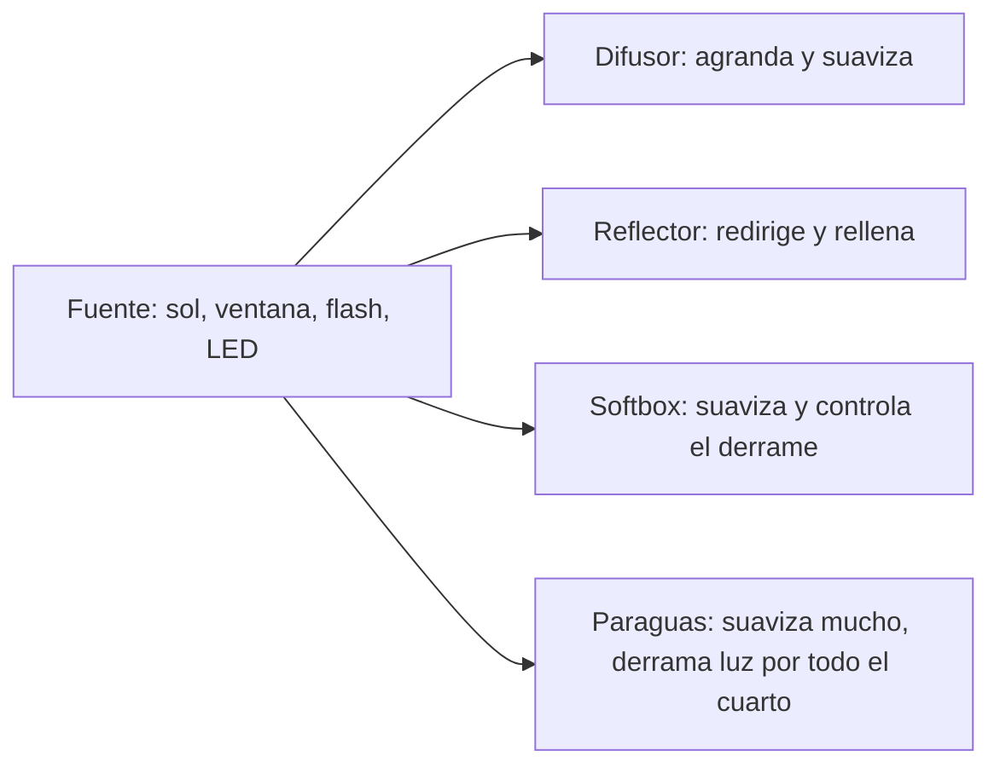

# Modificadores de luz (difusor, reflector y softbox)

Parte de: [[30-Fotografia/04 Luz y color/_Índice Luz y color|Luz y color]]

> [!info] Cómo avanzar
> `progreso`: **pendiente** → **viendo** (estudiando) → **visto** (contestaste la autoevaluación sin abrir las respuestas) → **dominado** (hiciste el laboratorio o lo aplicaste de verdad).

## Contenido

### Qué es
Un **modificador de luz** es cualquier cosa que cambia la **calidad, dirección, tamaño o color** de una fuente de luz. Los básicos:
- **Reflector**: superficie que rebota luz hacia el sujeto para rellenar sombras. Los kits "5 en 1" traen un aro con funda reversible: **blanco**, **plata**, **dorado**, **negro** y un **difusor** translúcido.
- **Difusor**: tela o panel translúcido que se pone **entre** la fuente y el sujeto para agrandar la fuente aparente y suavizarla.
- **Softbox**: caja de tela con interior reflejante y frente difusor que se monta en un flash o lámpara.
- **Paraguas**: de rebote (la luz se refleja en su interior) o de transmisión (la luz lo atraviesa).

### Cómo funciona
Todos aplican la misma física: **una fuente más grande respecto al sujeto da luz más suave**, y una superficie reflejante cambia la dirección de la luz. Ver [[Luz dura y luz suave]].

**Superficies del reflector**:
- **Blanco**: relleno suave y natural. El más versátil.
- **Plata**: relleno más intenso y especular, con más contraste; útil a distancia o con días nublados.
- **Dorado**: relleno cálido; favorece piel en exteriores pero se ve artificial si abusas.
- **Negro**: "relleno negativo": absorbe luz para **profundizar** sombras y dar más volumen en luz plana.

**Softbox vs paraguas**: el paraguas es barato, rápido de armar y da luz suave, pero la esparce por todo el cuarto (rebota en paredes y baja el contraste). La **softbox** controla mejor hacia dónde va la luz, tiene un borde definido que puedes "plumear" (usar el borde de la luz), crea reflejos en los ojos con forma rectangular u octagonal y acepta **rejillas** (grids) para un haz todavía más dirigido. Por eso en retratos y producto se prefiere la softbox cuando importa el control.

### Ejemplo
**Retrato en exterior con el sol detrás del sujeto (contraluz)**:
1. Coloca a la persona de espaldas al sol: cabello con borde de luz, cara en sombra.
2. Un ayudante (o un soporte) pone el reflector **blanco** frente a ella, un poco abajo y a 1 m, inclinado para recibir el sol y mandarlo a la cara. Si no alcanza, cambia a **plata**.
3. Dispara con la a6700 con 50 mm a f/2 o con el iPhone 3x; mide sobre la cara.

**Sesión en casa sin equipo** (ver [[Práctica Foto 05 - Retrato con luz de ventana y reflector casero]]):
- Ventana con sol directo → cortina blanca delgada o papel albanene como **difusor**.
- Lado de sombra → cartulina blanca, unicel (poliestireno) o una sábana como **reflector**.
- Para más drama → cartulina negra en el lado de sombra.

Ejercicio: fotografía el mismo retrato junto a la ventana con (1) nada, (2) reflector blanco a 1 m, (3) reflector a 50 cm y (4) cartulina negra. Mira la diferencia de contraste entre los lados de la cara.

### Cuándo usarlo y cuándo no
- **Reflector**: siempre que haya sombras demasiado profundas y no quieras otra luz. Es el modificador con mejor relación costo/resultado.
- **Difusor**: sol duro en retratos o producto en exteriores; siempre lo más cerca posible del sujeto.
- **Softbox**: retratos y producto en interior con flash o LED cuando quieres control.
- **Paraguas**: grupos, eventos o cuando necesitas luz suave rápido y no te importa el derrame.
- **No** modifiques por modificar: a veces la luz dura es la correcta.

### Errores comunes
1. **Reflector demasiado lejos**: casi no hace nada; acércalo hasta ver el cambio en la cara.
2. **Reflector desde abajo muy intenso**: luz de "linterna bajo la barbilla". Ángulo bajo pero suave, o lateral.
3. **Dorado en todo**: piel naranja. Úsalo con moderación o mezcla blanco/dorado.
4. **Softbox pequeña y lejana**: luz dura con caja; acércala.
5. **Olvidar el viento** en exteriores: los reflectores grandes son velas; sujétalos bien.

### Para profundizar
- [Portrait Lighting with One Light (Cambridge in Colour)](https://www.cambridgeincolour.com/tutorials/portrait-lighting.htm)
- [Portrait Lighting with Two Lights: Fill Light (Cambridge in Colour)](https://www.cambridgeincolour.com/tutorials/portrait-fill-light.htm)
- [Camera Flash, Part 1: Light Quality & Appearance (Cambridge in Colour)](https://www.cambridgeincolour.com/tutorials/camera-flash.htm)

## Autoevaluación

Contesta primero en voz alta o en papel; luego despliega la respuesta.

> [!question]- ¿Para qué sirve un reflector y qué superficies tiene?
> Rebota luz hacia las sombras. **Blanco**: natural y suave; **plateado**: más intenso; **dorado**: cálido. Casero: cartulina blanca, unicel o papel aluminio arrugado.

> [!question]- ¿Qué hace un difusor?
> Se interpone entre la luz y el sujeto para hacerla más grande y suave (tela blanca, cortina delgada, papel albanene).

> [!question]- ¿Qué ventaja da una softbox frente a un paraguas?
> Controla mejor dónde cae la luz (menos derrame) y da reflejos rectangulares parecidos a una ventana.

## Práctica

- [[Práctica Foto 05 - Retrato con luz de ventana y reflector casero]]
- [[Práctica Foto 09 - Producto y comida en casa]]

