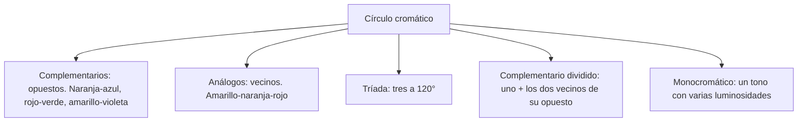

# Teoría del color y armonías

Parte de: [[30-Fotografia/04 Luz y color/_Índice Luz y color|Luz y color]]

> [!info] Cómo avanzar
> `progreso`: **pendiente** → **viendo** (estudiando) → **visto** (contestaste la autoevaluación sin abrir las respuestas) → **dominado** (hiciste el laboratorio o lo aplicaste de verdad).

## Contenido

### Qué es
La **teoría del color** es un conjunto de ideas para entender cómo se relacionan los colores y qué sensaciones producen juntos. En fotografía sirve para **elegir escenas, fondos, ropa y ediciones** que se vean coherentes en lugar de caóticas. Se apoya en el **círculo cromático** y en tres propiedades de cada color:
- **Tono (matiz)**: el color en sí (rojo, azul, verde).
- **Saturación**: qué tan intenso o puro es, frente a lo grisáceo.
- **Luminosidad (brillo o valor)**: qué tan claro u oscuro es.

Estas tres son exactamente los controles **HSL** de los editores (Hue, Saturation, Luminance).

### Cómo funciona
Las **armonías** son combinaciones de posiciones en el círculo:

- **Complementarios**: máximo contraste de color; el sujeto "salta". El par más útil en foto es **naranja–azul**: piel cálida contra cielo, mar o sombra azul; luces cálidas de ciudad contra la hora azul. Por eso tantos editores empujan las sombras hacia azul verdoso y los tonos de piel hacia naranja.
- **Análogos**: colores vecinos; dan calma y unidad. Un bosque de otoño (amarillos, naranjas, rojos) o un retrato en tonos tierra.
- **Tríada**: variedad equilibrada; difícil de controlar, funciona mejor con un color dominante y los otros como acento.
- **Monocromático**: un solo tono; minimalista y elegante.

Además, los colores **cálidos** (rojo, naranja, amarillo) parecen avanzar hacia el espectador y llaman la atención; los **fríos** (azul, verde) retroceden. Un punto rojo pequeño en una escena verde domina la foto.

### Ejemplo
**Retrato en la calle con la a6700 o el iPhone**:
1. Pide a tu sujeto una prenda naranja o mostaza y busca una pared azul, o espera la hora azul con luces cálidas. Complementarios.
2. Alternativa análoga: ropa beige o café sobre un muro de ladrillo y luz dorada.
3. En edición, usa HSL: baja la saturación de los colores que distraen (un letrero verde chillón), ajusta la luminosidad del naranja para que la piel brille y lleva ligeramente los azules hacia turquesa.

Ejercicio de "caza de color": sal con el iPhone y en 30 minutos haz 5 fotos de cada armonía: complementaria, análoga y monocromática. Después en [[Lightroom móvil (versión gratuita)]] o la app Fotos, prueba bajar la saturación global y subir solo la del color principal. Puedes explorar combinaciones en una rueda de color en línea, como Adobe Color, antes de una sesión.

### Cuándo usarlo y cuándo no
- **Úsala** para planear sesiones (ropa, locación, hora), para decidir encuadres en calle (esperar a que pase alguien de rojo frente a una pared verde) y para editar de forma coherente una serie.
- **No es una regla rígida**: hay fotos excelentes con colores "en conflicto". Úsala para entender por qué algo funciona o no.
- En blanco y negro, el color se convierte en luminosidad: dos colores distintos con la misma luminosidad se ven iguales en gris.

### Errores comunes
1. **Muchos colores saturados "para que se vea alegre"**: el ojo no sabe dónde mirar y la foto se vuelve ruidosa o infantil. Elige un color dominante, uno de apoyo y neutros.
2. **Subir la saturación global**: la piel se vuelve naranja y los cielos se manchan. Ajusta por color (HSL) o usa "intensidad" (vibrance), que protege tonos de piel.
3. **Ignorar el color del fondo**: una pared verde puede teñir la piel de verde por la luz reflejada.
4. **Editar en una pantalla sin calibrar** o con brillo extremo: tus colores se verán distintos en otras pantallas. Ver [[Espacios de color (sRGB, Adobe RGB y Display P3)]].

### Para profundizar
- [A Background on Color Perception (Cambridge in Colour)](https://www.cambridgeincolour.com/tutorials/color-perception.htm)
- [Adobe Color — rueda de color](https://color.adobe.com/create)
- [Understanding Histograms, Part 2: Luminosity & Color (Cambridge in Colour)](https://www.cambridgeincolour.com/tutorials/histograms2.htm)

## Autoevaluación

Contesta primero en voz alta o en papel; luego despliega la respuesta.

> [!question]- ¿Qué son colores complementarios? Da un ejemplo útil en foto.
> Los opuestos en el círculo cromático. **Naranja–azul** (piel o luz cálida contra cielo o sombra azul) es la combinación más usada.

> [!question]- ¿Qué es una armonía análoga?
> Colores vecinos en el círculo (verdes y amarillos, por ejemplo): sensación tranquila y unificada.

> [!question]- ¿Qué tres propiedades describen un color?
> **Tono** (hue), **saturación** y **luminosidad**. Es la base de los ajustes HSL en edición.

> [!question]- Error común: buscar muchos colores saturados "para que se vea alegre". ¿Qué suele pasar?
> La foto se ve caótica y el ojo no sabe a dónde mirar. Limitar la paleta y dejar un color de acento suele funcionar mejor.

## Práctica

- [[Práctica Foto 06 - Balance de blancos y horas de luz]]

