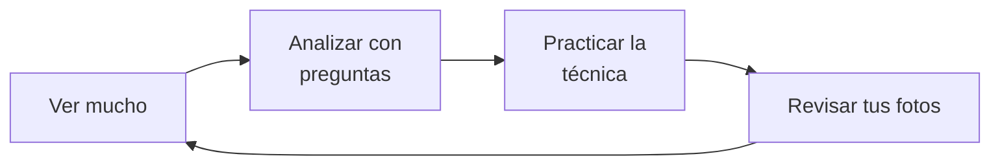

# Educar el ojo (analizar fotos y fotógrafos)

Parte de: [[30-Fotografia/05 Composición/_Índice Composición|Composición]]

> [!info] Cómo avanzar
> `progreso`: **pendiente** → **viendo** (estudiando) → **visto** (contestaste la autoevaluación sin abrir las respuestas) → **dominado** (hiciste el laboratorio o lo aplicaste de verdad).

## Contenido

### Qué es
**Educar el ojo** es entrenar la capacidad de ver qué hace funcionar una foto: luz, composición, momento, color, intención. Se logra **analizando** imágenes de otros con método, estudiando a fotógrafos de referencia y revisando tu propio archivo con mirada crítica. Es tan importante como la técnica: la cámara no decide qué fotografiar ni cómo encuadrarlo.

### Cómo funciona
Cuando una foto te guste, no te quedes en "está bonita". Hazte preguntas concretas:
1. **¿Dónde va mi ojo primero y por qué?** (luz, contraste, color, un rostro).
2. **¿Cómo es la luz?** Dura o suave, dirección, hora del día ([[Luz dura y luz suave]], [[Dirección de la luz]]).
3. **¿Qué composición usa?** Tercios, simetría, líneas, capas, espacio negativo.
4. **¿Qué focal y apertura parece?** Perspectiva comprimida o exagerada, desenfoque.
5. **¿Qué quedó fuera?** Lo que el fotógrafo decidió no incluir.
6. **¿Qué emoción o idea transmite y qué elementos la provocan?**

Usar a otros fotógrafos **sin copiarlos** significa estudiar sus **decisiones** (por qué esa luz, ese momento, esa distancia) y aplicarlas a **tus** temas y lugares. Un ejercicio útil es la "imitación consciente": reproduces la técnica de una foto (por ejemplo, contraluz con silueta) con un sujeto tuyo, y luego haces una versión propia que cambie algo. Lo que no se vale es reproducir una obra para hacerla pasar como tuya.

Revisar tus **fotos viejas** es la forma más honesta de medir avance: con distancia emocional ves errores que antes no notabas, descubres fotos buenas que ignoraste y reconoces qué temas repites (eso empieza a ser tu estilo).

### Ejemplo
Rutina semanal de 30 minutos:
- **Lunes**: elige una foto de un fotógrafo reconocido (en el archivo de [World Press Photo](https://worldpressphoto.org/collection) o en libros de la biblioteca) y responde las seis preguntas por escrito en tu bóveda.
- **Miércoles**: recrea la técnica con tu equipo. Ejemplo: si la foto usa contraluz al atardecer con silueta, sal con la **Sony a6700**, mide puntual en el cielo y deja la figura negra; luego haz lo mismo con el **iPhone 15 Pro** bajando la exposición.
- **Domingo**: abre una carpeta tuya de hace seis meses, elige 3 fotos que hoy harías diferente y escribe qué cambiarías.

Fotógrafos para empezar a estudiar: los mexicanos Manuel Álvarez Bravo, Graciela Iturbide y Lola Álvarez Bravo; y en calle, Henri Cartier-Bresson. Busca sus libros o exposiciones; observa cómo usan el momento, la sombra y la geometría.

### Cuándo usarlo y cuándo no
Hazlo de forma constante, sobre todo cuando sientes que te estancaste. Evita el exceso de consumo pasivo (horas de scroll en redes): ver muchas fotos sin analizarlas no educa, solo satura. Tampoco persigas tendencias de moda solo porque tienen "likes".

### Errores comunes
- **Copiar el estilo sin entenderlo**: aplicar el mismo preset no reproduce la luz ni el momento.
- **Comparar tu inicio con el trabajo maduro de otros**: desanima. Compárate con tus fotos de hace meses.
- **Analizar solo con gusto** ("me gusta / no me gusta"); usa las preguntas concretas.
- **No anotar**: lo que no escribes se olvida; tu bóveda es buen lugar para un "diario de fotos analizadas".

### Para profundizar
- [World Press Photo: colección](https://worldpressphoto.org/collection).
- [[Pedir y dar crítica fotográfica]].
- [[Portafolio fotográfico y dónde publicar]].
- Laboratorio: [[Práctica Foto 12 - Reto 52 semanas y portafolio]].

## Autoevaluación

Contesta primero en voz alta o en papel; luego despliega la respuesta.

> [!question]- ¿Qué preguntas te haces al analizar una foto que te gusta?
> ¿Dónde está la luz y de qué tipo es? ¿Qué focal y distancia? ¿Cómo dirige la mirada? ¿Qué se dejó fuera? ¿Qué emoción transmite?

> [!question]- ¿Cómo usar a otros fotógrafos sin copiarlos?
> Estudia su luz y composición, recrea una foto como ejercicio privado y luego aplica la idea a tus propios temas.

> [!question]- ¿Por qué conviene revisar tus propias fotos viejas?
> Ves tu progreso y detectas patrones de error (horizontes chuecos, fondos sucios).

## Práctica

- [[Práctica Foto 07 - Serie de 9 fotos de composición]]
- [[Práctica Foto 12 - Reto 52 semanas y portafolio]]

