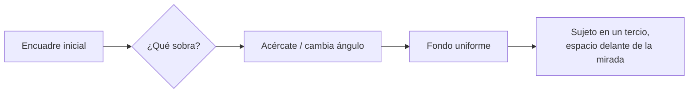

# Espacio negativo y simplicidad

Parte de: [[30-Fotografia/05 Composición/_Índice Composición|Composición]]

> [!info] Cómo avanzar
> `progreso`: **pendiente** → **viendo** (estudiando) → **visto** (contestaste la autoevaluación sin abrir las respuestas) → **dominado** (hiciste el laboratorio o lo aplicaste de verdad).

## Contenido

### Qué es
El **espacio negativo** es el área vacía o uniforme alrededor del sujeto: cielo liso, pared, agua, niebla, sombra profunda. No es "espacio desperdiciado": le da **aire** al sujeto, lo aísla y transmite calma, soledad, escala o minimalismo. La **simplicidad** es la decisión de quitar todo lo que no aporta para que la idea de la foto se lea en un segundo.

### Cómo funciona
Una foto se entiende mejor cuando tiene **un solo protagonista** claro. Cada elemento extra compite por la atención. Antes de disparar, pregúntate: **"¿Qué puedo quitar?"** (o "¿qué sobra en el encuadre?"). Luego elimina distracciones con alguna de estas acciones:
1. **Acercarte** físicamente o con zoom.
2. **Cambiar de ángulo**: bajar la cámara para poner el cielo detrás, subirla para poner el piso.
3. **Abrir el diafragma** para desenfocar el fondo ([[Apertura y profundidad de campo]]).
4. **Exponer para las altas luces** y dejar que las sombras se vuelvan negras.
5. **Elegir un fondo uniforme** (pared, cielo, agua).

El espacio negativo se relaciona con la **dirección de la mirada o el movimiento**: el espacio vacío debe estar **delante** del sujeto, hacia donde mira o se mueve. Así la foto "respira" y cuenta que algo va a pasar. Si el espacio queda detrás, el sujeto parece que va a salirse del encuadre.

### Ejemplo
- **iPhone 15 Pro**: un pájaro sobre un cable contra el cielo. Usa 3× para aislarlo, colócalo en el tercio inferior derecho mirando a la izquierda, con mucho cielo libre a la izquierda. Baja la exposición un poco para que el cielo tenga color.
- **Sony a6700**: una persona caminando frente a un muro blanco grande. f/5.6, modo AF-C con seguimiento; dispara cuando la persona esté en un tercio con el muro libre por delante.
- **DJI Mini 4K**: un kayak, un bote o una persona en una playa vista desde arriba; el agua o la arena son el espacio negativo. La escala diminuta del sujeto es la historia.
- **Osmo Pocket 4P**: en su modo foto con el lente tele, aísla una flor contra un fondo lejano y oscuro.

Ejercicio de simplicidad: toma una foto "normal" de tu escritorio. Luego haz tres versiones quitando un elemento cada vez (físicamente o con el encuadre) hasta que quede solo un objeto con espacio vacío. Compara cuál comunica más.

### Cuándo usarlo y cuándo no
Úsalo para minimalismo, retratos con sensación de soledad o calma, paisaje con niebla, producto de estilo limpio y fotos que quieren texto encima (portadas, carteles). No funciona cuando la historia **es** el contexto (una fiesta, un mercado lleno), ni cuando el espacio vacío es sucio o tiene manchas que distraen.

### Errores comunes
- **Espacio vacío que no está vacío**: un cable, una basura, una mancha brillante en la orilla. Revisa los bordes antes de disparar.
- **Sujeto demasiado pequeño sin intención**: si no se reconoce, la foto se lee como "nada". Asegúrate de que el sujeto tenga contraste.
- **Espacio detrás de la mirada**: el sujeto parece atrapado contra el borde.
- **Sobreexponer el fondo**: un cielo quemado se ve como error, no como minimalismo; mide para conservar algo de tono.

### Para profundizar
- [[Regla de tercios y proporción áurea]].
- [[Educar el ojo (analizar fotos y fotógrafos)]] para estudiar a fotógrafos minimalistas.
- Laboratorio: [[Práctica Foto 07 - Serie de 9 fotos de composición]].

## Autoevaluación

Contesta primero en voz alta o en papel; luego despliega la respuesta.

> [!question]- ¿Qué es el espacio negativo?
> Las áreas vacías alrededor del sujeto (cielo, pared, agua). Dan respiro y destacan al sujeto.

> [!question]- ¿Qué pregunta te ayuda a simplificar antes de disparar?
> "¿Qué sobra en este encuadre?" Revisa bordes y fondo, y quita, acerca o cambia de ángulo hasta que solo quede lo que cuenta la historia.

> [!question]- ¿Cómo se relaciona con la dirección de la mirada?
> Deja espacio negativo **hacia donde mira o se mueve** el sujeto; si no, la foto se siente apretada.

## Práctica

- [[Práctica Foto 07 - Serie de 9 fotos de composición]]

