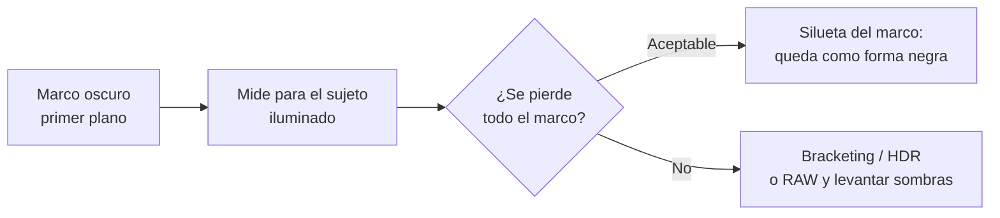

# Encuadre natural en composición

Parte de: [[Líneas guía, encuadre natural, simetría y patrones]]

> [!info] Cómo avanzar
> `progreso`: **pendiente** → **viendo** (estudiando) → **visto** (contestaste la autoevaluación sin abrir las respuestas) → **dominado** (hiciste el laboratorio o lo aplicaste de verdad).

## Contenido

### Qué es
El **encuadre natural** o **marco dentro del marco** consiste en usar elementos de la escena para rodear al sujeto: una puerta, una ventana, un arco, ramas, un túnel, el hueco entre dos personas, el espejo retrovisor de un auto. El marco **dirige la mirada** hacia lo que está dentro, pero además aporta **profundidad** (una capa de primer plano), **contexto** (dónde está el sujeto) y a veces **narrativa**: mirar "a través" de algo da sensación de observar sin ser visto.

### Cómo funciona
El marco funciona porque crea un borde de contraste alrededor del sujeto: el ojo entra, choca con el marco y se queda en el centro iluminado. Para que funcione:
1. **El sujeto debe destacar dentro del marco**: más luz, más color o más nitidez que el marco.
2. **El marco no tiene que estar completo**: dos ramas laterales o un arco por arriba bastan.
3. **El marco puede estar desenfocado** (primer plano con apertura abierta) o nítido (con f/8–f/11); decide según el estilo.

El reto técnico es la **exposición**: muchas veces el marco está en sombra y el exterior a pleno sol (una puerta oscura hacia una calle iluminada). La diferencia de luz puede superar lo que el sensor captura en una sola toma (ver [[Histograma y rango dinámico]]).

### Ejemplo
Ejercicio en un edificio con arcos o una puerta hacia un patio:
- **Sony a6700**: modo A, f/8, ISO 100. Coloca el punto de enfoque sobre el sujeto (persona en el patio). Usa medición puntual o compensación negativa (−0.7 a −1 EV) para que el exterior no se queme; el arco quedará más oscuro, casi silueta (ver [[Medición de luz (matricial, ponderada y puntual)]] y [[Compensación de exposición]]). Si quieres detalle en ambos, haz **bracketing** de 3 tomas a ±2 EV ([[Bracketing y HDR en fotografía]]).
- **iPhone 15 Pro**: toca sobre el sujeto para enfocar y desliza el sol hacia abajo para bajar la exposición. Smart HDR suele recuperar parte del marco automáticamente; compara con una toma en ProRAW revelada después.
- **Variante creativa**: con la a6700 a f/2.8 o el modo Retrato del iPhone, pon ramas muy cerca del lente para que queden como un velo desenfocado alrededor de la cara de alguien.

### Cuándo usarlo y cuándo no
Úsalo en viaje y arquitectura (arcos coloniales, ventanas), retrato ambiental, calle (una persona vista a través de un aparador) y paisaje (ramas que enmarcan una montaña). Evítalo cuando el marco es más interesante o más brillante que el sujeto, o cuando agregarlo obliga a alejarte tanto que el sujeto se vuelve diminuto.

### Errores comunes
- **Marco que roba la atención** por ser más brillante o colorido: el ojo se queda en el borde.
- **Exposición promedio**: la cámara mide el marco oscuro y quema el exterior. Mide para el sujeto.
- **Marco cortado sin intención**: un arco al que le falta un pedazo en una esquina se ve descuidado; o lo incluyes claramente o lo dejas fuera.
- **Enfoque en el marco**: el autofoco elige lo más cercano. Usa un punto de enfoque pequeño sobre el sujeto (ver [[Modos de enfoque automático (AF-S, AF-C y seguimiento)]]).

### Para profundizar
- [[Líneas guía, encuadre natural, simetría y patrones]].
- [[Punto de vista y capas de profundidad]].
- Laboratorio: [[Práctica Foto 07 - Serie de 9 fotos de composición]].

## Autoevaluación

Contesta primero en voz alta o en papel; luego despliega la respuesta.

> [!question]- ¿Qué es un encuadre natural (marco dentro del marco)?
> Usar puertas, ventanas, ramas o arcos para enmarcar al sujeto.

> [!question]- ¿Qué aporta además de dirigir la mirada?
> Profundidad (capas) y contexto del lugar.

> [!question]- ¿Qué cuidar con la exposición?
> El marco suele estar más oscuro; mide en el sujeto y acepta que el marco quede en sombra.

## Práctica

- [[Práctica Foto 07 - Serie de 9 fotos de composición]]

