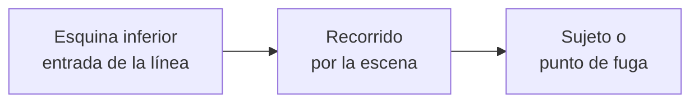

# Líneas guía en composición

Parte de: [[Líneas guía, encuadre natural, simetría y patrones]]

> [!info] Cómo avanzar
> `progreso`: **pendiente** → **viendo** (estudiando) → **visto** (contestaste la autoevaluación sin abrir las respuestas) → **dominado** (hiciste el laboratorio o lo aplicaste de verdad).

## Contenido

### Qué es
Las **líneas guía** son líneas dentro de la foto que conducen la mirada hacia el sujeto o hacia la profundidad de la escena: carreteras, vías, barandales, bordes de banqueta, ríos, filas de árboles, sombras alargadas, incluso la dirección de una mirada o un brazo extendido (líneas implícitas). Sirven para dar **dirección y profundidad**: convierten una imagen plana en un recorrido.

### Cómo funciona
El ojo sigue los bordes de contraste. Cuando varias líneas convergen (perspectiva), el punto donde se juntan atrae la atención; si colocas el sujeto ahí, la foto lo "señala".

Tipos útiles:
- **Convergentes**: vías del tren, pasillos. Dan profundidad fuerte.
- **Diagonales**: dinamismo y movimiento; una escalera en diagonal se siente más activa que una horizontal.
- **Curvas (en S)**: un río o carretera de montaña; recorrido suave y elegante.
- **Horizontales y verticales**: calma y estabilidad; útiles como base, no tanto como guía.

La **distancia focal** cambia mucho el efecto (ver [[Distancia focal y tipos de lente]]). Un **gran angular** exagera la perspectiva: lo cercano se ve enorme y las líneas se abren mucho al frente y convergen rápido al fondo. Bajar la cámara cerca del piso con un angular hace que la línea "nazca" en primer plano. Un teleobjetivo, en cambio, comprime y aplana las líneas.

### Ejemplo
Ejercicio con dos cámaras en una calle con banqueta larga:
1. **iPhone 15 Pro, lente 0.5× (13 mm equivalente)**: baja el teléfono casi al piso, apuntando a lo largo del borde de la banqueta. Activa la cuadrícula y el nivel. Haz que el borde entre por la esquina inferior izquierda y corra hacia el centro del encuadre. Espera a que alguien camine por el punto de fuga.
2. **Misma escena con 3× (77 mm)**: verás que las líneas casi no convergen; la foto se aplana.
3. **Sony a6700**: con el lente más angular que tengas, a f/8 para que el primer plano y el fondo queden nítidos (ver [[Apertura y profundidad de campo]] y [[Distancia hiperfocal]]).
4. **DJI Mini 4K**: sube a 30–60 m sobre una carretera que serpentea (respetando las reglas de [[Zonas restringidas y privacidad al volar]]) y busca una curva en S.

Compara las cuatro y anota cuál dirige mejor la mirada.

### Cuándo usarlo y cuándo no
Úsalas en paisaje, arquitectura, calle y aéreo; son de las técnicas más fáciles de aplicar. Evítalas o suavízalas cuando las líneas apuntan **fuera** del sujeto o compiten con él, y en retratos cerrados donde cualquier línea fuerte del fondo distrae (un poste que "sale" de la cabeza es una línea guía indeseada).

### Errores comunes
- **Líneas que salen por una esquina.** Si una línea fuerte apunta hacia la esquina del encuadre, saca la mirada de la foto. Haz que las líneas **entren** por las esquinas y **terminen** dentro, en el sujeto.
- **Punto de fuga vacío.** Las líneas convergen en nada interesante. Espera a un sujeto o cambia de posición.
- **Verticales inclinadas sin querer.** Con angular, inclinar la cámara hace que los edificios se caigan (ver [[Fotografía de arquitectura]]).
- **Demasiadas líneas.** Varias direcciones a la vez confunden; elige una dominante.

### Para profundizar
- [[Líneas guía, encuadre natural, simetría y patrones]] (panorama del tema).
- [Cambridge in Colour: Rule of Thirds](https://cdn.cambridgeincolour.com/tutorials/rule-of-thirds.htm).
- Laboratorio: [[Práctica Foto 07 - Serie de 9 fotos de composición]].

## Autoevaluación

Contesta primero en voz alta o en papel; luego despliega la respuesta.

> [!question]- ¿Qué son las líneas guía?
> Líneas reales o implícitas (caminos, ríos, barandales, miradas) que llevan la mirada hacia el sujeto o hacia el fondo.

> [!question]- ¿Qué focal ayuda a exagerarlas?
> El gran angular (0.5x del iPhone), acercándote a la línea desde una posición baja.

> [!question]- Error común: líneas que salen del encuadre por una esquina. ¿Qué pasa?
> Llevan la mirada **fuera** de la foto. Busca que conduzcan hacia el sujeto.

## Práctica

- [[Práctica Foto 07 - Serie de 9 fotos de composición]]

