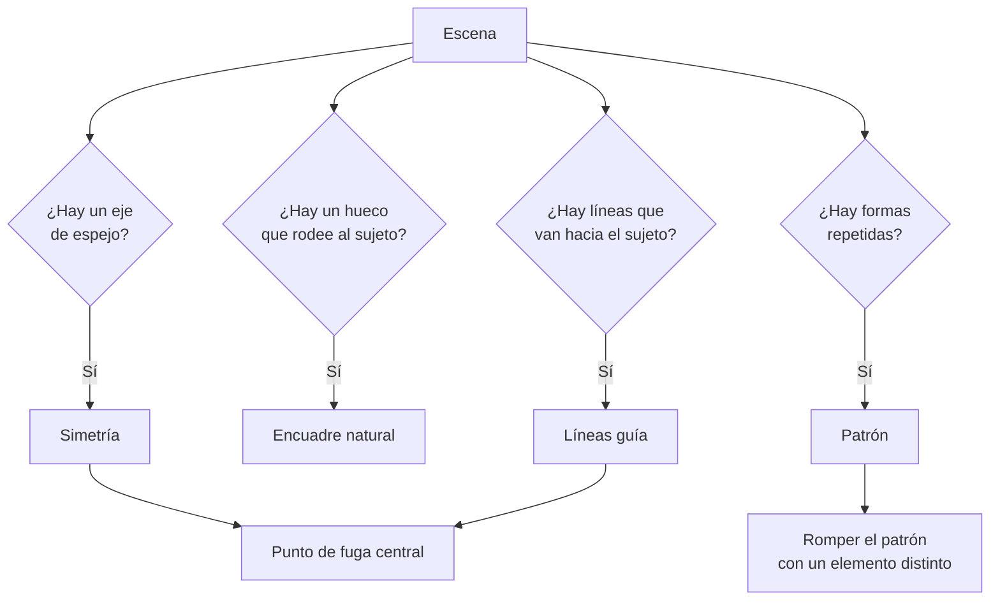

# Líneas guía, encuadre natural, simetría y patrones

Parte de: [[30-Fotografia/05 Composición/_Índice Composición|Composición]]

> [!info] Cómo avanzar
> `progreso`: **pendiente** → **viendo** (estudiando) → **visto** (contestaste la autoevaluación sin abrir las respuestas) → **dominado** (hiciste el laboratorio o lo aplicaste de verdad).

## Contenido

### Qué es
Este tema agrupa cuatro herramientas de composición que usan la **geometría de la escena** para ordenar la foto y llevar la mirada al sujeto:
- [[Líneas guía en composición]]: líneas reales o implícitas (caminos, barandales, sombras) que conducen el ojo.
- [[Encuadre natural en composición]]: un "marco dentro del marco" (puerta, arco, ramas) que rodea al sujeto.
- [[Simetría en composición]]: equilibrio en espejo respecto a un eje.
- [[Patrones y repetición en composición]]: formas que se repiten y crean ritmo.

Lo que tienen en común es que **no dependen de dónde pones el sujeto en la cuadrícula**, sino de descubrir estructuras que ya existen y alinearte con ellas moviendo la cámara.

### Cómo funciona
Las cuatro técnicas se combinan entre sí y con la [[Regla de tercios y proporción áurea]]:



- Las **líneas guía** y la **simetría** suelen trabajar juntas: un pasillo visto de frente tiene líneas que convergen en un punto de fuga central y es simétrico a la vez.
- El **encuadre natural** añade una capa de primer plano y da profundidad (ver [[Punto de vista y capas de profundidad]]).
- Los **patrones** se vuelven interesantes cuando algo los interrumpe: eso es **romper el patrón**. Una sombrilla roja entre cien negras, una ventana encendida en un edificio apagado, una persona caminando en un muro de azulejos. El elemento distinto se vuelve el sujeto automáticamente porque el ojo busca la anomalía.

### Ejemplo
Un **pasillo largo con arcos** (los portales del Centro de tu ciudad, un claustro, un mercado) permite usar las cuatro a la vez. Con la **a6700** y un lente angular (o el 13 mm del iPhone 15 Pro):
1. Ponte al centro del pasillo, cámara a la altura del pecho y bien nivelada: **simetría** y **líneas guía** convergiendo al fondo.
2. Retrocede hasta que el primer arco quede como marco: **encuadre natural**.
3. Los arcos sucesivos forman un **patrón** que da ritmo.
4. Espera a que una persona cruce en el punto de fuga o bajo un arco iluminado: **rompes el patrón** y tienes sujeto.

Con el **DJI Mini 4K** busca patrones desde arriba (surcos de cultivo, estacionamientos, techos) y líneas guía como carreteras; ver [[Composición aérea y cenital]]. La **Osmo Pocket 4P** es cómoda para pasillos porque su estabilizador te deja caminar y probar posiciones rápido.

### Cuándo usarlo y cuándo no
Busca estas estructuras en arquitectura, calle, paisaje y fotografía aérea. No las fuerces cuando el sujeto es una emoción o un gesto (retrato íntimo, evento): ahí importa más el momento que la geometría. Si la escena es caótica, a veces la mejor decisión es **simplificar** acercándote o usando teleobjetivo en vez de buscar líneas ([[Espacio negativo y simplicidad]]).

### Errores comunes
- **Líneas que no llevan a nada.** Un camino precioso que termina en un muro vacío. Las líneas deben apuntar al sujeto o al punto de fuga con algo interesante.
- **Simetría "casi".** Si estás ligeramente de lado, la simetría parece error. O es simétrica de verdad o claramente asimétrica.
- **Marco que compite.** Un marco más brillante o más nítido que el sujeto roba la mirada.
- **Patrón sin respirar.** Si el patrón llena todo sin variación, la foto se siente plana; incluye un borde o una ruptura.

### Para profundizar
- Subtemas: [[Líneas guía en composición]], [[Encuadre natural en composición]], [[Simetría en composición]], [[Patrones y repetición en composición]].
- [Cambridge in Colour: Rule of Thirds](https://cdn.cambridgeincolour.com/tutorials/rule-of-thirds.htm) (incluye cuándo conviene salirse de la cuadrícula).
- Laboratorio: [[Práctica Foto 07 - Serie de 9 fotos de composición]].

## Subtemas

- [[Líneas guía en composición]]
- [[Encuadre natural en composición]]
- [[Simetría en composición]]
- [[Patrones y repetición en composición]]

## Autoevaluación

Contesta primero en voz alta o en papel; luego despliega la respuesta.

> [!question]- ¿Qué tienen en común estas cuatro técnicas?
> Usan la estructura de la escena para **dirigir la mirada** u ordenar el encuadre.

> [!question]- ¿Cuál usarías en un pasillo largo con arcos?
> Líneas guía (las paredes convergen) y simetría (centrar el punto de fuga); los arcos además hacen encuadre natural.

> [!question]- ¿Qué es "romper el patrón"?
> Incluir un elemento distinto dentro de un patrón repetitivo; el ojo va directo a él.

## Práctica

- [[Práctica Foto 07 - Serie de 9 fotos de composición]]

## Progreso de los subtemas

```base
filters:
  and:
    - file.inFolder("30-Fotografia/05 Composición/Líneas guía, encuadre natural, simetría y patrones")
    - file.name != "Líneas guía, encuadre natural, simetría y patrones"
views:
  - type: table
    name: Progreso
    order:
      - file.name
      - progreso
      - nivel
```
