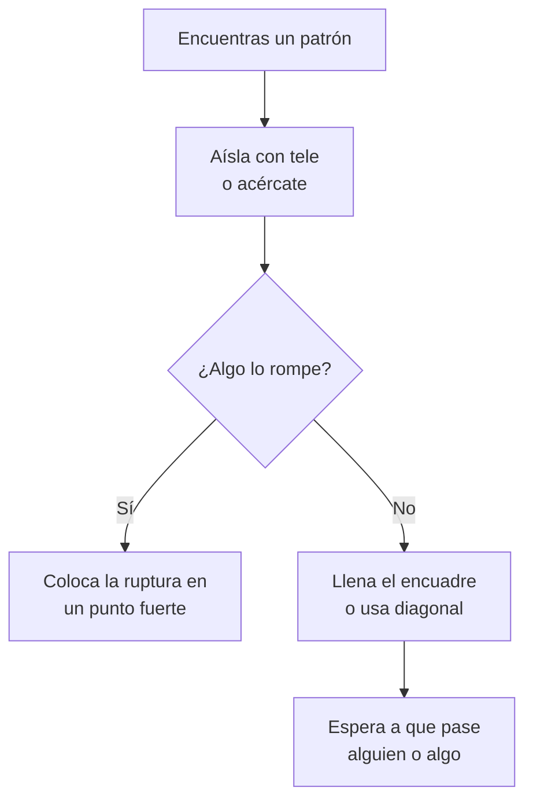

# Patrones y repetición en composición

Parte de: [[Líneas guía, encuadre natural, simetría y patrones]]

> [!info] Cómo avanzar
> `progreso`: **pendiente** → **viendo** (estudiando) → **visto** (contestaste la autoevaluación sin abrir las respuestas) → **dominado** (hiciste el laboratorio o lo aplicaste de verdad).

## Contenido

### Qué es
Un **patrón** es una forma, color o textura que se repite: ventanas de un edificio, tejas, sillas apiladas, mazorcas en el mercado, hileras de agave, olas, escalones. La repetición crea **ritmo visual** y orden. Cuando algo rompe la repetición, ese elemento se convierte en el sujeto.

### Cómo funciona
Hay tres formas de usar los patrones:
1. **Patrón puro**: la repetición llena el encuadre y es el tema. Funciona mejor si el patrón **sale de los bordes**, porque sugiere que continúa infinitamente.
2. **Ritmo**: elementos repetidos que se alejan en perspectiva (columnas, faroles) y llevan la mirada, combinando con [[Líneas guía en composición]].
3. **Patrón roto**: un elemento diferente (otro color, otra orientación, una persona) interrumpe la repetición. Es la versión más fuerte porque tiene sujeto.

Para aislar un patrón conviene un **teleobjetivo**: el 3× (77 mm) del iPhone 15 Pro o la parte larga del zoom de la a6700. El tele recorta lo que sobra y **comprime** la perspectiva, así los elementos lucen del mismo tamaño en vez de achicarse al fondo. Fotografiar el patrón **de frente** (plano paralelo al sensor) también ayuda a que se vea regular.

Para que el patrón **respire**, deja una variación: un borde, una zona de luz, un hueco, o cambia el ángulo para que la repetición tenga diagonal. Un patrón idéntico de orilla a orilla puede verse como papel tapiz.

### Ejemplo
Dónde encontrar patrones en tu entorno:
- **Mercado**: pirámides de frutas, canastas, chiles secos. iPhone en 3×, de frente, y busca una fruta distinta.
- **Arquitectura moderna**: fachadas de vidrio o balcones. a6700 con tele, f/8 para nitidez de orilla a orilla.
- **Estacionamiento o cultivos desde el aire**: el DJI Mini 4K en vista cenital revela patrones invisibles desde el suelo; un auto rojo entre grises rompe el patrón.
- **Estadio o auditorio vacío**: filas de butacas en diagonal.

Ejercicio: en 20 minutos, haz 10 fotos de patrones. Cinco "puros" que llenen el encuadre y cinco con una ruptura. Al revisar, elige la mejor de cada tipo y explica por qué.

### Cuándo usarlo y cuándo no
Útil en arquitectura, abstracto, aéreo, viaje (mercados), naturaleza (hojas, piedras). No funciona tan bien cuando el patrón es irregular o desordenado: en lugar de ritmo, se ve como ruido visual. Tampoco ayuda en retrato salvo como fondo sutil.

### Errores comunes
- **Patrón con bordes vacíos**: si el patrón termina antes del encuadre, se pierde la sensación de continuidad; acércate o usa más tele.
- **Ángulo oblicuo sin intención**: los elementos se ven de tamaños distintos y el ritmo se pierde.
- **Ruptura en el centro exacto** por inercia: suele verse estático; prueba un tercio.
- **Moiré o pérdida de detalle**: patrones muy finos (telas, rejillas) pueden generar artefactos; cambia ligeramente la distancia o el ángulo.

### Para profundizar
- [[Líneas guía, encuadre natural, simetría y patrones]].
- [[Composición aérea y cenital]].
- Laboratorio: [[Práctica Foto 07 - Serie de 9 fotos de composición]].

## Autoevaluación

Contesta primero en voz alta o en papel; luego despliega la respuesta.

> [!question]- ¿Dónde encuentras patrones?
> Ventanas de edificios, tejas, sillas apiladas, campos de cultivo, texturas naturales.

> [!question]- ¿Qué focal ayuda a aislar un patrón?
> La telefoto (3x): aplana y recorta el contexto para que el patrón llene el encuadre.

> [!question]- ¿Qué hacer para que el patrón "respire"?
> Llenar el encuadre hasta los bordes (sugiere que continúa) o romperlo con un elemento distinto.

## Práctica

- [[Práctica Foto 07 - Serie de 9 fotos de composición]]

