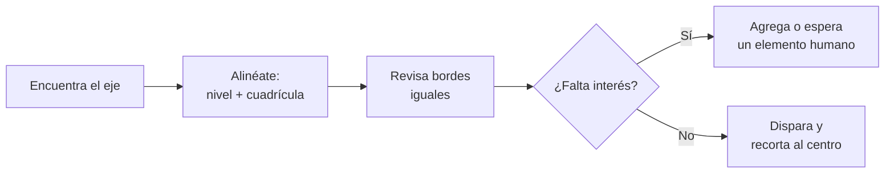

# Simetría en composición

Parte de: [[Líneas guía, encuadre natural, simetría y patrones]]

> [!info] Cómo avanzar
> `progreso`: **pendiente** → **viendo** (estudiando) → **visto** (contestaste la autoevaluación sin abrir las respuestas) → **dominado** (hiciste el laboratorio o lo aplicaste de verdad).

## Contenido

### Qué es
La **simetría** es la composición en espejo: la mitad izquierda refleja a la derecha (simetría vertical) o la de arriba a la de abajo (reflejo en agua). Transmite **orden, calma, monumentalidad o formalidad**. Es la excepción más clara a la [[Regla de tercios y proporción áurea]]: aquí el sujeto o el eje van **al centro exacto**.

### Cómo funciona
Funciona cuando la escena **ya es simétrica** y tú te alineas con su eje: fachadas de iglesias, pasillos, puentes, escaleras, túneles, reflejos de un lago al amanecer, una mesa servida vista desde arriba. El cerebro detecta la simetría al instante, por eso cualquier error se nota igual de rápido.

Detalles técnicos críticos:
1. **Posición exacta en el eje.** Un paso a la izquierda y la simetría se rompe. Muévete hasta que los elementos de ambos lados se vean del mismo tamaño.
2. **Cámara nivelada y paralela** al plano principal. Si inclinas la cámara hacia arriba, las verticales convergen (efecto "edificio que se cae"); si la giras, una mitad se ve más grande. Usa el nivel electrónico.
3. **Lente centrado y sin distorsión fuerte.** Los angulares extremos deforman los bordes; corrige con perfil de lente ([[Corrección de lente y perspectiva]]).
4. **Recorte final** usando las guías del editor para que el eje quede exactamente al centro.

Para que no sea aburrida, introduce **un elemento que rompa o anime la simetría**: una persona al centro (refuerza el eje), una figura descentrada (tensión), un pájaro volando en una mitad, un reflejo alterado por una onda.

### Ejemplo
- **Fachada o pasillo con la a6700**: tripié o apoyo, cámara a media altura del edificio si puedes (de un segundo piso o una escalinata) para no inclinar. Activa cuadrícula y el medidor de nivel. f/8, ISO 100. Toma una vacía y otra con una persona caminando por el eje.
- **Reflejo con el iPhone 15 Pro**: en un charco después de la lluvia, baja el teléfono casi al agua y gíralo de modo que el horizonte (la línea del reflejo) quede a la mitad exacta. Aquí el horizonte al centro **sí** tiene sentido.
- **Cenital con el DJI Mini 4K**: una cancha, una glorieta o una alberca vistas a 90° hacia abajo (ver [[Composición aérea y cenital]]). La simetría aérea se ve muy gráfica.
- **Mesa con comida**: plato al centro, cubiertos a ambos lados, desde arriba ([[Fotografía de producto y comida]]).

### Cuándo usarlo y cuándo no
Usa simetría con arquitectura formal, reflejos en agua quieta, retratos frontales "de póster" y composiciones cenitales. No la fuerces cuando la escena es casi simétrica pero tiene un elemento que lo arruina (un auto estacionado de un lado) y no puedes evitarlo: mejor cambia a una composición asimétrica clara. También evita la simetría si quieres transmitir movimiento o tensión.

### Errores comunes
- **Estar ligeramente fuera del eje**: parece descuido, no decisión.
- **Horizonte o verticales inclinados**: arruinan la sensación de orden.
- **Simetría sin sujeto**: una fachada perfecta pero vacía puede ser plana; espera a una persona o luz especial.
- **Distorsión de barril** con angular: los bordes se curvan y la simetría se ve rara; corrige el perfil del lente.

### Para profundizar
- [[Líneas guía, encuadre natural, simetría y patrones]].
- [[Fotografía de arquitectura]].
- Laboratorio: [[Práctica Foto 07 - Serie de 9 fotos de composición]].

## Autoevaluación

Contesta primero en voz alta o en papel; luego despliega la respuesta.

> [!question]- ¿Cuándo funciona la simetría?
> Arquitectura, reflejos en agua y escenas formales. Ahí sí conviene centrar.

> [!question]- ¿Qué detalle técnico es crítico en una foto simétrica?
> Estar exactamente centrado y nivelado; cualquier desviación se nota mucho. Usa la cuadrícula y el nivel del iPhone.

> [!question]- ¿Cómo evitas que una foto simétrica se vea aburrida?
> Agrega un elemento que la rompa ligeramente (una persona, un objeto de color) o busca luz interesante.

## Práctica

- [[Práctica Foto 07 - Serie de 9 fotos de composición]]

