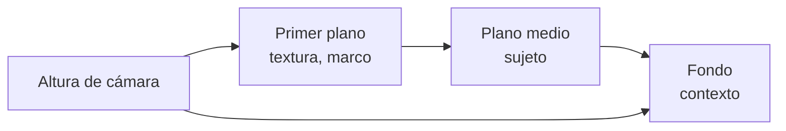

# Punto de vista y capas de profundidad

Parte de: [[30-Fotografia/05 Composición/_Índice Composición|Composición]]

> [!info] Cómo avanzar
> `progreso`: **pendiente** → **viendo** (estudiando) → **visto** (contestaste la autoevaluación sin abrir las respuestas) → **dominado** (hiciste el laboratorio o lo aplicaste de verdad).

## Contenido

### Qué es
El **punto de vista** es desde dónde y a qué altura tomas la foto. La mayoría de las personas dispara de pie, a la altura de los ojos, y por eso esas fotos se parecen a lo que todos ya vimos. Cambiar la altura o la posición de la cámara transforma la relación entre sujeto y fondo. Las **capas de profundidad** son la organización de la escena en **primer plano, plano medio y fondo** para que una foto 2D se sienta tridimensional.

### Cómo funciona
**Altura de la cámara:**
- **Picado** (desde arriba): empequeñece al sujeto, muestra patrones del suelo, ordena la escena.
- **Contrapicado** (desde abajo): engrandece, da poder o monumentalidad; pone el cielo de fondo y limpia distracciones.
- **Nivel del sujeto**: conexión y empatía. Para **niños y mascotas**, baja a **su altura de ojos** (agáchate o acuéstate); desde arriba se ven pequeños y distantes.
- **Cenital**: 90° hacia abajo, gráfico y abstracto (producto, comida, dron).

**Capas:** una foto con algo cerca (flores, una roca, una barda), algo en medio (la persona) y algo lejos (montañas, edificios) invita a recorrerla. Cuantas más capas distintas y separadas, más profundidad. La separación se refuerza con:
- **Superposición**: lo que tapa parcialmente está más cerca.
- **Tamaño relativo** (exagerado por el gran angular).
- **Perspectiva atmosférica**: lo lejano se ve más claro y azulado (hora azul, neblina).
- **Desenfoque selectivo**: primer plano o fondo fuera de foco.

### Ejemplo
Ejercicio "cinco alturas" con el mismo sujeto (tu perro, un amigo o una escultura):
1. De pie, a la altura de tus ojos (la referencia aburrida).
2. Agachado al nivel del sujeto.
3. Acostado en el piso con el **iPhone 15 Pro** en 0.5× (contrapicado; el cielo de fondo).
4. Subido a una banca o escalón (picado).
5. **DJI Mini 4K** en cenital a 10–20 m (en un lugar donde sea legal y seguro volar; ver [[NOM-107-SCT3-2019 y registro ante la AFAC]]).

Ejercicio de capas con la **Sony a6700**: en un parque, coloca hojas o flores muy cerca del lente (primer plano), una persona a 3–5 m (plano medio) y árboles o edificios al fondo. Haz una toma a f/2.8 (primer plano y fondo desenfocados) y otra a f/11 con enfoque en la hiperfocal ([[Distancia hiperfocal]]) para tener todo nítido. Con la **Osmo Pocket 4P**, su tamaño te permite ponerla a ras de piso fácilmente para contrapicados.

### Cuándo usarlo y cuándo no
Cambia el punto de vista **siempre** como hábito: antes de disparar, prueba al menos una altura distinta. Las capas son ideales en paisaje, viaje y calle. En producto con fondo liso o retrato de estudio, menos capas suele ser mejor (simplicidad). Cuidado con contrapicados extremos en retrato: agrandan la papada y las fosas nasales.

### Errores comunes
- **Disparar todo de pie**: fotos predecibles. Muévete antes de hacer zoom.
- **Primer plano sin relación** con el tema: una piedra cualquiera no aporta; debe dirigir o contextualizar.
- **Capas que se funden**: si sujeto y fondo tienen el mismo tono, se pierde la separación; busca contraste de luz o color.
- **Niños fotografiados desde arriba**: se ven lejanos; baja a su altura.

### Para profundizar
- [[Distancia focal y tipos de lente]] (cómo la focal cambia la perspectiva).
- [[Encuadre natural en composición]].
- Laboratorio: [[Práctica Foto 07 - Serie de 9 fotos de composición]].

## Autoevaluación

Contesta primero en voz alta o en papel; luego despliega la respuesta.

> [!question]- ¿Por qué cambiar la altura de la cámara mejora muchas fotos?
> La altura de los ojos es la vista de siempre; agacharte, subir o acercarte da una imagen menos común y cambia la relación sujeto-fondo.

> [!question]- ¿Qué son las capas de profundidad?
> Tener primer plano, plano medio y fondo con elementos de interés para dar sensación tridimensional.

> [!question]- ¿A qué altura fotografías niños y mascotas?
> A **su** altura: agáchate. Conecta con su mirada y evita que se vean pequeños.

## Práctica

- [[Práctica Foto 07 - Serie de 9 fotos de composición]]

