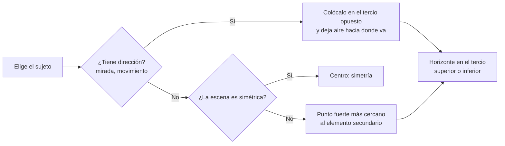

# Regla de tercios y proporción áurea

Parte de: [[30-Fotografia/05 Composición/_Índice Composición|Composición]]

> [!info] Cómo avanzar
> `progreso`: **pendiente** → **viendo** (estudiando) → **visto** (contestaste la autoevaluación sin abrir las respuestas) → **dominado** (hiciste el laboratorio o lo aplicaste de verdad).

## Contenido

### Qué es
La **regla de tercios** divide el encuadre con dos líneas horizontales y dos verticales en nueve rectángulos iguales. Las cuatro intersecciones (los "puntos fuertes") y las líneas mismas son buenos lugares para el sujeto, el horizonte o los ojos de un retrato. La **proporción áurea** (≈ 1 : 1.618) es una idea emparentada: en lugar de tercios exactos usa divisiones algo más cercanas al centro (la "malla phi") o una espiral que va cerrándose hacia un punto de interés. Las dos sirven para lo mismo: sacar al sujeto del centro exacto para que la foto tenga tensión, dirección y aire.

### Cómo funciona
El ojo tiende a recorrer la imagen; si el sujeto está en el centro, la mirada llega y se queda quieta. Colocado en un tercio, el sujeto convive con un espacio que "cuenta" algo: hacia dónde mira, hacia dónde camina, qué hay alrededor.

Para el horizonte: si el cielo es lo interesante (nubes de tormenta, atardecer), ponlo en el tercio inferior y deja dos tercios de cielo. Si el suelo manda (un campo de flores, una calle mojada con reflejos), horizonte en el tercio superior. La **malla phi** acerca esas líneas al centro (≈ 38 % y 62 % en lugar de 33 % y 67 %), lo que da un resultado más sutil. La **espiral áurea** es útil cuando hay una curva natural (una escalera de caracol, una ola, el brazo de una persona) que lleva al punto de interés.

### Ejemplo
Activa la cuadrícula en tus cámaras:
- **iPhone 15 Pro**: Ajustes → Cámara → **Cuadrícula**. Aparece también el nivel que te ayuda con el horizonte.
- **Sony a6700**: en el menú de visualización activa la **Línea de cuadrícula** (rejilla de tercios).
- **DJI Mini 4K**: en la app DJI Fly, configuración de cámara → cuadrícula.

Ejercicio en el parque más cercano: busca una banca con una persona (o tu mochila) y toma cuatro fotos: sujeto al centro, sujeto en el tercio izquierdo mirando a la derecha, sujeto en el tercio derecho mirando a la derecha (mirando "fuera" del encuadre) y horizonte a la mitad. Compara en la PC: normalmente la segunda se siente más natural y la tercera, incómoda. Con el dron, haz lo mismo con una línea de costa o un camino: horizonte en el tercio superior y el camino saliendo de una esquina inferior.

### Cuándo usarlo y cuándo no
Úsala como **punto de partida** cuando no sabes dónde poner el sujeto, en paisajes con horizonte y en retratos de medio cuerpo (ojos en el tercio superior). **Rómpela** cuando la escena pide simetría (un pasillo, un reflejo perfecto en agua quieta: ver [[Simetría en composición]]), cuando quieres una sensación de confrontación (retrato frontal centrado, mirada a cámara), cuando el espacio negativo es el protagonista ([[Espacio negativo y simplicidad]]) o en formatos cuadrados donde el centro funciona muy bien. Lo importante es que el sujeto esté donde está **por una decisión**, no por inercia.

### Errores comunes
- **Horizonte siempre a la mitad.** Divide la foto en dos mitades que compiten. Decide qué mitad importa más y dale dos tercios.
- **Horizonte chueco.** Un par de grados se notan muchísimo, sobre todo con mar. Usa el nivel del iPhone o el medidor de nivel de la a6700, o endereza después ([[Recorte y enderezado]]).
- **Colocar el sujeto en un tercio pero de espaldas al espacio.** Si la persona mira hacia el borde cercano, la foto se siente "encerrada". Deja aire en la dirección de la mirada.
- **Usar la cuadrícula como dogma.** Un sujeto un poco fuera del punto fuerte no arruina nada; un fondo sucio sí.
- **Confiar en recortar después.** Recortar a tercios funciona, pero pierdes resolución y no arregla una perspectiva mal elegida. Compón en cámara.

### Para profundizar
- [Cambridge in Colour: Rule of Thirds](https://cdn.cambridgeincolour.com/tutorials/rule-of-thirds.htm)
- [[Líneas guía, encuadre natural, simetría y patrones]] y [[Punto de vista y capas de profundidad]] para combinar los tercios con otras técnicas.
- Laboratorio: [[Práctica Foto 07 - Serie de 9 fotos de composición]].

## Autoevaluación

Contesta primero en voz alta o en papel; luego despliega la respuesta.

> [!question]- ¿Qué es la regla de tercios?
> Dividir el encuadre con dos líneas horizontales y dos verticales y colocar elementos importantes sobre las líneas o en sus cruces. Activa la **cuadrícula** en Ajustes → Cámara del iPhone.

> [!question]- ¿Qué es la proporción áurea en composición?
> Una proporción (~1:1.618) que se usa como cuadrícula ("phi grid") o espiral; sus líneas quedan algo más cerca del centro que las de tercios.

> [!question]- ¿Cuándo romper la regla de tercios?
> Simetría, reflejos, sujetos muy centrales o cuando el espacio negativo cuenta la historia. Es un punto de partida, no una ley.

> [!question]- Error común: el horizonte siempre a la mitad. ¿Qué sugiere la regla?
> Colocarlo en el tercio inferior si el cielo es interesante, o en el superior si el primer plano lo es.

## Práctica

- [[Práctica Foto 07 - Serie de 9 fotos de composición]]

