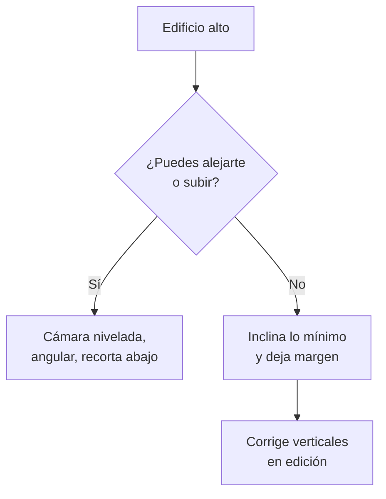

# Fotografía de arquitectura

Parte de: [[30-Fotografia/06 Géneros/_Índice Géneros|Géneros]]

> [!info] Cómo avanzar
> `progreso`: **pendiente** → **viendo** (estudiando) → **visto** (contestaste la autoevaluación sin abrir las respuestas) → **dominado** (hiciste el laboratorio o lo aplicaste de verdad).

## Contenido

### Qué es
La **fotografía de arquitectura** retrata edificios, interiores, puentes y espacios construidos, buscando mostrar su **forma, volumen, materiales y relación con la luz**. Va desde la foto documental (fachada completa, recta) hasta la abstracta (detalles, líneas, patrones). Es un género muy técnico donde la **perspectiva** manda.

### Cómo funciona
**Verticales que convergen.** Cuando inclinas la cámara hacia arriba para que quepa un edificio alto, el sensor deja de estar paralelo a la fachada y las líneas verticales se juntan hacia arriba: el edificio parece **caerse hacia atrás**. Soluciones:
1. **Mantener la cámara nivelada** (sensor vertical) y alejarte o usar un lente más angular; luego recortas la parte inferior sobrante (mucho piso).
2. **Subir**: fotografiar desde un piso intermedio de un edificio de enfrente.
3. **Corregir en edición** con la herramienta de perspectiva o de verticales ([[Corrección de lente y perspectiva]]); pierdes algo de los bordes, así que deja margen.
4. Usar la convergencia **a propósito** con un contrapicado extremo, para que se note que fue intencional.

**Luz:** la arquitectura exterior funciona mejor con **luz lateral** que marque volúmenes (sombras en relieves, columnas, balcones), o en **hora azul** con las luces del edificio encendidas, cuando el cielo y la iluminación artificial se equilibran ([[Hora dorada y hora azul]], [[Dirección de la luz]]). La luz frontal del mediodía aplana las fachadas.

**Interiores:** mezcla fuerte de ventanas brillantes y rincones oscuros; usa tripié y **bracketing** ([[Bracketing y HDR en fotografía]]). Cuida el balance de blancos con luces mixtas.

### Ejemplo
- **iPhone 15 Pro en una calle estrecha del Centro**: usa la **0.5× (13 mm equivalentes)** para que quepa la fachada completa **sin inclinar** el teléfono. Activa la cuadrícula y el nivel (en vista horizontal hacia el frente se alinea la cruz). Quedará mucha banqueta abajo; recórtala después. Compara con una toma inclinada en 1× y nota cómo se "cae" el edificio.
- **Sony a6700**: tripié, f/8, ISO 100, temporizador de 2 s. Haz bracketing de 3 tomas a ±2 EV para un interior de iglesia (si está permitido fotografiar y usar tripié). Revela en RAW y corrige el perfil del lente.
- **Hora azul**: unos 20–30 minutos después de la puesta de sol, fotografía un edificio iluminado. La a6700 en tripié a f/8 y varios segundos; el iPhone en modo Noche apoyado.
- **DJI Mini 4K**: vistas cenitales de plazas o techos, respetando restricciones de vuelo en zonas urbanas ([[Zonas restringidas y privacidad al volar]]).

### Cuándo usarlo y cuándo no
Usa la técnica de verticales rectas para fotos documentales, de inmobiliaria o de viaje. Permítete perspectivas dramáticas cuando buscas expresión, no registro. Revisa siempre si el lugar permite fotografía (templos, museos, edificios de gobierno) y si se requiere permiso para tripié o uso comercial.

### Errores comunes
- **Verticales ligeramente inclinadas**: peor que muy inclinadas porque parece error.
- **Corregir perspectiva sin margen**: la corrección recorta bordes y puedes perder la punta del edificio.
- **Fotografiar a mediodía**: fachadas planas y sombras duras verticales.
- **Distorsión de barril** del gran angular sin corregir: líneas rectas curvadas.
- **Ignorar el entorno**: autos y cables que distraen; espera, cambia el ángulo o vuelve temprano.

### Para profundizar
- [[Simetría en composición]] y [[Líneas guía en composición]].
- [[Corrección de lente y perspectiva]].
- [Ayuda de la Sony a6700 (Help Guide)](https://helpguide.sony.net/ilc/2320/v1/en/).

## Autoevaluación

Contesta primero en voz alta o en papel; luego despliega la respuesta.

> [!question]- ¿Por qué los edificios "se caen hacia atrás" en las fotos?
> Por inclinar la cámara hacia arriba: las verticales convergen. Mantén la cámara nivelada o corrige perspectiva en edición.

> [!question]- ¿Cuándo funciona mejor la arquitectura exterior?
> Con luz lateral que marque volúmenes, o en hora azul con luces encendidas.

> [!question]- ¿Qué cámara del iPhone conviene para fachadas completas en calles estrechas?
> La 0.5x, manteniéndola nivelada y recortando la parte inferior sobrante.

