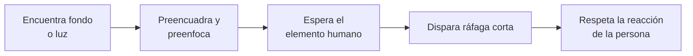

# Fotografía de calle

Parte de: [[30-Fotografia/06 Géneros/_Índice Géneros|Géneros]]

> [!info] Cómo avanzar
> `progreso`: **pendiente** → **viendo** (estudiando) → **visto** (contestaste la autoevaluación sin abrir las respuestas) → **dominado** (hiciste el laboratorio o lo aplicaste de verdad).

## Contenido

### Qué es
La **fotografía de calle** retrata la vida cotidiana en espacios públicos de forma **espontánea**: gente caminando, vendedores, gestos, coincidencias visuales, luz y sombra en la ciudad. No es solo "fotos en la calle": lo que importa es el **momento** humano o la situación curiosa, sin posar. Es el género que más entrena la observación y la rapidez.

### Cómo funciona
**Técnicas para no perder el momento:**
- **Preencuadrar ("pesca")**: encuentra un buen fondo o una luz interesante (un muro con color, un rayo de sol entre edificios, un cartel) y **espera** a que alguien entre en escena. Es la técnica más útil para empezar.
- **Enfoque por zona**: en la a6700, enfoque manual o AF-S previo a 3 m con f/8; todo entre ~2 y ~6 m (según el lente) queda aceptablemente nítido y disparas sin esperar al autofoco ([[Distancia hiperfocal]]).
- **Velocidad mínima** de 1/250–1/500 s para congelar caminantes; ISO automático.
- **Disparo silencioso** cuando sea apropiado.
- **Cámara lista**: encendida, en la mano, no en la mochila.

**Ética y legalidad:**
- Respeta a quien no quiere ser fotografiado; si alguien te pide borrar una foto, considéralo seriamente.
- Mucho cuidado con **niños**, personas en situación vulnerable (indigencia, accidentes, crisis) o momentos de dolor. Pregúntate si la foto respeta la dignidad de la persona.
- Fotografiar en la vía pública es común, pero **publicar** o **usar comercialmente** la imagen identificable de una persona tiene implicaciones legales; revisa [[Permiso de modelo y fotografía en espacios públicos en México]].
- Algunos lugares (Metro, plazas comerciales, edificios de gobierno) tienen reglas propias.

### Ejemplo
Ejercicio "un muro, una hora" en el Centro de tu ciudad:
1. Elige un muro de color o una esquina con luz lateral fuerte (mañana o tarde).
2. **Sony a6700** con un lente de 35 mm o similar (≈50 mm equivalente): modo A, f/8, ISO auto con mínimo 1/500 s, enfoque manual en el punto donde pasará la gente. Activa el **focus peaking** para fijarlo ([[Enfoque manual y focus peaking]]).
3. Quédate en el mismo lugar 30 minutos y dispara cada vez que alguien cruce la luz. Varía: silueta, persona con sombra larga, dos personas que se cruzan.
4. **iPhone 15 Pro**: más discreto. Usa 1× o 2×, toca y mantén para bloquear exposición y enfoque (AE/AF) en el punto de paso, y dispara con el botón de volumen o ráfaga.
5. **Osmo Pocket 4P**: discreta para video y fotos a la altura de la cintura.

Revisa en casa: elige 3 fotos donde el momento sea claro.

### Cuándo usarlo y cuándo no
Ideal para entrenar el ojo y el reflejo, y para viajes. Evita disparar en situaciones donde tu cámara pueda causar daño o conflicto (manifestaciones tensas sin experiencia, zonas donde te pidan no fotografiar, personas en crisis). En eventos privados (bodas, fiestas) ya no es fotografía de calle: hay expectativas distintas.

### Errores comunes
- **Fotografiar espaldas a 50 m**: sin rostro ni gesto no hay historia. Acércate o usa el preencuadre.
- **Esconderse con telefoto**: se ve furtivo y genera desconfianza; mejor focal normal y actitud abierta.
- **Fondo sucio** que compite con el gesto.
- **Velocidad lenta**: personas movidas sin intención.
- **Publicar sin pensar**: una foto graciosa para ti puede humillar a otra persona.

### Para profundizar
- [[Educar el ojo (analizar fotos y fotógrafos)]] (estudia a Cartier-Bresson y Graciela Iturbide).
- [[Cuidado del equipo en viaje, calle y lluvia]].
- [World Press Photo: colección](https://worldpressphoto.org/collection).
- Laboratorio: [[Práctica Foto 07 - Serie de 9 fotos de composición]].

## Autoevaluación

Contesta primero en voz alta o en papel; luego despliega la respuesta.

> [!question]- ¿Qué es la fotografía de calle?
> Retratar la vida cotidiana en espacios públicos de forma espontánea.

> [!question]- ¿Qué técnica ayuda a no perder el momento?
> Preencuadrar: encontrar un buen fondo o luz y esperar a que alguien entre en escena.

> [!question]- ¿Qué consideraciones éticas y legales tiene?
> Respeta a quien no quiere ser fotografiado, cuidado con niños y situaciones vulnerables, y revisa [[Permiso de modelo y fotografía en espacios públicos en México]].

