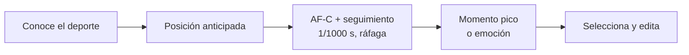

# Fotografía de deporte y acción

Parte de: [[30-Fotografia/06 Géneros/_Índice Géneros|Géneros]]

> [!info] Cómo avanzar
> `progreso`: **pendiente** → **viendo** (estudiando) → **visto** (contestaste la autoevaluación sin abrir las respuestas) → **dominado** (hiciste el laboratorio o lo aplicaste de verdad).

## Contenido

### Qué es
La **fotografía de deporte y acción** captura movimiento rápido: partidos de futbol, carreras, ciclismo, skate, niños corriendo, mascotas jugando. El objetivo es **congelar el instante decisivo** (el balón en el pie, el salto en su punto más alto) o **sugerir velocidad** con barrido. Combina técnica (enfoque y velocidad) con algo más importante: **anticipación**.

### Cómo funciona
**Ajustes base en la Sony a6700:**
- **AF-C** (enfoque continuo) con **seguimiento** y reconocimiento de sujeto (humano, animal, ave, vehículo según el deporte). El área de enfoque de seguimiento te permite elegir al jugador y la cámara lo persigue ([[Modos de enfoque automático (AF-S, AF-C y seguimiento)]]).
- **Ráfaga** en la velocidad más alta.
- **Velocidad de obturación ≥ 1/1000 s** para congelar; 1/2000 s para aves o raquetas.
- **Apertura** abierta (f/2.8–f/5.6) para dejar entrar luz y separar del fondo.
- **ISO automático** con mínimo de velocidad fijado si la luz cambia (sol y sombra, estadio).
- Modo S o modo M con ISO automático.

Más detalles del equipo en [[Sony a6700]].

**Lo que hace la diferencia más allá de la técnica:** **conocer el deporte** para anticipar dónde ocurrirá la acción y colocarte ahí. En futbol, detrás de la portería del equipo que ataca; en atletismo, la última curva o la meta; en skate, frente al obstáculo donde hacen el truco. Fotografía también las **emociones**: celebraciones, frustración, el banquillo.

**Barrido (panning):** velocidad lenta (1/30–1/60 s) siguiendo al sujeto con la cámara; el sujeto queda relativamente nítido y el fondo se convierte en líneas de movimiento. Requiere práctica y muchos intentos.

**iPhone en acción:** usa **ráfaga** (desliza el botón de disparo hacia la izquierda o configura el botón de volumen para ráfaga en Ajustes → Cámara), buena luz (de día, al aire libre) y anticipación. Las **Live Photos** te dejan elegir otro cuadro como foto principal. Para niños y mascotas, el modo **Acción** del video (estabilización fuerte) es otra opción.

### Ejemplo
Partido de futbol amateur o niños en el parque:
1. **Sony a6700** con el zoom más largo que tengas. Modo S a 1/1000 s, ISO auto (máximo 6400), AF-C con seguimiento de humano, ráfaga alta. Colócate a la altura de la cancha, idealmente bajo, para que los jugadores se recorten contra el cielo o un fondo limpio.
2. Haz tres series: acción congelada (disparo al balón), emoción (gol, abrazo) y barrido a 1/60 s de un jugador corriendo.
3. **iPhone 15 Pro** en 3× con ráfaga desde la banda. Compara cuántas tomas quedan nítidas frente a la a6700.
4. **Osmo Pocket 4P**: graba en cámara lenta (alta frecuencia de cuadros) un remate y luego extrae un cuadro; ver [[Cámara lenta (high frame rate)]].
5. **DJI Mini 4K**: solo con permiso de los organizadores y nunca sobre personas.

### Cuándo usarlo y cuándo no
Úsalo en cualquier situación de movimiento rápido. Para deportes en interiores con poca luz, el ISO subirá mucho: acepta ruido o usa un lente luminoso. En eventos profesionales puede haber reglas de acreditación y prohibición de cámaras de lente intercambiable; revisa antes de ir.

### Errores comunes
- **Velocidad demasiado lenta**: sujetos movidos sin intención. Fija el mínimo en ISO auto.
- **AF-S o punto único fijo**: el jugador se sale del punto y la cámara enfoca el fondo.
- **Seguir el balón en vez de anticipar**: llegas tarde al momento.
- **Fondo caótico** (gradas, autos): bájate o cambia de lado.
- **Solo fotos de acción**: sin emociones ni contexto, la serie se siente repetitiva.

### Para profundizar
- [[Velocidad de obturación y movimiento]].
- [Ayuda de la Sony a6700 (Help Guide)](https://helpguide.sony.net/ilc/2320/v1/en/).
- [[Tarjetas de memoria (clases de velocidad)]] (las ráfagas llenan el búfer rápido).

## Autoevaluación

Contesta primero en voz alta o en papel; luego despliega la respuesta.

> [!question]- ¿Qué ajustes base usar en la a6700 para deporte?
> AF-C con seguimiento, ráfaga, velocidad ≥1/1000 s, y ISO automático si la luz cambia. Detalles en [[Sony a6700]].

> [!question]- ¿Qué hace la diferencia más allá de la técnica?
> Conocer el deporte para anticipar dónde ocurrirá la acción y colocarte ahí.

> [!question]- ¿Qué puedes hacer con el iPhone en acción?
> Usar ráfaga (desliza el botón de disparo), buena luz y anticipar; las Live Photos te dejan elegir otro cuadro.

