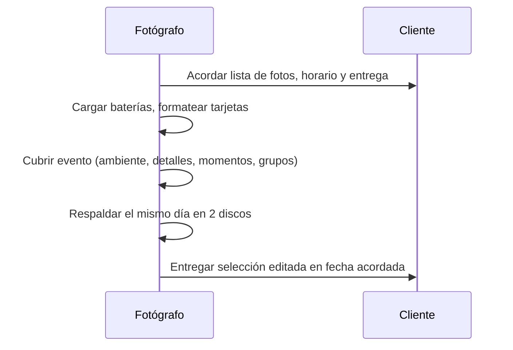

# Fotografía de eventos

Parte de: [[30-Fotografia/06 Géneros/_Índice Géneros|Géneros]]

> [!info] Cómo avanzar
> `progreso`: **pendiente** → **viendo** (estudiando) → **visto** (contestaste la autoevaluación sin abrir las respuestas) → **dominado** (hiciste el laboratorio o lo aplicaste de verdad).

## Contenido

### Qué es
La **fotografía de eventos** documenta reuniones con un propósito: fiestas, cumpleaños, bodas, graduaciones, conferencias, posadas. A diferencia de la calle, aquí hay **expectativas**: personas clave, momentos que no se repiten y alguien (cliente, familia, organizador) que espera recibir las fotos. Es un género de **planeación, confiabilidad y discreción**.

### Cómo funciona
**Lista de fotos que no deben faltar:**
1. **Ambiente y lugar**: el salón decorado, la entrada, una vista general con gente.
2. **Detalles**: centros de mesa, pastel, invitaciones, comida, manos.
3. **Personas principales**: festejado, novios, ponente, anfitriones; solos y con familiares.
4. **Momentos clave**: discursos, brindis, partir el pastel, entrega de premios, primer baile, piñata.
5. **Fotos de grupo**: familia, mesa por mesa, equipo de trabajo.

**Luz mixta del salón:** focos cálidos, pantallas LED de colores, luz de ventana y a veces luz fluorescente. El balance de blancos automático duda y cada foto sale con un tono distinto. Soluciones:
- **Toma en RAW** para corregir balance después de forma consistente ([[RAW vs JPEG y HEIF]], [[Consistencia de color en una serie]]).
- Si usas **flash, rebótalo** en techo o pared blanca para suavizarlo; un flash directo da caras planas y sombras duras ([[Flash (TTL, manual, rebotado y alta velocidad)]]).
- Fija el balance de blancos en un valor (por ejemplo, 3200–3500 K en salones con focos cálidos) para que la serie sea uniforme.

**Precauciones de flujo:**
- **Baterías y tarjetas de repuesto**, cargadas y formateadas.
- La **Sony a6700 tiene una sola ranura de tarjeta** SD: si la tarjeta falla, pierdes todo. Cambia de tarjeta a mitad del evento para repartir riesgo.
- **Respaldo el mismo día** en dos lugares ([[Respaldo 3-2-1 de fotos y videos]]).
- **Entregar a tiempo lo acordado**: número aproximado de fotos, formato y fecha. Ponlo por escrito aunque sea para un familiar.

### Ejemplo
Cumpleaños familiar en un salón:
- **Sony a6700**: modo A con f/2.8–f/4, ISO auto hasta 6400 con mínimo 1/125 s, AF-C con detección de ojo. RAW + JPEG. Si tienes flash externo, apúntalo al techo.
- **iPhone 15 Pro**: perfecto para fotos discretas y videos cortos de momentos; en 2× o 3× para caras. El modo Noche ayuda en la pista de baile sin flash.
- **Osmo Pocket 4P**: video estabilizado del recorrido por las mesas o del pastel; con el DJI Mic Mini 2 capturas los discursos con buen audio.
- Antes de que lleguen los invitados, fotografía detalles y el salón vacío con luz tranquila.
- Para la foto de grupo, coloca a la gente con la luz de frente suave, dispara ráfaga corta (alguien siempre parpadea) y usa f/5.6–f/8 para que todas las filas queden nítidas.

### Cuándo usarlo y cuándo no
Aplica en cualquier evento donde alguien espera las fotos. Si te contratan, acuerda alcance, entrega y uso de las fotos por escrito, y pregunta si hay personas que no quieren aparecer. En ceremonias religiosas, pide reglas al oficiante (a veces no se permite flash ni moverse por el altar).

### Errores comunes
- **Perderse un momento clave** por no conocer el programa: pide el itinerario.
- **Flash directo**: caras brillantes y fondo negro.
- **Una sola tarjeta y sin respaldo**: el error más caro.
- **Fotos de grupo con gente cortada o con ojos cerrados**: revisa ampliando y repite.
- **Entregar todo sin seleccionar**: entrega una selección cuidada, no 2,000 fotos crudas.

### Para profundizar
- [[Flash (TTL, manual, rebotado y alta velocidad)]].
- [[Importar, nombrar y organizar fotos]].
- [Ayuda de la Sony a6700 (Help Guide)](https://helpguide.sony.net/ilc/2320/v1/en/).

## Autoevaluación

Contesta primero en voz alta o en papel; luego despliega la respuesta.

> [!question]- ¿Qué fotos no deben faltar en un evento?
> Ambiente y lugar, detalles, personas principales, momentos clave (discursos, pastel) y fotos de grupo.

> [!question]- ¿Cómo manejas la luz mixta de un salón?
> Toma en RAW para corregir balance después; si usas flash, rebótalo.

> [!question]- ¿Qué precauciones de flujo tomas?
> Baterías y tarjetas de repuesto, respaldo el mismo día y entregar a tiempo lo acordado.

