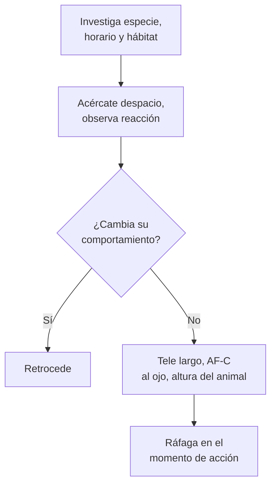

# Fotografía de fauna

Parte de: [[30-Fotografia/06 Géneros/_Índice Géneros|Géneros]]

> [!info] Cómo avanzar
> `progreso`: **pendiente** → **viendo** (estudiando) → **visto** (contestaste la autoevaluación sin abrir las respuestas) → **dominado** (hiciste el laboratorio o lo aplicaste de verdad).

## Contenido

### Qué es
La **fotografía de fauna** retrata animales en su entorno: aves, mamíferos, reptiles, insectos, vida marina. Puede ser en la naturaleza, en parques urbanos, reservas o con mascotas. Requiere paciencia, conocimiento del animal y, sobre todo, **ética**: el **bienestar del animal está por encima de la foto**.

### Cómo funciona
**Ética primero:**
- **No acosar**: si el animal cambia su comportamiento por tu presencia (deja de comer, huye, se pone alerta), estás demasiado cerca. Retrocede.
- **No alimentar** ni usar cebos para atraerlos.
- **No alterar nidos**, madrigueras ni ramas para "despejar" la vista.
- **No usar reproducción de cantos** en exceso en época de anidación.
- **Respetar reglas** de Áreas Naturales Protegidas y senderos; el dron cerca de fauna puede estresarla y en muchas zonas está prohibido.

**Focal:** casi siempre hace falta un **telefoto largo**: equivalentes de **300 mm o más**. En la a6700 (factor 1.5), un zoom que llegue a 200 mm reales equivale a 300 mm; uno de 350 mm reales llega a ≈525 mm equivalentes ([[Tamaño de sensor y factor de recorte]], [[Lentes para la Sony a6700]]). El **3× del iPhone 15 Pro (≈77 mm)** sirve para animales acostumbrados a la gente: parques urbanos, patos, ardillas, mascotas, zoológicos.

**Enfoque en el ojo:** si el ojo del animal está desenfocado, la foto casi siempre falla, aunque el resto esté perfecto. La a6700 tiene reconocimiento de **animal, ave e insecto**; usa AF-C con seguimiento para animales en movimiento ([[Modos de enfoque automático (AF-S, AF-C y seguimiento)]]).

**Técnica:**
- Velocidad: 1/500 s para animales quietos, 1/2000 s o más para aves en vuelo.
- Apertura abierta para separar del fondo.
- Ponte a la **altura del animal** (agáchate): conexión visual y fondo más limpio.
- Luz suave de mañana o tarde; los animales también son más activos a esas horas.

### Ejemplo
- **Parque urbano con iPhone 15 Pro**: ardillas o aves acostumbradas a la gente. Usa el 3×, agáchate a su nivel y espera a que se acerquen solas. Toca el ojo para enfocar y usa ráfaga.
- **Lago o humedal con Sony a6700**: con el zoom más largo disponible, modo A a f/5.6–f/6.3, ISO auto con mínimo 1/1000 s, AF-C con reconocimiento de **ave**. Llega temprano, quédate quieto en un lugar y deja que las aves se acostumbren. Haz series de aves posadas y en vuelo.
- **Mascota en casa**: práctica ideal de enfoque al ojo y anticipación; altura del piso, luz de ventana.
- **Identificación**: sube tus fotos a una plataforma de ciencia ciudadana para identificar especies y aportar datos.
- **DJI Mini 4K**: evita volar cerca de fauna silvestre; úsalo para paisaje del hábitat a distancia y altura respetuosas.

### Cuándo usarlo y cuándo no
Ideal para practicar paciencia y enfoque. Evita fotografiar fauna en temporada de anidación cerca de nidos, animales en cautiverio en condiciones de maltrato (no promuevas esos lugares) o especies en peligro si tu presencia puede afectarlas. Nunca publiques la ubicación exacta de especies sensibles: puede atraer cazadores furtivos (ver [[Metadatos EXIF e IPTC]]).

### Errores comunes
- **Acercarse demasiado**: espanta al animal y puede ser peligroso.
- **Enfoque en una rama o hierba** delante del ojo: usa un punto de enfoque pequeño o reconocimiento de sujeto.
- **Fotografiar desde arriba**: fotos de "documento", sin conexión.
- **Velocidad lenta con tele largo**: el pulso y el movimiento se multiplican.
- **Publicar la ubicación** de nidos o especies raras.

### Para profundizar
- [Audubon: guía de fotografía ética de aves](https://www.audubon.org/es/get-outside/audubons-guide-ethical-bird-photography).
- [[Lentes para la Sony a6700]].
- [[Fotografía de deporte y acción]] (técnica similar de seguimiento).

## Autoevaluación

Contesta primero en voz alta o en papel; luego despliega la respuesta.

> [!question]- ¿Qué regla ética es prioritaria en fauna?
> El bienestar del animal está por encima de la foto: no acosar, no alimentar, no alterar nidos.

> [!question]- ¿Qué focal suele hacer falta?
> Telefoto largo (equivalentes de 300 mm o más). El 3x del iPhone sirve para animales acostumbrados a personas (parques, mascotas).

> [!question]- ¿Dónde enfocas?
> En el **ojo** del animal; si está desenfocado, la foto casi siempre falla.

