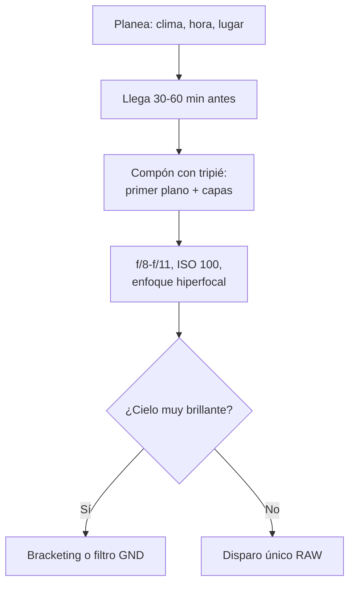

# Fotografía de paisaje

Parte de: [[30-Fotografia/06 Géneros/_Índice Géneros|Géneros]]

> [!info] Cómo avanzar
> `progreso`: **pendiente** → **viendo** (estudiando) → **visto** (contestaste la autoevaluación sin abrir las respuestas) → **dominado** (hiciste el laboratorio o lo aplicaste de verdad).

## Contenido

### Qué es
La **fotografía de paisaje** retrata lugares naturales o urbanos amplios: montañas, costas, desiertos, bosques, ciudades vistas de lejos. Un paisaje fuerte combina tres elementos: **buena luz** (hora dorada, nubes, niebla, tormenta), **un primer plano interesante** que dé entrada a la foto y **una composición con capas** que lleve del frente al fondo. Sin luz especial, incluso un lugar espectacular se ve plano.

### Cómo funciona
**Luz:** las horas cercanas al amanecer y al atardecer dan luz lateral, cálida y sombras largas que revelan relieve ([[Hora dorada y hora azul]]). Las nubes dan textura al cielo; un cielo azul liso al mediodía suele ser lo menos interesante.

**Composición:** busca primer plano (rocas, flores, un charco), plano medio (un lago, un pueblo) y fondo (montañas, cielo). Coloca el horizonte en un tercio ([[Regla de tercios y proporción áurea]]) y usa líneas como ríos o caminos ([[Líneas guía en composición]]).

**Técnica:** f/8–f/11 es el punto de mayor nitidez de la mayoría de los lentes y da profundidad de campo amplia. Enfoca a la [[Distancia hiperfocal]] o un tercio dentro de la escena. ISO base (100).

**Tripié, incluso de día:** te obliga a **componer con calma**, permite ISO bajo con velocidades lentas, hace posible el **bracketing** alineado para escenas de mucho contraste y las **panorámicas** por tomas ([[Bracketing y HDR en fotografía]], [[Fotografía panorámica]]). También permite esperar a que la luz cambie sin perder el encuadre.

**Focal:** no solo gran angular. El angular muestra amplitud y exagera el primer plano; la **telefoto aísla** picos, capas de montañas con niebla o un árbol solitario y comprime la distancia.

### Ejemplo
Salida al amanecer a un mirador:
1. Revisa la hora de salida del sol y el clima la noche anterior. Lleva lámpara.
2. **Sony a6700** en tripié: modo A, f/8, ISO 100, temporizador de 2 s o disparo remoto desde el celular. RAW. Haz una versión angular con una roca en primer plano y otra con zoom largo aislando las capas de montañas.
3. **iPhone 15 Pro**: prueba las tres cámaras (0.5×, 1×, 3×) desde el mismo punto y compara. En ProRAW tendrás más margen para recuperar el cielo.
4. **DJI Mini 4K**: si la zona lo permite, sube a 50–100 m para un paisaje con capas que no se ve desde el suelo. Usa AEB de 3 tomas si el sol está en cuadro ([[Panorámicas y HDR con dron]]).
5. Quédate 20 minutos después de la salida del sol: la luz cambia rápido.

### Cuándo usarlo y cuándo no
Es el género ideal para practicar paciencia, exposición y composición. Al mediodía con cielo despejado, mejor cambia a otra cosa (detalles en sombra, interiores) o usa un polarizador ([[Filtro polarizador circular (CPL)]]). En lugares protegidos (ANP, zonas arqueológicas) revisa reglas de acceso y uso de dron.

### Errores comunes
- **Primer plano vacío**: mucho suelo sin interés. Busca un elemento cercano o sube el horizonte.
- **Cielo quemado o suelo negro**: el rango dinámico supera al sensor; haz bracketing, usa GND o exposición para las luces y levanta sombras del RAW.
- **Horizonte chueco**: usa el nivel electrónico.
- **Llegar justo a la hora**: te pierdes la mejor luz preparando el tripié.
- **Usar solo gran angular**: la montaña lejana se vuelve diminuta.

### Para profundizar
- [[Filtros (ND, polarizador y degradado)]].
- [[Larga exposición]] para agua y nubes en movimiento.
- [Cambridge in Colour: Rule of Thirds](https://cdn.cambridgeincolour.com/tutorials/rule-of-thirds.htm).
- Laboratorio: [[Práctica Foto 10 - Panorámica y time-lapse]].

## Autoevaluación

Contesta primero en voz alta o en papel; luego despliega la respuesta.

> [!question]- ¿Qué tres elementos hacen fuerte un paisaje?
> Buena luz (hora dorada, nubes), un primer plano interesante y una composición con capas.

> [!question]- ¿Por qué un tripié ayuda incluso de día?
> Te obliga a componer con calma, permite ISO bajo, bracketing y panorámicas alineadas.

> [!question]- ¿Qué focal usar? ¿Solo gran angular?
> No: la telefoto aísla montañas, capas de niebla o detalles. Prueba las tres cámaras.

