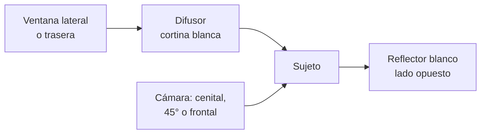

# Fotografía de producto y comida

Parte de: [[30-Fotografia/06 Géneros/_Índice Géneros|Géneros]]

> [!info] Cómo avanzar
> `progreso`: **pendiente** → **viendo** (estudiando) → **visto** (contestaste la autoevaluación sin abrir las respuestas) → **dominado** (hiciste el laboratorio o lo aplicaste de verdad).

## Contenido

### Qué es
La **fotografía de producto y comida** busca mostrar un objeto o platillo de forma atractiva y fiel: textura, color, forma y contexto. Se usa para ventas en línea, menús, redes sociales y portafolio. La buena noticia: se puede aprender en casa, con una ventana y una cartulina blanca.

### Cómo funciona
**Luz base:** la **luz de ventana lateral o trasera**, suave y difusa (día nublado o con una cortina blanca delante), con un **reflector blanco** del lado opuesto para rellenar sombras. La luz trasera (contraluz suave) hace brillar líquidos, vapor y bordes; la lateral marca textura (pan, carne, telas). Ver [[Luz dura y luz suave]] y [[Modificadores de luz (difusor, reflector y softbox)]].

**Ángulos típicos:**
- **Cenital** (90°, desde arriba): platos planos, pizzas, mesas completas, flat lays de producto.
- **45°**: lo que tiene algo de altura (un plato hondo, una taza con espuma); es como lo ve quien está sentado.
- **Frontal** (0°, a la altura del plato): hamburguesas, pasteles por capas, vasos, botellas; muestra las capas.

**Evita el flash del celular:** da luz **dura y plana** desde el eje de la cámara, brillos desagradables en salsas y vidrio y sombras feas detrás. La comida se ve grasosa y sin volumen.

**Estilismo:** menos es más. Fondo neutro (tabla de madera, mantel liso, cartulina), uno o dos props relacionados (cubiertos, ingredientes), migas o gotas puestas con intención. Limpia bordes de platos.

### Ejemplo
Mini estudio en la mesa del comedor junto a una ventana:
1. Apaga las luces del techo (mezclan temperatura de color).
2. Pon el plato a 1 m de la ventana, con la luz entrando por detrás a un lado ("a las 10 en punto").
3. Reflector: cartulina blanca o tapa de caja forrada con papel aluminio mate del lado contrario.
4. **iPhone 15 Pro**: 2× o 3× para evitar distorsión (el 0.5× deforma los platos). Toca para enfocar y baja un poco la exposición si los blancos se queman. Para cenital, ponte de pie en una silla con el teléfono paralelo a la mesa (usa el nivel de la cuadrícula, que muestra una cruz cuando apuntas hacia abajo).
5. **Sony a6700**: tripié, f/5.6–f/8 para que el plato completo quede nítido en 45°, ISO 100, temporizador. Balance de blancos personalizado con una hoja blanca ([[Balance de blancos y temperatura de color]]).
6. Para producto pequeño (un reloj, unos audífonos), haz una "barrida" con una cartulina curva como fondo infinito.

Si quieres mostrar el producto en video, ver [[Video de producto]].

### Cuándo usarlo y cuándo no
Ideal para practicar control de luz sin salir de casa. Si vas a vender o hacer fotos para un negocio, cuida la **fidelidad del color** (el cliente debe recibir lo que vio) y revisa el monitor ([[Espacios de color (sRGB, Adobe RGB y Display P3)]]). Para catálogos con fondo blanco puro, una luz continua o flash con difusor da más consistencia que la ventana, que cambia con el clima ([[Luces LED portátiles]]).

### Errores comunes
- **Usar el flash del celular**: luz dura, plana y brillos.
- **Mezclar luz de ventana con focos amarillos**: dominantes de color imposibles de corregir del todo.
- **Gran angular cerca**: platos ovalados y cubiertos deformes.
- **Comida fría o seca**: fotografía rápido; ten lista la escena antes de servir y usa un pincel con aceite para dar brillo.
- **Fondo saturado de props**: el producto se pierde.

### Para profundizar
- [[Fotografía de estudio y tethering]].
- [[Modificadores de luz (difusor, reflector y softbox)]].
- Laboratorio: [[Práctica Foto 09 - Producto y comida en casa]].

## Autoevaluación

Contesta primero en voz alta o en papel; luego despliega la respuesta.

> [!question]- ¿Qué luz es la base de la fotografía de comida casera?
> Luz de ventana lateral o trasera, suave (difusa), con un reflector blanco del lado opuesto.

> [!question]- ¿Qué ángulos son típicos y para qué?
> **Cenital** (desde arriba) para platos planos y mesas; **45°** para lo que tiene altura; **frontal** para hamburguesas o vasos.

> [!question]- Error común: usar el flash del celular. ¿Por qué evitarlo?
> Da luz dura y plana, brillos desagradables y sombras feas. Usa luz natural.

## Práctica

- [[Práctica Foto 09 - Producto y comida en casa]]

