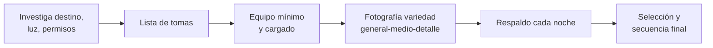

# Fotografía de viaje

Parte de: [[30-Fotografia/06 Géneros/_Índice Géneros|Géneros]]

> [!info] Cómo avanzar
> `progreso`: **pendiente** → **viendo** (estudiando) → **visto** (contestaste la autoevaluación sin abrir las respuestas) → **dominado** (hiciste el laboratorio o lo aplicaste de verdad).

## Contenido

### Qué es
La **fotografía de viaje** cuenta un lugar y la experiencia de estar ahí: paisajes, arquitectura, comida, gente, costumbres y tus propios momentos. Es una mezcla de géneros ([[Fotografía de paisaje]], [[Fotografía de calle]], [[Fotografía de arquitectura]], [[Fotografía de producto y comida]]) unidos por una **narrativa**.

### Cómo funciona
**Mezcla de fotos que cuenta bien un viaje:**
1. **Planos generales** que ubiquen el lugar (la bahía, la plaza principal, el pueblo desde un mirador).
2. **Planos medios** de la vida del lugar (mercado, gente trabajando, transporte).
3. **Detalles**: comida, texturas, artesanías, letreros, puertas.
4. **Personas**: retratos con permiso y escenas espontáneas respetuosas.
5. **Momentos propios**: tus acompañantes, tú en el lugar, el cansancio, la risa.

Esa variedad de escalas (general–medio–detalle) es lo que en video se llama cobertura ([[B-roll y plano de ubicación]]); en una galería o carrusel hace que la historia fluya.

**Preparación antes del viaje:**
- **Horarios de luz**: amanecer, atardecer y hora azul del destino ([[Hora dorada y hora azul]]).
- **Permisos y reglas** de los lugares: zonas arqueológicas, museos, templos, parques naturales; uso de tripié y dron (en México, el INAH y las Áreas Naturales Protegidas tienen reglas propias; revisa [[Permiso de modelo y fotografía en espacios públicos en México]] y [[Zonas restringidas y privacidad al volar]]).
- **Clima**: temporada de lluvias, calor, polvo.
- **Lista de tomas** de lugares que quieres fotografiar y a qué hora.
- **Plan de respaldo** en el camino.

**Cuidado del equipo clave en viaje:** protección contra **polvo, arena, humedad y lluvia** (bolsas secas, funda de lluvia), **carga de baterías** cada noche, cables y cargadores contados, y **no dejar equipo a la vista** en el auto o en la mesa. Ver [[Cuidado del equipo en viaje, calle y lluvia]] y [[Tarjetas, baterías y cuidado del equipo fotográfico]].

### Ejemplo
Viaje de fin de semana a un pueblo con zona arqueológica:
- **Equipo ligero**: Sony a6700 con un zoom versátil, iPhone 15 Pro, Osmo Pocket 4P para video y, si es legal volar en la zona (no lo es dentro de zonas arqueológicas sin autorización), el DJI Mini 4K para el pueblo visto desde arriba.
- **Mañana**: llega temprano a la zona arqueológica (menos gente, mejor luz). Fotografía general, detalles de piedra con luz lateral y personas para escala.
- **Mediodía**: mercado y comida (luz en sombra, iPhone en 2×).
- **Tarde**: calle con luz dorada, retratos de artesanos con permiso.
- **Noche**: plaza en hora azul con la a6700 apoyada o el iPhone en modo Noche.
- Cada noche: copia las tarjetas al SSD y el celular a la nube o al SSD ([[SSD externo para grabar y respaldar]]).

Al volver, arma una secuencia de 15–20 fotos que cuente el viaje de principio a fin.

### Cuándo usarlo y cuándo no
Siempre que viajes, pero balancea: no vivas el viaje solo a través de la pantalla. Si viajas con familia, acuerda momentos para fotografiar y momentos sin cámara. Evita fotografiar a personas como "atracción turística" sin su consentimiento.

### Errores comunes
- **Solo fotos de monumentos**: postales sin historia. Incluye detalles y personas.
- **Equipo de más**: cargar todo agota y te hace perder momentos.
- **No respaldar** hasta volver: un robo o una tarjeta dañada te deja sin nada.
- **Ignorar las reglas del lugar**: tripié o dron sin permiso puede costarte una multa o el equipo.
- **Llegar al mediodía** a todo: luz dura y multitudes.

### Para profundizar
- [INAH: aclaración sobre uso de celulares y cámaras en zonas arqueológicas (2024)](https://www.inah.gob.mx/images/boletines/2024/345/Boletin%20345.pdf).
- [[Cuidado del equipo en viaje, calle y lluvia]].
- [[Respaldo 3-2-1 de fotos y videos]].

## Autoevaluación

Contesta primero en voz alta o en papel; luego despliega la respuesta.

> [!question]- ¿Qué mezcla de fotos cuenta bien un viaje?
> Planos generales del lugar, detalles (comida, texturas), personas y momentos propios.

> [!question]- ¿Cómo te preparas antes de un viaje fotográfico?
> Investiga horarios de luz, permisos de lugares, clima, y respalda en el camino.

> [!question]- ¿Qué cuidado de equipo es clave en viaje?
> Protección contra polvo y lluvia, carga de baterías y no dejar equipo a la vista. Ver [[Cuidado del equipo en viaje, calle y lluvia]].

