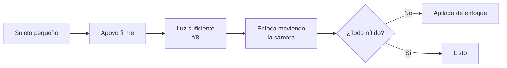

# Fotografía macro

Parte de: [[30-Fotografia/06 Géneros/_Índice Géneros|Géneros]]

> [!info] Cómo avanzar
> `progreso`: **pendiente** → **viendo** (estudiando) → **visto** (contestaste la autoevaluación sin abrir las respuestas) → **dominado** (hiciste el laboratorio o lo aplicaste de verdad).

## Contenido

### Qué es
La **fotografía macro**, en sentido estricto, es reproducir el sujeto a **tamaño real o mayor sobre el sensor**: relación de reproducción **1:1**. Un insecto de 10 mm ocupa 10 mm del sensor. En la práctica se llama "macro" a cualquier primer plano extremo de cosas pequeñas: insectos, gotas, flores, texturas. El **modo macro del iPhone 15 Pro** usa el **ultra gran angular** para enfocar a muy pocos centímetros (alrededor de 2 cm); el resultado es un **primer plano extremo** muy útil, aunque no es una macro 1:1 de lente dedicado.

### Cómo funciona
**El gran problema: la profundidad de campo mínima.** A distancias tan cortas, la zona nítida puede medir **milímetros**, incluso cerrando el diafragma. Además, cualquier movimiento (viento, tu pulso, el insecto) se amplifica. Por eso la macro pide:
1. **Apoyo**: tripié, codos en el suelo o una bolsa de frijoles.
2. **Buena luz**: para usar f/8–f/11 sin subir mucho el ISO. Un flash difuso o una lámpara LED ayudan.
3. **Enfoque manual moviendo la cámara**: en lugar de girar el anillo, mueves la cámara hacia adelante o atrás hasta que el punto clave (los ojos del insecto) esté nítido ([[Enfoque manual y focus peaking]]).
4. **Apilado de enfoque**: varias tomas con enfoque distinto que se combinan en una con todo nítido ([[Focus stacking (apilado de enfoque)]]).

Ojo con la **difracción**: cerrar más allá de f/11–f/16 en APS-C suaviza toda la imagen; a veces es mejor f/8 + apilado.

**Control del macro en la app nativa del iPhone:** en **Ajustes → Cámara**, activa **Control de macro**. Aparece un botón con una **flor** cuando te acercas, para activar o desactivar el cambio automático al ultra gran angular. Sin ese control, el iPhone cambia de cámara solo y a veces "salta" el encuadre.

### Ejemplo
- **iPhone 15 Pro**: busca gotas de rocío en una hoja temprano. Activa el Control de macro, acércate hasta que aparezca la flor, toca para enfocar la gota y mantén para bloquear AE/AF. Apoya el teléfono en una piedra y dispara con temporizador de 3 s. Prueba también video macro.
- **Sony a6700**: opciones para empezar sin gastar mucho: **tubos de extensión** (se colocan entre cuerpo y lente, sin vidrio), **filtros de acercamiento** (+4, +10) en el lente kit, o un lente macro dedicado como el Sony E 30 mm f/3.5 Macro (1:1). Modo M, f/8, 1/200 s, ISO automático, enfoque manual con focus peaking y lupa. Fotografía una moneda, la textura de una hoja o una flor.
- **Apilado casero**: con la a6700 en tripié, 10–20 tomas avanzando el enfoque poco a poco; combínalas en software gratuito.

### Cuándo usarlo y cuándo no
La macro es excelente para días sin buena luz de paisaje y para practicar en casa (texturas, monedas, comida). Con insectos vivos, prioriza su bienestar: no los enfríes ni los atrapes para fotografiarlos (ver [[Fotografía de fauna]]). Si el sujeto se mueve mucho, cambia a ráfaga y apertura algo más abierta, aceptando menos profundidad.

### Errores comunes
- **Enfoque en el lugar equivocado**: con milímetros de margen, enfoca los ojos o el punto principal.
- **Movimiento**: un leve viento arruina la toma; protege la flor con tu cuerpo o un cartón.
- **Cerrar a f/22**: difracción y foto blanda.
- **Fondo desordenado**: aunque esté desenfocado, colores fuertes distraen. Pon una cartulina detrás.
- **Sombra propia**: estás tan cerca que tapas la luz; usa un reflector o lámpara.

### Para profundizar
- [[Focus stacking (apilado de enfoque)]].
- [Guía del iPhone: fotos y videos macro](https://support.apple.com/en-lk/guide/iphone/iphfaacf2eb0/16.0/ios).
- [[Lentes para la Sony a6700]].
- Laboratorio: [[Práctica Foto 04 - Enfoque manual, macro y apilado]].

## Autoevaluación

Contesta primero en voz alta o en papel; luego despliega la respuesta.

> [!question]- ¿Qué es macro en sentido estricto y qué hace el iPhone?
> Macro estricto es reproducir el sujeto a tamaño real en el sensor (1:1). El modo macro del iPhone usa el ultra gran angular para enfocar muy cerca (unos centímetros); es "primer plano extremo" más que macro 1:1.

> [!question]- ¿Qué problema principal tiene la macro?
> Profundidad de campo mínima y cualquier movimiento se nota. Usa apoyo, buena luz y [[Focus stacking (apilado de enfoque)]].

> [!question]- ¿Cómo controlas cuándo se activa el macro en la app nativa?
> En Ajustes → Cámara puedes activar el **control de macro**, que muestra un botón de flor para activarlo o desactivarlo.

## Práctica

- [[Práctica Foto 04 - Enfoque manual, macro y apilado]]

