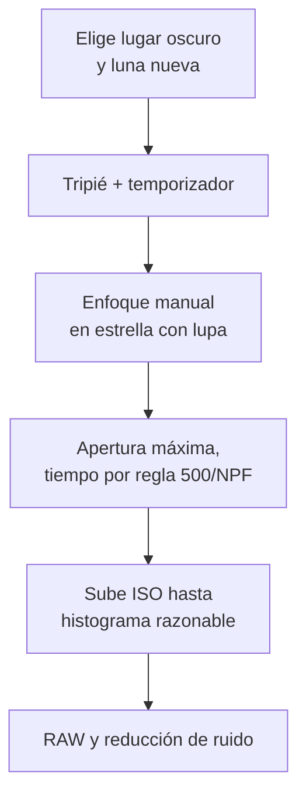

# Fotografía nocturna y astrofotografía

Parte de: [[30-Fotografia/06 Géneros/_Índice Géneros|Géneros]]

> [!info] Cómo avanzar
> `progreso`: **pendiente** → **viendo** (estudiando) → **visto** (contestaste la autoevaluación sin abrir las respuestas) → **dominado** (hiciste el laboratorio o lo aplicaste de verdad).

## Contenido

### Qué es
La **fotografía nocturna** abarca escenas con poca luz: ciudades iluminadas, calles con neón, hora azul tardía, interiores oscuros. La **astrofotografía de paisaje** busca capturar el cielo estrellado o la Vía Láctea junto con un primer plano terrestre. Ambas comparten el reto central: **muy poca luz**, lo que obliga a exposiciones largas, ISO alto o ambos.

### Cómo funciona
Una foto nocturna nítida necesita cuatro cosas:
1. **Estabilidad**: tripié o una superficie firme, temporizador de 2 s o disparo remoto.
2. **Velocidades lentas**: de 1 s a 30 s (o más en modo BULB).
3. **ISO controlado**: tan bajo como la escena permita; en astro suele ir de 1600 a 6400, aceptando ruido que luego reduces ([[ISO y ruido digital]], [[Reducción de ruido con IA]]).
4. **Enfoque correcto**: el autofoco falla en la oscuridad. Enfoca en manual con lupa sobre una estrella brillante o una luz lejana ([[Enfoque manual y focus peaking]]).

**Regla de 500**: estima el tiempo máximo antes de que la rotación de la Tierra convierta las estrellas en rayitas:

`tiempo máximo (s) ≈ 500 / (focal real × factor de recorte)`

Con la **a6700** (factor 1.5): con 16 mm, 500 / 24 ≈ **20 s**; con 11 mm, 500 / 16.5 ≈ **30 s**. Es aproximada: con sensores de muchos megapíxeles las estrellas ya se ven algo alargadas al 100 %. La **regla NPF** usa también la apertura y el tamaño del píxel; una versión simplificada es `(35 × N + 30 × p) / f`, con N = número f, p = tamaño de píxel en micras y f = focal real. Para la a6700 (p ≈ 3.8 µm) con 16 mm a f/2.8 da unos **13 s**: más estricto que la regla de 500.

**Modo Noche del iPhone**: se activa solo cuando hay poca luz. Si detecta que el teléfono está **estable en un tripié**, ofrece tiempos mucho más largos (del orden de **hasta 30 s**) y fusiona varias tomas para reducir ruido. Puedes elegir **Máx.** con el regulador.

**El lugar importa más que el equipo**: la **contaminación lumínica** de las ciudades mexicanas borra casi todas las estrellas. Busca sitios oscuros (consulta un mapa de contaminación lumínica), noches **sin luna** (luna nueva) y cielo despejado. La temporada de Vía Láctea visible en la noche en el hemisferio norte va aproximadamente de primavera a fin de verano, con el centro galáctico hacia el sur (Pendiente de confirmar las fechas exactas para tu ubicación con una app de planetario).

### Ejemplo
- **Ciudad de noche con iPhone 15 Pro**: apoya el teléfono en un tripié pequeño, apunta a una avenida con luces. Modo Noche en Máx.; compara con ProRAW en modo Noche.
- **Astro con Sony a6700** (lejos de la ciudad): lente angular y luminoso (11–16 mm, f/1.8–f/2.8), modo M, RAW, balance de blancos fijo en ~4000 K, estabilizador **desactivado** en tripié, reducción de ruido de exposición larga según prefieras (duplica el tiempo de cada toma). Con 16 mm: 15 s, f/2.8, ISO 3200 como punto de partida. Revisa el histograma: el pico debe separarse de la izquierda. Pinta el primer plano con una lámpara tenue durante 1–2 s o haz una toma aparte para el paisaje.
- **DJI Mini 4K**: no es buena herramienta para astro (sensor pequeño y vuelo nocturno con reglas especiales); úsalo de día para explorar el lugar ([[NOM-107-SCT3-2019 y registro ante la AFAC]]).

### Cuándo usarlo y cuándo no
Haz nocturna urbana cualquier día; reserva la astro para lugares oscuros y noches sin luna. Si solo tienes el celular, la astro funciona con limitaciones; el iPhone en tripié con modo Noche puede mostrar algunas estrellas en un sitio oscuro. Ve acompañado y avisa dónde estarás.

### Errores comunes
- **Confiar en el autofoco**: estrellas borrosas. Enfoca manual y revisa al 100 %.
- **Dejar el estabilizador encendido en tripié**: puede generar micro desenfoque.
- **Ignorar la luna**: con luna llena el cielo se aclara y las estrellas desaparecen.
- **Pantalla al máximo**: engaña; la foto se ve bien en el visor y oscura en la PC. Usa el histograma.
- **Rocío en el lente**: en la madrugada se empaña; lleva un paño o calentador.

### Para profundizar
- [Apple: usar el modo Noche en el iPhone](https://support.apple.com/es-lamr/102519).
- [Mapa de contaminación lumínica](https://www.lightpollutionmap.info).
- [NPF: la regla para estrellas más nítidas](https://nationalparksatnight.com/blog/2019/4/13/new-rule-for-shooting-the-sharpest-stars-in-the-sky).
- Laboratorio: [[Práctica Foto 08 - Larga exposición nocturna con el iPhone]].

## Ejercicios

Resuélvelos en papel o en la herramienta; la solución está plegada.

> [!question]- a6700 con lente de 16 mm (factor 1.5). Según la regla de 500, ¿tiempo máximo?
> 500 / (16 × 1.5) = 500 / 24 ≈ **20 s**.

> [!question]- Mismo cálculo con un 11 mm en la a6700.
> 500 / (11 × 1.5) = 500 / 16.5 ≈ **30 s**.

## Autoevaluación

Contesta primero en voz alta o en papel; luego despliega la respuesta.

> [!question]- ¿Qué necesita una foto nocturna nítida?
> Estabilidad (tripié o apoyo), velocidades lentas, ISO controlado y enfoque correcto.

> [!question]- ¿Qué hace el modo Noche del iPhone con tripié?
> Detecta que está estable y permite tiempos más largos (hasta unos 30 s), fusionando varias tomas.

> [!question]- ¿Qué es la regla de 500 y para qué sirve?
> Una estimación del tiempo máximo de exposición antes de que las estrellas se vean como rayas: 500 / (focal × factor de recorte). Es aproximada; la regla NPF es más precisa con sensores modernos.

> [!question]- ¿Qué afecta más a la astrofotografía en México: el equipo o el lugar?
> El **lugar**: la contaminación lumínica de la ciudad borra las estrellas. Busca sitios oscuros y noches sin luna.

## Práctica

- [[Práctica Foto 08 - Larga exposición nocturna con el iPhone]]

