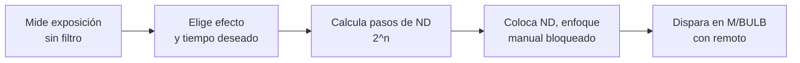

# Larga exposición

Parte de: [[30-Fotografia/06 Géneros/_Índice Géneros|Géneros]]

> [!info] Cómo avanzar
> `progreso`: **pendiente** → **viendo** (estudiando) → **visto** (contestaste la autoevaluación sin abrir las respuestas) → **dominado** (hiciste el laboratorio o lo aplicaste de verdad).

## Contenido

### Qué es
Una **larga exposición** es una toma con **velocidad lenta**, desde fracciones de segundo hasta minutos, para mostrar el **paso del tiempo** en una sola imagen: estelas de luz de autos, agua sedosa en cascadas o el mar, nubes que se estiran, multitudes que desaparecen. Lo fijo queda nítido y lo que se mueve se convierte en trazo o textura ([[Velocidad de obturación y movimiento]]).

### Cómo funciona
**Requisitos:** tripié (o apoyo firme), disparo sin tocar la cámara (temporizador o remoto) y control de exposición. De noche la escena ya es oscura, así que una velocidad de varios segundos sale natural. **De día** hay demasiada luz: aun con f/16 e ISO 100, quizás solo llegas a 1/30 s. Ahí entra el **filtro ND**: reduce la luz que entra sin cambiar el color (idealmente) y te permite velocidades lentas sin sobreexponer ([[Filtro ND en fotografía]]).

**Calcular el tiempo con ND:** cada paso duplica el tiempo. Un ND de *n* pasos multiplica el tiempo por 2ⁿ.
- 1/60 s con ND de 10 pasos (ND1000): 1/60 × 1024 ≈ **17 s**.
- 1/125 s con ND de 6 pasos (ND64): 64/125 ≈ **0.5 s**.

Guía de tiempos según el efecto:
- **Agua sedosa** en cascada: 0.5–2 s.
- **Mar como niebla**: 10–30 s.
- **Estelas de autos**: 5–30 s (según tráfico).
- **Nubes con dirección**: 30 s a varios minutos (requiere ND fuerte y modo BULB).

**En la a6700**: modo S o M hasta 30 s; más allá, **BULB** con disparador remoto o la app del celular. La **reducción de ruido de exposición larga** toma un "cuadro negro" del mismo tiempo para restar píxeles calientes; duplica la espera.

**En el iPhone, sin app especial:**
1. **Exposición larga de Live Photo**: toma una Live Photo con el teléfono apoyado; en Fotos, abre el menú de efectos de Live Photo y elige **Exposición larga**. El iPhone fusiona los cuadros del clip de ~3 s.
2. **Modo Noche con tripié**, para escenas oscuras con tiempos largos.

### Ejemplo
- **Estelas de autos con Sony a6700**: desde un puente peatonal (seguro y sin estorbar), tripié, f/11, ISO 100, 15 s, enfoque manual en el tráfico. Balance de blancos fijo. Prueba 5 s, 15 s y 30 s.
- **Cascada de día**: mide sin filtro: f/11, ISO 100, 1/60 s. Con ND1000: unos 17 s. Enfoca **antes** de poner el filtro (con ND fuerte el visor se oscurece y el AF falla), pasa a enfoque manual y cubre el visor si entra luz.
- **iPhone 15 Pro**: en una fuente o río, Live Photo con el teléfono apoyado; aplica Exposición larga. Compara con la versión de la a6700.
- **Osmo Pocket 4P**: sus modos de time-lapse y motionlapse son una alternativa en video para mostrar el paso del tiempo ([[Time-lapse]]).

### Cuándo usarlo y cuándo no
Usa larga exposición para simplificar escenas caóticas (el mar se vuelve liso, la gente desaparece), para mostrar movimiento y en nocturna. Evítala cuando el sujeto principal se mueve y debe verse nítido (personas, animales), con viento fuerte que mueve el tripié o en lugares donde el tripié estorba o no está permitido.

### Errores comunes
- **Tripié inestable o con la correa colgando**: vibra con el viento. Bájalo y cuelga peso.
- **Enfocar con el ND puesto**: el AF no ve; enfoca antes y bloquea.
- **Entrada de luz por el visor** en exposiciones largas: manchas; cúbrelo.
- **Sobreexponer por no calcular**: usa la fórmula 2ⁿ o una app de calculadora ND.
- **Dominante de color** con ND baratos: corrige en RAW.

### Para profundizar
- [[Filtro ND en fotografía]].
- [Apple: tomar y editar Live Photos](https://support.apple.com/es-lamr/HT207310).
- [[Fotografía nocturna y astrofotografía]].
- Laboratorio: [[Práctica Foto 08 - Larga exposición nocturna con el iPhone]].

## Ejercicios

Resuélvelos en papel o en la herramienta; la solución está plegada.

> [!question]- Exposición correcta: 1/60 s. Pones un ND de 10 pasos (ND1000). ¿Qué tiempo necesitas?
> 1/60 × 2¹⁰ = 1024/60 ≈ **17 s**.

> [!question]- Exposición correcta: 1/125 s. ND de 6 pasos (ND64). ¿Nuevo tiempo?
> 64/125 ≈ **0.5 s**.

## Autoevaluación

Contesta primero en voz alta o en papel; luego despliega la respuesta.

> [!question]- ¿Qué es una larga exposición?
> Una toma con velocidad lenta (de fracciones de segundo a minutos) para mostrar el paso del tiempo: estelas de autos, agua sedosa, nubes que se mueven.

> [!question]- ¿Qué opciones tiene el iPhone sin app especial?
> El efecto **Exposición larga** de una Live Photo (fusiona los cuadros del clip) y el modo Noche con tripié.

> [!question]- ¿Para qué sirve un filtro ND en larga exposición de día?
> Reduce la luz para poder usar velocidades lentas sin sobreexponer. Ver [[Filtro ND en fotografía]].

## Práctica

- [[Práctica Foto 08 - Larga exposición nocturna con el iPhone]]

