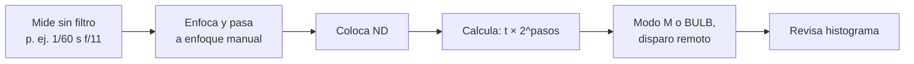

# Filtro ND en fotografía

Parte de: [[Filtros (ND, polarizador y degradado)]]

> [!info] Cómo avanzar
> `progreso`: **pendiente** → **viendo** (estudiando) → **visto** (contestaste la autoevaluación sin abrir las respuestas) → **dominado** (hiciste el laboratorio o lo aplicaste de verdad).

## Contenido

### Qué es
Un **filtro ND** (*neutral density*, densidad neutra) reduce la cantidad de luz que entra al lente **de manera uniforme y, en teoría, sin cambiar el color**. Es como ponerle lentes de sol a la cámara. Sirve para usar **velocidades lentas de día** (agua sedosa, nubes en movimiento, gente que desaparece) o **aperturas abiertas a pleno sol** (retrato a f/1.8 sin pasar el límite de velocidad), y en video para respetar la regla de 180° ([[Regla de los 180 grados del obturador]]).

### Cómo funciona
Hay tres notaciones y conviene leerlas todas:

| Pasos | Factor (ND*n*) | Densidad óptica | Luz que pasa |
|---|---|---|---|
| 1 | ND2 | 0.3 | 1/2 |
| 3 | ND8 | 0.9 | 1/8 |
| 6 | ND64 | 1.8 | 1/64 |
| 10 | ND1000 (≈1024) | 3.0 | ≈1/1000 |

- **Factor** (ND8, ND64, ND1000): cuántas veces reduce la luz. Los pasos son log₂ del factor: 8 = 2³ → 3 pasos; 64 = 2⁶ → 6 pasos; 1000 ≈ 2¹⁰ → ~10 pasos.
- **Densidad óptica** (0.3, 0.9, 1.8, 3.0): cada **0.3 = 1 paso**. Así, 0.9 = 3 pasos, 1.8 = 6 pasos y 3.0 = 10 pasos.

**Calcular el nuevo tiempo:** multiplica el tiempo sin filtro por 2^pasos (o por el factor):

`tiempo con ND = tiempo sin filtro × 2^pasos`

- 1/30 s con ND64: 64/30 ≈ **2 s**.
- 1/60 s con ND1000: 1024/60 ≈ **17 s**.
- 1/250 s con ND1000: 1000/250 = **4 s**.

**ND variable:** dos polarizadores que giran uno sobre otro (de ~2 a ~8 pasos según el modelo). Práctico para video, pero en los extremos puede dar una "X" oscura o colores raros, sobre todo con angulares.

### Ejemplo
Río o fuente a media mañana con la **Sony a6700** en tripié:
1. Sin filtro, en modo A a f/11 e ISO 100, la cámara indica 1/60 s.
2. Enfoca en el agua y cambia a **enfoque manual** (con un ND fuerte el AF y el visor se quedan casi a oscuras).
3. Pon el ND1000 y pasa a modo **M**: 1/60 × 1024 ≈ 17 s → usa 15 s o 20 s (o BULB).
4. Dispara con temporizador o desde la app. Revisa el histograma y corrige ±1 paso.
5. Toma en **RAW**: muchos ND fuertes agregan una **dominante** (magenta, azul o cálida). Corrige el balance de blancos después usando una zona neutra (una piedra gris) o toma una referencia sin filtro para comparar.

Con el **DJI Mini 4K** o la **Osmo Pocket 4P**, los ND se usan sobre todo para video: si grabas a 30 fps, buscas ~1/60 s; a pleno sol eso exige ND16–ND64 aproximadamente (según la luz; mídelo).

### Cuándo usarlo y cuándo no
Úsalo para larga exposición diurna, retratos con apertura abierta bajo sol fuerte y video a pleno sol. No lo necesitas de noche ni en interiores. Si solo quieres desenfocar el fondo de día y tu cámara tiene obturador electrónico rápido, a veces basta con subir la velocidad.

### Errores comunes
- **Enfocar con el filtro puesto**: el AF falla y la foto sale blanda.
- **Fuga de luz por el visor** en exposiciones de varios segundos: cúbrelo.
- **Dominante de color** sin corregir: dispara en RAW y ajusta el balance.
- **Confundir notaciones**: un "ND 1.8" no es 1.8 pasos, son 6.
- **ND variable al máximo** con angular: patrón en X; no lo lleves al extremo.

### Para profundizar
- [Cambridge in Colour: Camera Lens Filters](https://www.cambridgeincolour.com/tutorials/camera-lens.htm).
- [[Larga exposición]].
- [[Filtros (ND, polarizador y degradado)]].
- Laboratorio: [[Práctica Foto 08 - Larga exposición nocturna con el iPhone]].

## Ejercicios

Resuélvelos en papel o en la herramienta; la solución está plegada.

> [!question]- ¿Cuántos pasos tiene un filtro ND 1.8?
> 1.8 / 0.3 = **6 pasos** (equivale a ND64).

> [!question]- Tienes 1/30 s sin filtro y pones un ND64. ¿Tiempo nuevo?
> 1/30 × 64 ≈ **2 s**.

## Autoevaluación

Contesta primero en voz alta o en papel; luego despliega la respuesta.

> [!question]- ¿Qué significa ND8, ND64 y ND1000?
> El factor de reducción de luz: ND8 = 3 pasos, ND64 = 6 pasos, ND1000 ≈ 10 pasos.

> [!question]- ¿Qué es la notación 0.3, 0.9, 3.0?
> Densidad óptica: cada 0.3 = 1 paso. 0.9 = 3 pasos; 3.0 = 10 pasos.

> [!question]- Error común con ND fuerte: tono de color raro. ¿Qué haces?
> Muchos ND agregan dominante; toma en RAW y corrige el balance de blancos después.

