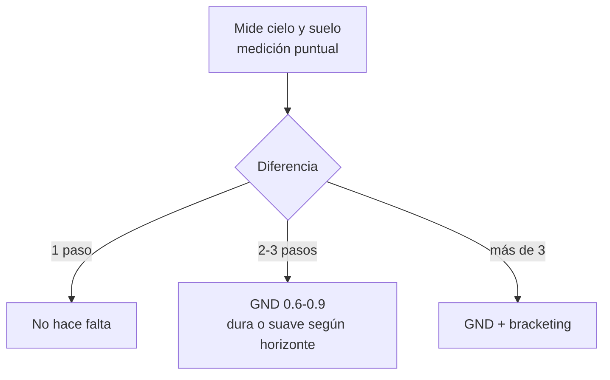

# Filtro degradado (GND)

Parte de: [[Filtros (ND, polarizador y degradado)]]

> [!info] Cómo avanzar
> `progreso`: **pendiente** → **viendo** (estudiando) → **visto** (contestaste la autoevaluación sin abrir las respuestas) → **dominado** (hiciste el laboratorio o lo aplicaste de verdad).

## Contenido

### Qué es
Un **filtro degradado neutro (GND)** es una placa que tiene **una mitad oscura** (con densidad neutra) y **una mitad clara**, con una **transición** entre ambas. Se coloca de modo que la parte oscura cubra el cielo: así **oscurece el cielo sin afectar el suelo** y equilibra escenas donde el cielo es mucho más brillante que el paisaje, como amaneceres y atardeceres.

### Cómo funciona
El sensor tiene un rango dinámico limitado ([[Histograma y rango dinámico]]). Al atardecer, el cielo puede ser 3–4 pasos más brillante que el suelo: si expones para el suelo, el cielo se quema; si expones para el cielo, el suelo se va a negro. El GND reduce el brillo del cielo para que todo quepa en una sola toma.

**Fuerza:** se expresa igual que los ND: 0.3 (1 paso), 0.6 (2 pasos), 0.9 (3 pasos).

**Tipo de transición:**
- **Dura**: cambio brusco. Para **horizontes planos** (mar, llanura, lago).
- **Suave**: cambio gradual a lo largo de una zona amplia. Para **horizontes irregulares** (montañas, árboles, edificios), donde una línea dura oscurecería las cimas.
- **Inversa**: más oscura justo en el horizonte y más clara arriba, pensada para el sol en el horizonte.

**Montaje:** casi siempre de placa con portafiltros, porque necesitas **deslizar** la transición arriba o abajo para alinearla con el horizonte. Los GND roscados fijan la transición a la mitad.

**Alternativas si no lo tienes:**
1. **Bracketing**: varias tomas a distintas exposiciones que combinas ([[Bracketing y HDR en fotografía]], [[Unir HDR y panorámicas]]).
2. **Máscara de degradado** en el revelado RAW: bajas exposición y altas luces solo en el cielo ([[Máscaras y ajustes locales]]). Funciona muy bien con sensores modernos si no quemaste el cielo en la toma.
3. En celular, el **Smart HDR** del iPhone ya combina exposiciones automáticamente.

### Ejemplo
Atardecer en la playa con la **Sony a6700** en tripié:
1. Medición **puntual**: mide el cielo cerca del sol (sin apuntar al sol) y luego la arena. Supón que el cielo da 1/250 s y la arena 1/30 s a f/11: **3 pasos** de diferencia.
2. Coloca un GND 0.9 de **transición dura** y alinéala con el horizonte del mar (cierra el diafragma con el botón de previsualización o revisa en pantalla ampliada).
3. Expón para la arena (1/30 s); el cielo quedará correcto.
4. Compara con una toma sin filtro revelada con máscara de degradado en darktable ([[darktable y Ansel]]). Observa qué tan bien recupera el RAW.
5. **iPhone 15 Pro**: toma la misma escena en ProRAW y en HEIF normal; el Smart HDR hará algo parecido de forma automática.

### Cuándo usarlo y cuándo no
Úsalo en amaneceres y atardeceres con horizonte limpio, especialmente si quieres resolver todo en una toma (por ejemplo, con olas en movimiento que complican el bracketing). No sirve bien cuando hay elementos que cruzan el horizonte (un árbol, un faro, una persona de pie), porque también se oscurecen. Muchos fotógrafos prefieren bracketing o máscaras por la flexibilidad.

### Errores comunes
- **Transición dura en montañas**: las cimas se ven oscurecidas de forma rara.
- **Línea del filtro mal alineada**: banda visible sobre o bajo el horizonte.
- **Demasiada fuerza**: cielo más oscuro que el suelo, se ve falso.
- **Elementos verticales oscurecidos** (faros, árboles).
- **Dominante de color** en filtros baratos.

### Para profundizar
- [Cambridge in Colour: Camera Lens Filters](https://www.cambridgeincolour.com/tutorials/camera-lens.htm).
- [[Filtros (ND, polarizador y degradado)]].
- [[Medición de luz (matricial, ponderada y puntual)]].

## Autoevaluación

Contesta primero en voz alta o en papel; luego despliega la respuesta.

> [!question]- ¿Qué es un filtro degradado neutro?
> La mitad oscura y la mitad clara, con una transición; oscurece el cielo sin afectar el suelo.

> [!question]- ¿Transición dura o suave?
> **Dura** para horizontes planos (mar); **suave** para horizontes irregulares (montañas).

> [!question]- ¿Qué alternativa tienes si no lo tienes?
> Bracketing o una máscara de degradado en el revelado RAW.

