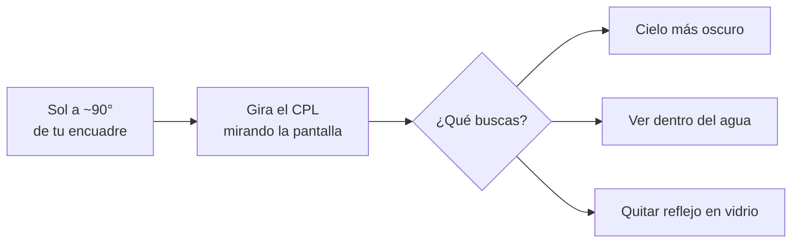

# Filtro polarizador circular (CPL)

Parte de: [[Filtros (ND, polarizador y degradado)]]

> [!info] Cómo avanzar
> `progreso`: **pendiente** → **viendo** (estudiando) → **visto** (contestaste la autoevaluación sin abrir las respuestas) → **dominado** (hiciste el laboratorio o lo aplicaste de verdad).

## Contenido

### Qué es
Un **polarizador circular (CPL)** es un filtro giratorio que **bloquea la luz polarizada** según su orientación. En la práctica hace tres cosas: **reduce reflejos** en agua, vidrio y superficies mojadas (no en metal desnudo), **oscurece el cielo azul** dándole más contraste con las nubes y **satura el follaje** al quitar el brillo de las hojas. Es el único filtro cuyo efecto no se puede imitar de verdad en edición.

### Cómo funciona
La luz que se refleja en superficies no metálicas y la luz del cielo azul (dispersada por la atmósfera) están parcialmente **polarizadas**: vibran sobre todo en una dirección. El CPL deja pasar luz en una sola orientación; al girarlo, eliges cuánta luz polarizada bloqueas. El "circular" se refiere a una segunda capa que vuelve a desordenar la luz para que no confunda al autofoco y la medición de las cámaras modernas.

**Ángulo respecto al sol:** el efecto en el cielo es **máximo con el sol a unos 90°** de la dirección a la que apuntas (sol a tu izquierda o derecha). Truco: forma una "pistola" con la mano, apunta el índice al sol; el pulgar extendido señala las zonas de máximo efecto al girar la mano. Con el sol a tu espalda o de frente, el efecto en el cielo es casi nulo.

**Cielo disparejo con gran angular:** como la polarización varía a lo largo del cielo según el ángulo con el sol, un lente muy angular (por ejemplo, 10–16 mm en la a6700, o el 13 mm equivalente) abarca zonas con distinto grado de polarización y aparece una **banda más oscura** en una parte del cielo. Se nota sobre todo en cielos azules limpios.

**Costo de luz:** el CPL quita aproximadamente 1–2 pasos de luz, así que la velocidad baja.

### Ejemplo
- **Sony a6700** en un lago o río a media mañana: con el sol a tu lado, gira el CPL mientras miras la pantalla: verás aparecer las piedras del fondo y desaparecer el reflejo del cielo. Haz una toma con el efecto al mínimo y otra al máximo. Repite apuntando al cielo con nubes y compara el contraste.
- **Follaje después de la lluvia**: el CPL quita el brillo blanco de las hojas mojadas y el verde se ve más profundo.
- **Vitrina o ventana**: fotografiar a través de un aparador sin reflejos (inclina un poco la cámara; el efecto es máximo cerca de 30–40° respecto al vidrio).
- **iPhone 15 Pro** con CPL de clip: funciona igual, pero cuida que el clip no tape el ultra gran angular y que gire bien.
- **Comparación**: intenta imitar en edición la foto con CPL (bajar luminancia del azul, quitar brillo). El cielo se puede aproximar; el fondo del río no.

### Cuándo usarlo y cuándo no
Úsalo en paisaje diurno, agua, follaje, arquitectura con vidrio y fotos de producto con reflejos no metálicos. Quítalo en interiores, de noche, en hora azul (pierdes luz sin ganar nada) y con gran angular extremo en cielos limpios si la banda oscura te molesta. En arcoíris, el CPL puede **borrar** el arcoíris si lo giras mal (también puede intensificarlo).

### Errores comunes
- **Polarizar al máximo siempre**: cielos casi negros, poco naturales. Ajusta a medias.
- **Olvidar regirarlo** al cambiar de orientación (horizontal/vertical).
- **Banda oscura** con angular: reduce el efecto o usa más focal.
- **Comprar un polarizador lineal**: puede confundir el AF y la medición; compra circular.
- **Dejarlo puesto** al entrar a interiores.

### Para profundizar
- [Cambridge in Colour: Camera Lens Filters](https://www.cambridgeincolour.com/tutorials/camera-lens.htm).
- [[Filtros (ND, polarizador y degradado)]].
- [[Fotografía de paisaje]].

## Autoevaluación

Contesta primero en voz alta o en papel; luego despliega la respuesta.

> [!question]- ¿Qué hace un polarizador circular?
> Bloquea luz polarizada: reduce reflejos en agua y vidrio, oscurece el cielo azul y satura el follaje.

> [!question]- ¿En qué ángulo respecto al sol oscurece más el cielo?
> Con el sol a ~**90°** de la dirección a la que apuntas.

> [!question]- ¿Por qué puede dar un cielo disparejo con gran angular?
> El efecto varía en el cielo según el ángulo; con focales muy amplias se ve una banda más oscura.

