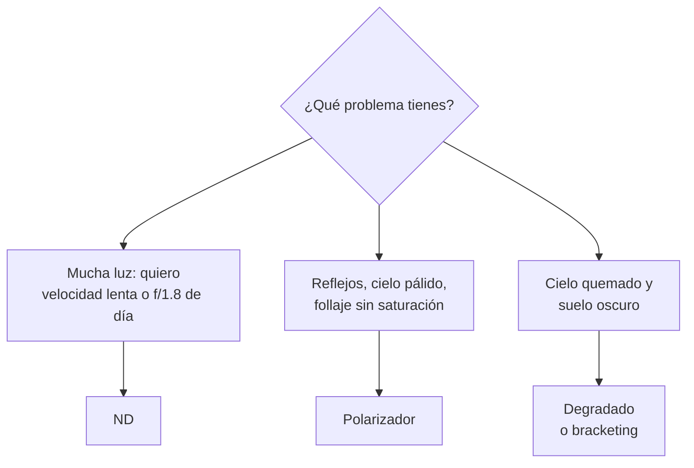

# Filtros (ND, polarizador y degradado)

Parte de: [[30-Fotografia/07 Avanzado/_Índice Avanzado|Avanzado]]

> [!info] Cómo avanzar
> `progreso`: **pendiente** → **viendo** (estudiando) → **visto** (contestaste la autoevaluación sin abrir las respuestas) → **dominado** (hiciste el laboratorio o lo aplicaste de verdad).

## Contenido

### Qué es
Los **filtros fotográficos** son piezas de vidrio o resina que se colocan delante del lente para modificar la luz **antes** de que llegue al sensor. En fotografía digital sobreviven tres tipos porque resuelven problemas que la edición no resuelve igual de bien:
- [[Filtro ND en fotografía]] (densidad neutra): **demasiada luz** para la velocidad o apertura que quieres. Oscurece toda la imagen de forma pareja.
- [[Filtro polarizador circular (CPL)]]: **reflejos** en agua y vidrio y **cielos deslavados**. Bloquea luz polarizada.
- [[Filtro degradado (GND)]]: **cielo mucho más brillante que el suelo**. Oscurece solo una parte.

### Cómo funciona


**Tipos de montaje:**
1. **Roscados**: circulares, se enroscan al frente del lente. Cada lente tiene un **diámetro de filtro** (en milímetros, impreso en el lente o en la tapa con el símbolo ⌀). Son compactos y baratos; para usar uno en varios lentes, compra el del diámetro mayor y usa **anillos adaptadores** (step-up).
2. **De placa con portafiltros**: un soporte se monta al lente con un anillo y ahí deslizas placas cuadradas o rectangulares (100 mm es un tamaño común). Permiten apilar filtros y mover la transición de un degradado. Son más caros y voluminosos.
3. **Para celular y cámaras pequeñas**: clips, fundas con rosca o filtros magnéticos específicos de cada modelo. Para el DJI Mini 4K y la Osmo Pocket 4P existen juegos de ND específicos (de DJI o terceros; Pendiente de confirmar la disponibilidad oficial para la Pocket 4P). Ver [[Filtros ND y Black Mist para video]].

**¿Qué filtro no puede imitarse en edición?** El **polarizador**. Quitar el reflejo de una vitrina o ver el fondo de un río ocurre en la luz misma: la información que tapaba el reflejo nunca llega al sensor si no la filtras. El **degradado** sí se imita en parte con máscaras de degradado o bracketing, sobre todo con RAW ([[Máscaras y ajustes locales]], [[Bracketing y HDR en fotografía]]). El **ND** tampoco se imita del todo: puedes simular agua sedosa apilando muchas fotos, pero no es lo mismo que una exposición continua.

### Ejemplo
Kit inicial sensato para tu equipo:
- **Sony a6700**: un **CPL** y un **ND variable o ND64/ND1000** del diámetro de tu lente principal (revisa el número ⌀ del lente). Con eso cubres cielos, reflejos y larga exposición de día.
- **iPhone 15 Pro**: el Smart HDR ya resuelve parte del problema del cielo; para larga exposición usa la Live Photo con Exposición larga. Un CPL de clip sirve para reflejos de agua.
- **DJI Mini 4K**: un juego de ND para video (para respetar la regla de 180°: [[Exposición en video aéreo (ND y 180 grados)]]).

Ejercicio comparativo: en un lago a media tarde, toma con la a6700 la misma escena sin filtro, con CPL girado al máximo y con ND para 2 s de exposición. Anota qué cambió en cada una.

### Cuándo usarlo y cuándo no
Usa filtros cuando el problema esté en la luz y no se arregle bien después. No pongas filtros "por si acaso": cada vidrio extra puede añadir reflejos internos, viñeteo o pérdida de nitidez, sobre todo si es barato. Un filtro "UV protector" no aporta a la imagen en digital; es solo protección física opcional.

### Errores comunes
- **Comprar el diámetro equivocado**: revisa el número del lente antes.
- **Apilar demasiados filtros** en un angular: viñeteo en las esquinas.
- **Filtros baratos**: dominante de color y pérdida de nitidez.
- **Olvidar quitar el CPL** en interiores: pierdes 1–2 pasos de luz sin motivo.
- **Dedos y polvo** en el filtro: límpialo como un lente.

### Para profundizar
- [Cambridge in Colour: Camera Lens Filters](https://www.cambridgeincolour.com/tutorials/camera-lens.htm).
- Subtemas: [[Filtro ND en fotografía]], [[Filtro polarizador circular (CPL)]], [[Filtro degradado (GND)]].
- [[Larga exposición]].

## Subtemas

- [[Filtro ND en fotografía]]
- [[Filtro polarizador circular (CPL)]]
- [[Filtro degradado (GND)]]

## Autoevaluación

Contesta primero en voz alta o en papel; luego despliega la respuesta.

> [!question]- ¿Qué problema resuelve cada filtro?
> **ND**: demasiada luz para la velocidad o apertura que quieres. **Polarizador**: reflejos y cielos deslavados. **Degradado**: cielo mucho más brillante que el suelo.

> [!question]- ¿Qué tipos de montaje hay?
> Roscados (se enroscan al lente) y de placa con portafiltros. Para celular existen clips o fundas con rosca.

> [!question]- ¿Qué filtro no puede imitarse en edición?
> El **polarizador**: quitar reflejos de agua o vidrio ocurre en la luz misma. Un degradado sí se imita en parte con máscaras, sobre todo en RAW.

## Progreso de los subtemas

```base
filters:
  and:
    - file.inFolder("30-Fotografia/07 Avanzado/Filtros (ND, polarizador y degradado)")
    - file.name != "Filtros (ND, polarizador y degradado)"
views:
  - type: table
    name: Progreso
    order:
      - file.name
      - progreso
      - nivel
```
