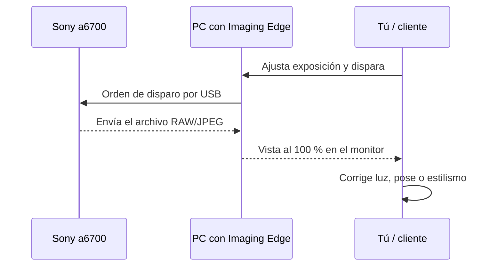

# Fotografía de estudio y tethering

Parte de: [[30-Fotografia/07 Avanzado/_Índice Avanzado|Avanzado]]

> [!info] Cómo avanzar
> `progreso`: **pendiente** → **viendo** (estudiando) → **visto** (contestaste la autoevaluación sin abrir las respuestas) → **dominado** (hiciste el laboratorio o lo aplicaste de verdad).

## Contenido

### Qué es
La **fotografía de estudio** es fotografiar en un espacio donde **controlas toda la luz**: retrato, producto, moda, comida. No necesitas un estudio profesional; una habitación con cortinas cerradas, un fondo y una o dos luces bastan. El **tethering** (disparo conectado) es **conectar la cámara a la computadora** para ver cada foto en pantalla grande al momento y, según el software, **controlar la cámara desde la PC** (disparo, apertura, velocidad, ISO, enfoque).

### Cómo funciona
**Estudio:** partes de la oscuridad y agregas luz a propósito. La luz principal define el estilo, el relleno controla el contraste de las sombras y una luz de fondo o de contorno separa al sujeto ([[Esquemas de iluminación de retrato]], [[Iluminación de tres puntos]]). Pueden ser flashes o luz continua LED ([[Luz LED continua]], [[Luces LED portátiles]]).

**Tethering:** la cámara se conecta por **USB** (a veces Wi-Fi) y el software recibe cada archivo al instante, normalmente en una carpeta que tú eliges. Ventajas en producto o retrato:
- **Revisar enfoque, luz y detalles al 100 %** en un monitor grande (un reflejo, una pelusa, un mechón de pelo) y **corregir antes de seguir**.
- El **cliente o la persona retratada ve el resultado** y opina en el momento.
- En producto, puedes comparar tomas lado a lado para mantener **consistencia**.
- Las fotos quedan ya en la computadora, con nombres y carpetas.

**Software:**
- **Sony Imaging Edge Desktop** (gratuito, de Sony): su módulo **Remote** permite disparo remoto por USB, y la Sony a6700 (ILCE-6700) aparece como compatible en la lista oficial de dispositivos.
- **darktable** (gratuito, código abierto) tiene una vista de **captura conectada (tethering)** basada en la biblioteca gphoto2; la compatibilidad depende de cada modelo (Pendiente de confirmar para la a6700 con la versión de darktable y gphoto2 que instales).
- En la cámara: la función de **disparo remoto desde PC** debe estar habilitada en el menú de conexión USB.

### Ejemplo
Mini estudio de producto en tu escritorio:
1. Mesa junto a una pared, cartulina blanca en curva (fondo infinito). Cortinas cerradas.
2. Una luz LED con difusor a 45° a un lado y un reflector blanco del otro.
3. **Sony a6700** en tripié, modo M (f/8, 1/125 s, ISO 100), balance de blancos personalizado con una hoja blanca.
4. Conecta por USB a la PC (la GTX 1660 Ti no importa aquí; basta un puerto USB estable) y abre **Imaging Edge Desktop → Remote**. Configura la carpeta de destino.
5. Fotografía un producto (unos audífonos o una pieza impresa en 3D). Revisa cada toma al 100 % y ajusta posición, polvo y reflejos.
6. Abre las fotos en darktable para revelarlas.

Con el **iPhone 15 Pro** no hay tethering clásico, pero puedes revisar en pantalla grande con AirDrop a una Mac o con iCloud; para producto, también puedes controlar la Sony desde el celular con la app de Sony.

### Cuándo usarlo y cuándo no
Úsalo en producto, retrato de estudio, comida y cualquier sesión donde la precisión importe más que la movilidad. No vale la pena en calle, eventos o fauna. El cable USB es un riesgo de tropiezo: fíjalo al tripié con cinta o un clip.

### Errores comunes
- **Cable flojo o largo**: desconexiones; usa un cable de calidad y asegúralo.
- **No configurar la carpeta de destino**: las fotos terminan en un lugar desconocido.
- **Juzgar color en un monitor sin calibrar** ([[Calibración del monitor]]).
- **Mezclar luz ambiente y luz de estudio** con distinta temperatura.
- **Olvidar la batería**: algunas cámaras se alimentan por USB, otras no lo suficiente; lleva repuesto.

### Para profundizar
- [Sony Imaging Edge Desktop](https://creatorscloud.sony.net/catalog/en-us/ie-desktop/).
- [Sony: dispositivos compatibles con Imaging Edge](https://support.d-imaging.sony.co.jp/app/imagingedge/es/devices).
- [darktable: manual de tethering](https://docs.darktable.org/usermanual/5.6/en/tethering/).
- Laboratorio: [[Práctica Foto 09 - Producto y comida en casa]].

## Autoevaluación

Contesta primero en voz alta o en papel; luego despliega la respuesta.

> [!question]- ¿Qué es el tethering?
> Conectar la cámara a la computadora para ver cada foto en pantalla grande al momento (y a veces controlar la cámara desde ahí).

> [!question]- ¿Qué ventaja tiene en producto o retrato?
> Revisas enfoque, luz y detalles al 100 % y corriges antes de seguir; el cliente ve el resultado.

> [!question]- ¿Qué programa gratuito permite tethering con algunas cámaras?
> darktable tiene un modo de captura (tethering) basado en gphoto2; la compatibilidad depende de la cámara (Pendiente de confirmar para la a6700). Sony ofrece su propio software.

