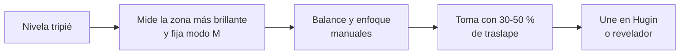

# Fotografía panorámica

Parte de: [[30-Fotografia/07 Avanzado/_Índice Avanzado|Avanzado]]

> [!info] Cómo avanzar
> `progreso`: **pendiente** → **viendo** (estudiando) → **visto** (contestaste la autoevaluación sin abrir las respuestas) → **dominado** (hiciste el laboratorio o lo aplicaste de verdad).

## Contenido

### Qué es
Una **fotografía panorámica** es una imagen más amplia (o más alta) de lo que cabe en una sola toma, construida al **unir varias fotos** que se traslapan. Sirve para paisajes extensos, interiores grandes, ciudades y también para obtener **más resolución** (varias fotos con un lente normal dan más detalle que una con angular).

### Cómo funciona
**Modo Pano del iPhone:** en la app Cámara eliges **Pano**, tocas el disparador y **barres la escena moviendo el teléfono despacio** siguiendo la flecha y manteniéndola sobre la línea guía; la app une las tomas en tiempo real. Puedes tocar la flecha para cambiar la dirección del barrido. Funciona bien con escenas lejanas; con objetos cercanos aparecen errores.

**Error de paralaje:** cuando giras la cámara, los objetos **cercanos cambian de posición respecto al fondo**. Si giras alrededor de tu cuerpo (y no del lente), un poste cercano aparece en un lugar distinto en cada toma y la unión falla: líneas cortadas, objetos duplicados. Para evitarlo:
1. Gira alrededor del **centro óptico del lente** (punto nodal o, más precisamente, pupila de entrada), no de tu cuerpo ni del tornillo del tripié. Con un riel nodal ajustas la cámara para que ese punto quede sobre el eje de giro.
2. **Aleja los objetos cercanos** del encuadre si no tienes riel.
3. A mano, gira el celular sobre sí mismo, no tu brazo extendido.

**Panorámica manual por tomas (a6700):** fija todo para que las fotos sean consistentes:
- **Exposición en manual** (o bloqueada): si cambia entre tomas, el cielo tendrá bandas.
- **Balance de blancos fijo**.
- **Enfoque manual** bloqueado.
- **30–50 % de traslape** entre tomas.
- Cámara **vertical** para tener más altura en la panorámica horizontal.
- Nivela el tripié para que el horizonte no se curve.

Luego unes en software: el gratuito **Hugin** o la función de panorama de algunos reveladores ([[Unir HDR y panorámicas]]).

### Ejemplo
- **iPhone 15 Pro**: desde un mirador, toma una Pano horizontal y otra vertical (gira el teléfono en horizontal y barre hacia arriba, ideal para un edificio alto o una cascada).
- **Sony a6700**: tripié nivelado, cámara vertical, lente de 35–50 mm. Mide la parte más brillante del cielo, pasa a modo M con f/8 e ISO 100, balance de blancos en "Luz de día", enfoque manual. Toma 6–8 fotos girando de izquierda a derecha con traslape de un tercio. Une en Hugin y compara la resolución con una foto angular.
- **DJI Mini 4K**: tiene modos de panorámica automáticos (**Esfera, 180° y Gran angular**); el dron toma y une las fotos. Útil en paisajes amplios ([[Panorámicas y HDR con dron]]).
- **Osmo Pocket 4P**: ofrece panorámica **180°** y **3×3** según su ficha técnica.

### Cuándo usarlo y cuándo no
Úsala cuando la escena no cabe, cuando quieres más resolución para imprimir grande o para formatos alargados. Evítala con sujetos en movimiento rápido (gente, olas, autos cercanos), que aparecerán cortados o duplicados, salvo que sea un efecto buscado. Con luz cambiando rápido (atardecer), toma la secuencia rápido.

### Errores comunes
- **Exposición automática** entre tomas: bandas de brillo.
- **Paralaje** por objetos cercanos y giro mal hecho.
- **Traslape insuficiente**: el software no encuentra puntos en común.
- **Tripié desnivelado**: horizonte en forma de curva.
- **Polarizador puesto**: cielo con bandas desiguales entre tomas.

### Para profundizar
- [Cambridge in Colour: Photo Stitching Digital Panoramas](https://cdn.cambridgeincolour.com/tutorials/digital-panoramas.htm).
- [Hugin: tutoriales oficiales](https://hugin.sourceforge.io/tutorials/index.shtml).
- [[Unir HDR y panorámicas]].
- Laboratorio: [[Práctica Foto 10 - Panorámica y time-lapse]].

## Autoevaluación

Contesta primero en voz alta o en papel; luego despliega la respuesta.

> [!question]- ¿Cómo funciona el modo Pano del iPhone?
> Barres la escena moviendo el teléfono despacio siguiendo la flecha; la app une las tomas en tiempo real.

> [!question]- ¿Qué es el error de paralaje y cómo se evita?
> Los objetos cercanos cambian de posición respecto al fondo al girar la cámara, y la unión falla. Gira alrededor del centro óptico del lente (no de tu cuerpo) y aleja los objetos cercanos.

> [!question]- ¿Qué ajustes fijas al hacer una panorámica manual por tomas?
> Exposición, balance de blancos y enfoque en manual (o bloqueados), con 30–50 % de traslape entre tomas.

## Práctica

- [[Práctica Foto 10 - Panorámica y time-lapse]]

