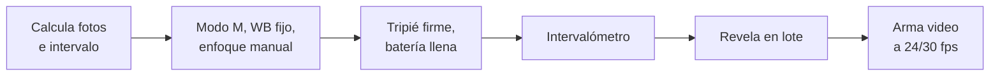

# Time-lapse

Parte de: [[30-Fotografia/07 Avanzado/_Índice Avanzado|Avanzado]]

> [!info] Cómo avanzar
> `progreso`: **pendiente** → **viendo** (estudiando) → **visto** (contestaste la autoevaluación sin abrir las respuestas) → **dominado** (hiciste el laboratorio o lo aplicaste de verdad).

## Contenido

### Qué es
Un **time-lapse** es una secuencia de fotos tomadas a **intervalos regulares** y reproducidas como **video**, de modo que el tiempo se acelera: nubes que corren, el sol que cae, una ciudad que se enciende, una planta que crece, una impresión 3D que avanza. La variante en movimiento (la cámara se desplaza entre tomas) se llama **hyperlapse** ([[Time-lapse e hyperlapse en video]], [[Hyperlapse con dron]]).

### Cómo funciona
**Las tres cuentas que necesitas:**
- **Número de fotos** = duración del clip (s) × cuadros por segundo (fps).
- **Tiempo de grabación** = número de fotos × intervalo.
- **Intervalo** = tiempo disponible ÷ número de fotos.

Ejemplos:
- Clip de 10 s a 30 fps con intervalo de 3 s: 10 × 30 = **300 fotos**; 300 × 3 = 900 s = **15 min** de grabación.
- Tienes 1 hora de atardecer y quieres 20 s a 24 fps: 20 × 24 = 480 fotos; 3600 ÷ 480 = **7.5 s** de intervalo.

**Intervalos de referencia:** nubes rápidas 1–3 s; tráfico 1–2 s; atardecer 5–10 s; estrellas 15–30 s (con exposición larga); construcción o plantas, minutos.

**Parpadeo (flicker):** cambios de brillo de un cuadro a otro. La causa principal son los **ajustes automáticos** de exposición y balance de blancos entre cuadros (y pequeñas variaciones del diafragma). Para evitarlo: **modo M**, ISO fijo, **balance de blancos fijo**, enfoque manual. En transiciones día-noche, donde sí necesitas cambiar la exposición, se usan técnicas de rampa y software de "deflicker".

**iPhone vs intervalómetro:**
- El **Time-lapse del iPhone** es automático: tú grabas el tiempo que quieras y el teléfono **decide el intervalo** según la duración, para que el clip final quede corto. Rápido y sencillo, pero sin control de intervalo ni exposición, y te da un video, no fotos.
- Con **intervalómetro** (integrado o externo) o una app eliges **intervalo y exposición fija**, y obtienes **fotos individuales** (RAW si quieres) para editar y luego armar el video con más calidad y resolución.



### Ejemplo
- **Sony a6700**: tiene **función de disparo a intervalos** integrada. En tripié, modo M, ISO 100, balance de blancos "Luz de día", enfoque manual, RAW o JPEG. Configura intervalo de 5 s y 300 tomas (25 min, clip de 10 s a 30 fps). Lleva batería de repuesto o alimentación USB.
- **Ensamblar gratis**: revela en lote con darktable, exporta JPEG numerados y únelos con DaVinci Resolve (como secuencia de imágenes) o con ffmpeg:

```bash
# Une fotos numeradas en un video de 30 fps (H.264)
ffmpeg -framerate 30 -i DSC%05d.JPG -c:v libx264 -pix_fmt yuv420p -vf "scale=3840:-2" timelapse.mp4
```

- **iPhone 15 Pro**: graba 20 min del cielo en modo Time-lapse sobre un tripié pequeño; compara con el de la a6700.
- **Osmo Pocket 4P**: tiene modos **Timelapse, Hyperlapse y Motionlapse** (movimiento entre posiciones programadas) según su ficha.
- **DJI Mini 4K**: su modo de disparo temporizado (intervalos de 2 a 60 s) sirve como intervalómetro, aunque la batería limita la duración.
- **Bonus**: graba tu impresora Elegoo durante una impresión con intervalos de 10 s.

### Cuándo usarlo y cuándo no
Úsalo para mostrar procesos lentos o cambios de luz. Evítalo si la escena casi no cambia (resultado aburrido) o si hay viento fuerte que mueve el tripié. Considera el desgaste del obturador mecánico en secuencias largas: usa obturador electrónico si tu escena lo permite.

### Errores comunes
- **Exposición o balance automáticos**: parpadeo.
- **Intervalo mal calculado**: clip demasiado corto o movimiento entrecortado.
- **Batería agotada a la mitad**.
- **Tripié que se mueve** o alguien que lo golpea.
- **Tarjeta llena**: calcula el espacio (300 RAW pueden ocupar varios GB).

### Para profundizar
- [Sony: tutorial de time-lapse con la ILCE-6700](https://support.d-imaging.sony.co.jp/support/tutorial/ilc/ilce-6700/en/15.php).
- [Ayuda Sony a6700: configuración de disparo a intervalos](https://helpguide.sony.net/ilc/2320/v1/en/contents/0407P_interval_shoot_setting.html).
- [Especificaciones de la Osmo Pocket 4P](https://drdrone.ca/pages/dji-osmo-pocket-4p-technical-specifications).
- Laboratorio: [[Práctica Foto 10 - Panorámica y time-lapse]].

## Ejercicios

Resuélvelos en papel o en la herramienta; la solución está plegada.

> [!question]- Quieres un clip de 10 s a 30 fps con un intervalo de 3 s. ¿Cuántas fotos y cuánto tiempo grabas?
> 10 × 30 = **300 fotos**; 300 × 3 s = 900 s = **15 min**.

> [!question]- Tienes 1 hora de atardecer y quieres 20 s a 24 fps. ¿Qué intervalo?
> 20 × 24 = 480 fotos; 3600 / 480 = **7.5 s** por foto.

## Autoevaluación

Contesta primero en voz alta o en papel; luego despliega la respuesta.

> [!question]- ¿Qué es un time-lapse?
> Una secuencia de fotos tomadas a intervalos y reproducidas como video, para acelerar el tiempo.

> [!question]- ¿Qué diferencia hay entre el time-lapse del iPhone y uno con intervalómetro?
> El del iPhone es automático (decide el intervalo según la duración). Con intervalómetro o app eliges intervalo, exposición fija y obtienes fotos individuales para editar.

> [!question]- ¿Qué causa parpadeo (flicker)?
> Cambios de exposición automáticos entre cuadros. Fija exposición y balance de blancos.

## Práctica

- [[Práctica Foto 10 - Panorámica y time-lapse]]

