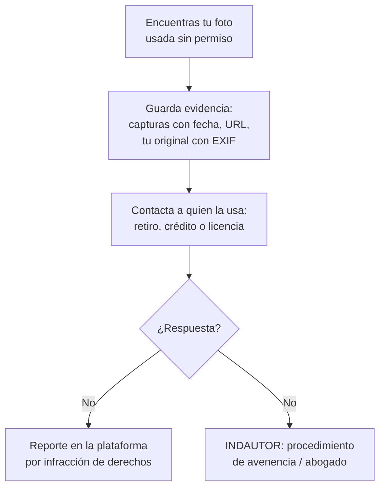

# Derechos de autor de fotos y videos

Parte de: [[30-Fotografia/08 Flujo, publicación y legal/_Índice Flujo, publicación y legal|Flujo, publicación y legal]]

> [!info] Cómo avanzar
> `progreso`: **pendiente** → **viendo** (estudiando) → **visto** (contestaste la autoevaluación sin abrir las respuestas) → **dominado** (hiciste el laboratorio o lo aplicaste de verdad).

## Contenido

> [!warning] Información general, no asesoría legal
> Este resumen es para orientarte. Las leyes cambian (la Ley Federal del Derecho de Autor se reformó en mayo de 2026) y cada caso tiene matices. Para decisiones con consecuencias (contratos, demandas, ventas), consulta a un abogado especialista y el texto vigente de la ley.

### Qué es
Los **derechos de autor** protegen las **obras originales** (fotografías y obras audiovisuales incluidas) y reconocen a su **autor** facultades sobre ellas. En términos generales, el autor de una foto es **la persona que la toma y toma las decisiones creativas**: encuadre, momento, luz, ajustes. No importa de quién sea la cámara. En México la materia la regula la **Ley Federal del Derecho de Autor (LFDA)** y la administra el **Instituto Nacional del Derecho de Autor (INDAUTOR)**.

### Cómo funciona
**La protección nace con la obra.** Según la LFDA, la protección existe desde que la obra se **fija en un soporte** (el archivo en tu tarjeta), **sin necesidad de registro**. Registrar la obra ante INDAUTOR **no crea** el derecho, pero sirve como **prueba** de autoría y fecha, útil si hay un conflicto.

**Dos tipos de derechos:**
- **Morales**: ser reconocido como autor, decidir si la obra se divulga y oponerte a deformaciones que dañen tu reputación. Son del autor, **no se venden ni se renuncian** (la ley los describe como inalienables, imprescriptibles e irrenunciables).
- **Patrimoniales**: **explotar** la obra: reproducirla, distribuirla, comunicarla al público, transformarla. **Se pueden licenciar o transmitir** (por contrato). Según el artículo 29 de la LFDA, duran la **vida del autor más 100 años** después de su muerte; luego la obra pasa al dominio público.

**Encargos y trabajo:** cuando alguien **te contrata para hacer fotos**, la titularidad de los derechos patrimoniales puede corresponder a quien encarga, salvo pacto en contrario (Pendiente de confirmar el texto vigente de los artículos sobre obra por encargo y relación laboral). Por eso conviene un acuerdo escrito que diga **qué usos** puede hacer el cliente, por cuánto tiempo y si tú puedes usar las fotos en tu portafolio.

**Licencias:** puedes dar permiso de uso sin ceder tus derechos. Las licencias **Creative Commons** son una forma estándar: por ejemplo, **CC BY** permite usar con atribución; **CC BY-NC** solo sin fines comerciales; **ND** sin obras derivadas; **SA** compartir igual.

**"Si está en internet es libre" es falso.** Publicado no significa sin derechos. Para usar fotos ajenas busca **licencia explícita** (Creative Commons, bancos de imágenes con licencia) y respeta sus condiciones, o pide permiso por escrito.

### Ejemplo
Supón que una tienda en línea usa tu foto de producto sin permiso:
1. **Evidencia**: capturas de pantalla con fecha y URL; conserva tu archivo original (RAW con EXIF de tu a6700 o tu iPhone) y, si la registraste, el certificado.
2. **Contacto**: mensaje cordial pidiendo retiro, crédito o una licencia pagada.
3. **Plataforma**: casi todas las redes y marketplaces tienen formularios para reportar infracciones de derechos de autor.
4. **INDAUTOR**: ofrece un **procedimiento de avenencia** (conciliación) entre las partes; desde el 1 de enero de 2026 ya no cobra derechos por ese procedimiento, según análisis de despachos. Para acciones legales o reclamos por daños, consulta a un abogado; ciertas infracciones con fines comerciales se atienden ante el IMPI (Pendiente de confirmar la vía adecuada para tu caso).

Prevención práctica: agrega tu nombre y copyright en los metadatos ([[Metadatos EXIF e IPTC]]), publica en tamaño web ([[Tamaños para web y redes sociales]]) y, si te sirve, una marca de agua discreta ([[Marca de agua]]).

### Cuándo usarlo y cuándo no
Ten esto en mente al **publicar**, **vender** o **usar** fotos de otros, y al aceptar encargos. Las fotos de **personas** tienen además un tema distinto, el derecho a la propia imagen: ver [[Permiso de modelo y fotografía en espacios públicos en México]]. Las imágenes generadas con IA tienen su propia discusión: [[Ética y derechos de las imágenes con IA]].

### Errores comunes
- **Creer que sin registro no hay derechos**: existen desde la creación.
- **Entregar fotos a un cliente sin acordar usos**: luego aparecen en espectaculares sin pago extra.
- **Usar fotos de Google** para un proyecto propio.
- **Ignorar las condiciones** de una licencia CC (por ejemplo, NC en un uso comercial).
- **Actuar con enojo público** antes de reunir evidencia.

### Para profundizar
- [Ley Federal del Derecho de Autor (Cámara de Diputados, texto y reformas)](https://www.diputados.gob.mx/LeyesBiblio/ref/lfda.htm).
- [Licencias Creative Commons (ejemplo: CC BY-NC 4.0 en español)](https://creativecommons.org/licenses/by-nc/4.0/legalcode.es).
- [INDAUTOR elimina cuotas del procedimiento de avenencia desde 2026 (Legalink)](https://www.legalink.net/en/publications/newsletters/indautor-eliminates-conciliation-procedure-fees-starting-in-2026/7144).

## Autoevaluación

Contesta primero en voz alta o en papel; luego despliega la respuesta.

> [!question]- En términos generales, ¿quién es el autor de una foto?
> La persona que la toma y toma las decisiones creativas. En México la protección nace con la creación de la obra y no requiere registro; registrarla ante INDAUTOR sirve como prueba (verificar con fuentes oficiales).

> [!question]- ¿Qué diferencia hay entre derechos morales y patrimoniales?
> **Morales**: ser reconocido como autor y la integridad de la obra; no se venden. **Patrimoniales**: explotar la obra (copiar, distribuir, licenciar); sí se pueden ceder o licenciar (verificar con fuentes oficiales).

> [!question]- Si encuentras una foto tuya usada sin permiso, ¿qué pasos razonables das?
> Guarda evidencias (capturas con fecha, original con metadatos), contacta a quien la usa, y usa los mecanismos de reporte de la plataforma. Para acciones legales, consulta a un abogado (verificar con fuentes oficiales).

> [!question]- Error común: "si está en internet es libre". ¿Por qué está mal?
> Publicado no significa sin derechos. Usa imágenes con licencia explícita (p. ej. Creative Commons) y respeta sus condiciones.

