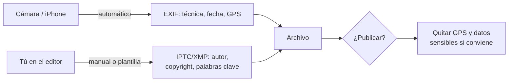

# Metadatos EXIF e IPTC

Parte de: [[30-Fotografia/08 Flujo, publicación y legal/_Índice Flujo, publicación y legal|Flujo, publicación y legal]]

> [!info] Cómo avanzar
> `progreso`: **pendiente** → **viendo** (estudiando) → **visto** (contestaste la autoevaluación sin abrir las respuestas) → **dominado** (hiciste el laboratorio o lo aplicaste de verdad).

## Contenido

### Qué es
Los **metadatos** son información guardada **dentro** del archivo de la foto, además de la imagen. Hay dos familias principales:
- **EXIF**: datos **técnicos** que escribe la cámara automáticamente: marca y modelo, lente, focal, apertura, velocidad, ISO, fecha y hora, orientación y, si está activado, **GPS** (ubicación).
- **IPTC**: datos **descriptivos y de derechos** que agregas tú: autor, título, descripción, palabras clave, lugar, aviso de copyright, contacto, condiciones de uso. Hoy suelen guardarse en formato XMP siguiendo el estándar de IPTC.

Sirven para **aprender** (ver con qué ajustes salió una foto), **organizar** (buscar por lente, fecha o palabra clave) y **proteger** tu autoría.

### Cómo funciona


**Ver los datos:**
- **iPhone**: en Fotos, abre la imagen y **desliza hacia arriba** o toca el botón de información (**i**). Verás lente, focal, apertura, velocidad, ISO, tamaño y un mapa si tiene ubicación.
- **Windows**: clic derecho → Propiedades → Detalles.
- **darktable / digiKam**: panel de información de imagen.
- **ExifTool** (línea de comandos) para todo, incluido lo que otros programas no muestran.

**Por qué revisar la ubicación antes de publicar:** el **GPS** en EXIF puede revelar **tu casa**, la escuela de tus hijos o la casa de otras personas, y la ubicación de especies sensibles en fauna. Muchas redes eliminan metadatos al subir, pero no todas, y si envías el archivo original por correo, mensajería o un enlace de nube, la ubicación viaja con él. En el iPhone, al compartir toca **Opciones** (arriba de la hoja de compartir) y desactiva **Ubicación** (y, si quieres, todos los datos de la foto). También puedes desactivar la ubicación para la Cámara en Ajustes → Privacidad y seguridad → Localización.

**Agregar autoría:** usa una plantilla de metadatos en darktable o digiKam que agregue automáticamente creador, copyright y contacto al importar. En la **Sony a6700**, el menú de configuración tiene **Información de copyright** para grabar tu nombre en cada foto desde la cámara (Pendiente de confirmar el nombre exacto del menú en tu idioma de firmware).

### Ejemplo
Con ExifTool en Windows:

```bash
# Ver los datos técnicos más útiles
exiftool -Model -LensModel -FocalLength -FNumber -ExposureTime -ISO -DateTimeOriginal foto.jpg

# Ver si tiene ubicación
exiftool -gps:all foto.jpg

# Quitar solo la ubicación (crea una copia _original de respaldo)
exiftool -gps:all= foto.jpg

# Agregar autor y copyright en lote a una carpeta de exportadas
exiftool -Artist="Tu Nombre" -Copyright="© 2026 Tu Nombre. Todos los derechos reservados." -XMP-dc:Creator="Tu Nombre" D:/Fotos/2026/Editadas
```

Ejercicio: toma tres fotos con el iPhone 15 Pro (0.5×, 1× y 3×), revisa en el panel de información qué focal, apertura e ISO usó cada una y anótalo. Repite con la a6700 y compara. Después comparte una foto contigo mismo con y sin ubicación y revisa la diferencia con ExifTool.

### Cuándo usarlo y cuándo no
Revisa EXIF para aprender de tus fotos y de las de otros (cuando estén disponibles). Agrega IPTC en todo lo que publiques o entregues. Quita el GPS antes de compartir fotos tomadas en casa, de menores o de lugares sensibles. Para fotos de viaje en lugares públicos, conservar la ubicación en tu archivo personal es útil para organizar; decide al exportar.

### Errores comunes
- **Publicar con GPS** desde casa.
- **Hora de la cámara mal configurada** (horario de verano, viaje): rompe el orden cronológico; ajústala o corrige en lote.
- **Pensar que los metadatos protegen**: se pueden borrar; son evidencia útil, no un candado.
- **Exportar quitando todo** y perder tu autoría; elige qué conservar.

### Para profundizar
- [IPTC Photo Metadata User Guide](https://iptc.org/std/photometadata/documentation/userguide/).
- [ExifTool (documentación oficial)](https://exiftool.org/).
- [[Derechos de autor de fotos y videos]].
- Laboratorio: [[Práctica Foto 11 - Importar, organizar y respaldar]].

## Autoevaluación

Contesta primero en voz alta o en papel; luego despliega la respuesta.

> [!question]- ¿Qué guarda EXIF y qué guarda IPTC?
> **EXIF**: datos técnicos de la toma (cámara, lente, velocidad, ISO, fecha, GPS). **IPTC**: datos descriptivos y de derechos (autor, título, palabras clave, copyright).

> [!question]- ¿Por qué revisar la ubicación antes de publicar?
> El GPS en EXIF puede revelar tu casa o la de otras personas. Al compartir desde el iPhone, toca **Opciones** y desactiva la ubicación.

> [!question]- ¿Dónde ves la velocidad e ISO de una foto en el iPhone?
> En Fotos, desliza hacia arriba o toca el botón de información (i).

## Práctica

- [[Práctica Foto 11 - Importar, organizar y respaldar]]

