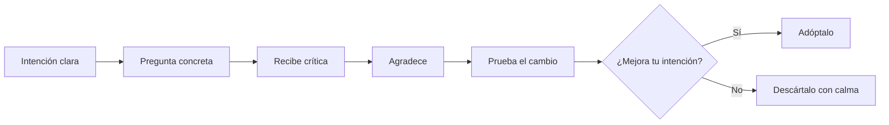

# Pedir y dar crítica fotográfica

Parte de: [[30-Fotografia/08 Flujo, publicación y legal/_Índice Flujo, publicación y legal|Flujo, publicación y legal]]

> [!info] Cómo avanzar
> `progreso`: **pendiente** → **viendo** (estudiando) → **visto** (contestaste la autoevaluación sin abrir las respuestas) → **dominado** (hiciste el laboratorio o lo aplicaste de verdad).

## Contenido

### Qué es
La **crítica fotográfica** es la retroalimentación sobre una foto o serie para entender qué funciona, qué no y cómo mejorar. **Pedir** crítica útil y **darla** bien son habilidades distintas: una crítica vaga ("está bonita", "no me gusta") no enseña nada; una crítica concreta y respetuosa acelera tu aprendizaje más que cualquier equipo nuevo. Es parecida a una buena revisión de código: sobre el trabajo, no sobre la persona.

### Cómo funciona
**Pedir crítica útil:**
1. **Di qué querías lograr**: "quería transmitir soledad en la ciudad" o "quería que el ojo fuera directo al vendedor".
2. **Pregunta algo concreto**: "¿la mirada va al sujeto?", "¿el cielo distrae?", "¿la edición se ve exagerada?", "¿cuál de estas tres quitarías?".
3. **Da contexto técnico** si sirve (cámara, luz disponible, restricciones).
4. Pide a personas que **sepan del tema** o que sean tu público, no solo a quien te quiere.

"¿Te gusta?" da respuestas inútiles: la gente responde por cortesía.

**Dar crítica con estructura** (sobre la foto, no sobre la persona):
1. **Qué funciona**: algo específico ("la luz lateral marca muy bien la textura de la pared").
2. **Qué podría mejorar**, concreto ("el poste detrás de la cabeza compite con la cara").
3. **Sugerencia práctica** ("un paso a la izquierda o abrir a f/2.8 para desenfocarlo").

Usa lenguaje de efecto: "mi ojo se va primero a…" en lugar de "está mal". Considera la **intención** del autor: una foto oscura puede ser oscura a propósito.

**Qué hacer con una crítica que no te convence:** **agradece**, **pruébala** en otra foto o en una versión alternativa y **decide** tú. No toda opinión aplica a tu intención o estilo. Si varias personas dicen lo mismo de forma independiente, probablemente tienen razón.

### Ejemplo
Rutina mensual con un amigo o grupo de fotografía:
- Cada quien lleva **3 fotos** (por ejemplo, del laboratorio de composición o del reto semanal).
- Para cada foto, el autor dice su intención en una frase y hace una pregunta concreta.
- Los demás responden con la estructura **funciona / mejoraría / sugerencia**, máximo dos minutos por foto.
- El autor solo escucha y anota; al final puede aclarar dudas, no defenderse.

Ejemplo de crítica bien dada a una foto aérea con el DJI Mini 4K:
> "Funciona: el patrón de los surcos llena el encuadre y la línea del camino entra por la esquina inferior. Mejoraría: el horizonte está ligeramente inclinado y el cielo quemado distrae arriba. Sugerencia: prueba una versión cenital sin cielo, o usa el modo AEB y revela el cielo aparte."

Ejemplo de pedirla bien con una foto de la Sony a6700: "Quería un retrato íntimo con luz de ventana. ¿Se siente cercano o frío? ¿La sombra del lado derecho es demasiado dura?"

Guarda las críticas recibidas en tu bóveda junto a la foto: con el tiempo verás patrones (siempre te dicen que dejas horizontes chuecos, por ejemplo).

### Cuándo usarlo y cuándo no
Pide crítica cuando estés eligiendo fotos para el portafolio, cuando sientas estancamiento y después de cada laboratorio. No la pidas de una foto que todavía no te convence a ti (primero hazte tú la crítica) ni en momentos en que no estés dispuesto a escuchar. En redes abiertas, los comentarios suelen ser poco útiles; prefiere grupos pequeños o personas de confianza.

### Errores comunes
- **Pedir "¿te gusta?"** o "¿qué opinas?" sin pregunta concreta.
- **Defender cada punto**: cierras la conversación y la gente deja de ser honesta.
- **Criticar al autor** ("no tienes ojo") en lugar de la foto.
- **Solo halagos o solo defectos**: ambos son poco útiles.
- **Cambiar todo** según la última opinión, sin probar ni decidir.

### Para profundizar
- [[Educar el ojo (analizar fotos y fotógrafos)]].
- [[Portafolio fotográfico y dónde publicar]].
- [World Press Photo: colección](https://worldpressphoto.org/collection) (para practicar análisis con fotos de referencia).
- Laboratorio: [[Práctica Foto 12 - Reto 52 semanas y portafolio]].

## Autoevaluación

Contesta primero en voz alta o en papel; luego despliega la respuesta.

> [!question]- ¿Cómo pides crítica útil?
> Di qué querías lograr y pregunta algo concreto ("¿la mirada va al sujeto?"). "¿Te gusta?" da respuestas inútiles.

> [!question]- ¿Qué estructura usar para dar crítica?
> Qué funciona → qué podría mejorar (concreto) → sugerencia práctica. Sobre la foto, no sobre la persona.

> [!question]- ¿Qué haces con una crítica que no te convence?
> Agradece, pruébala en otra foto y decide. No toda opinión aplica a tu intención.

## Práctica

- [[Práctica Foto 12 - Reto 52 semanas y portafolio]]

