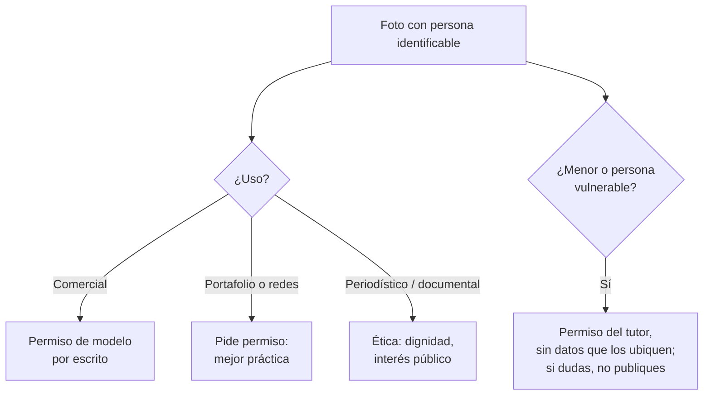

# Permiso de modelo y fotografía en espacios públicos en México

Parte de: [[30-Fotografia/08 Flujo, publicación y legal/_Índice Flujo, publicación y legal|Flujo, publicación y legal]]

> [!info] Cómo avanzar
> `progreso`: **pendiente** → **viendo** (estudiando) → **visto** (contestaste la autoevaluación sin abrir las respuestas) → **dominado** (hiciste el laboratorio o lo aplicaste de verdad).

## Contenido

> [!warning] Información general, no asesoría legal
> El marco cambió en 2026 y hay interpretaciones distintas. Antes de un uso comercial o si hay un conflicto, consulta a un abogado y el texto vigente de las leyes.

### Qué es
Un **permiso de modelo** (*model release*) es un **documento firmado** en el que una persona autoriza el uso de su imagen para **fines concretos**: publicidad, portafolio, venta en bancos de imágenes, redes de una marca. Es indispensable para **usos comerciales** y muy recomendable para cualquier publicación de retratos identificables. Este tema también cubre las reglas para fotografiar en **lugares públicos** como zonas arqueológicas, museos y la vía pública.

### Cómo funciona
**La imagen de las personas en México (panorama general):**
- Durante años, el **artículo 87 de la LFDA** establecía que el retrato de una persona solo podía usarse o publicarse con su consentimiento, con excepciones (por ejemplo, cuando la persona era parte menor de un conjunto o la foto se tomaba en un lugar público con fines informativos o periodísticos).
- La **reforma publicada en el DOF el 14 de mayo de 2026** cambió ese artículo: según análisis de despachos y medios, ahora se refiere a la imagen y voz de **artistas intérpretes o ejecutantes** (con reglas sobre inteligencia artificial), y ya no a "una persona" en general.
- Eso **no significa** que la imagen de cualquier persona quede libre: la **Suprema Corte** ha reconocido el **derecho a la propia imagen** como un derecho de la personalidad, y existen leyes civiles locales (por ejemplo, la ley de responsabilidad civil para la protección de la vida privada, el honor y la propia imagen de la Ciudad de México) y normas de **protección de datos personales**. Cómo se aplican al caso concreto es materia de abogado (Pendiente de confirmar cómo queda la protección general tras la reforma).

**Regla práctica**: para publicar con fines **comerciales** (anuncio, venta, marca) el retrato identificable de alguien, consigue **permiso por escrito**. Para portafolio o redes personales, pedir permiso sigue siendo la mejor práctica y evita conflictos.

**Qué incluir en un permiso de modelo** (no hay un formato oficial obligatorio):
1. Nombre de la persona y del fotógrafo, fecha y lugar de la sesión.
2. **Usos autorizados** (portafolio, redes, publicidad, venta) y **medios**.
3. **Duración** y territorio.
4. Si hay **pago** o intercambio.
5. Firma; si es **menor de edad**, firma de madre, padre o tutor.

**Lugares públicos con reglas propias:**
- **Zonas arqueológicas y museos del INAH**: según su boletín de junio de 2024, se permite tomar fotos y video **para uso personal** con celulares y cámaras no profesionales; si las imágenes tendrán **fines comerciales**, se paga una cuota (entonces de $60 MXN) además de los derechos federales. El **equipo profesional**, tripiés y drones requieren autorización (Pendiente de confirmar requisitos y cuotas vigentes en el sitio de trámites del INAH).
- **Vía pública en la Ciudad de México**: las filmaciones y producciones se tramitan ante la **Comisión de Filmaciones (CFILMA)** con permisos según su impacto; para una sesión pequeña con cámara de mano conviene confirmar si aplica (Pendiente de confirmar para foto fija). Otras ciudades tienen reglas similares.
- **Metro, plazas comerciales y edificios privados**: tienen reglamentos propios; pregunta.
- **Drones**: reglas aparte ([[NOM-107-SCT3-2019 y registro ante la AFAC]], [[Zonas restringidas y privacidad al volar]]).

### Ejemplo
Sesión de retrato de un amigo que quieres usar en tu portafolio y quizá vender en un banco de imágenes:
1. Antes de empezar, explica para qué usarás las fotos.
2. Firma un permiso sencillo (una hoja o un formulario digital) con los usos: portafolio, redes y bancos de imágenes.
3. Guarda el permiso junto con la carpeta de la sesión y en tu respaldo.
4. Si la sesión es en una zona arqueológica, consulta antes las reglas para tripié y uso comercial.
5. En fotos de calle con la a6700 o el iPhone, si alguien te pide no publicar, respétalo.

**Niños y personas vulnerables:** pide permiso a madre, padre o tutor, **no publiques datos que los identifiquen o ubiquen** (nombre completo, escuela, uniforme, ubicación GPS) y, **si dudas, no publiques**. La legislación de derechos de niñas, niños y adolescentes protege su intimidad e imagen.

### Cuándo usarlo y cuándo no
Usa permiso de modelo en cualquier uso comercial, sesiones planeadas y fotos de menores. En fotografía de calle o periodística, el criterio ético (dignidad, interés público, no exponer a personas vulnerables) pesa tanto como el legal ([[Fotografía de calle]]).

### Errores comunes
- **Acuerdos solo verbales** para usos comerciales.
- **Permiso genérico** sin usos concretos: se presta a conflictos.
- **Asumir que "en la calle todo se vale"** para cualquier uso.
- **Publicar niños** con datos que los ubiquen.
- **Llegar a una zona arqueológica con tripié y dron** sin revisar reglas.

### Para profundizar
- [Reforma a la LFT y LFDA en materia de IA (Galicia Abogados, mayo 2026)](https://galicia.com.mx/links/files/Actualizaciones/GC.-Actualizacion.-TMT.-Reforma-LFT-y-Derecho-de-Autor-en-materia-de-IA.pdf).
- [SCJN: tesis temática sobre el derecho a la propia imagen](https://www.scjn.gob.mx/Transparencia/Documents/CriteriosPJF/Tesis_tematica_derecho_a_la_propia_imagen.pdf).
- [INAH: boletín sobre fotos con celulares y cámaras en zonas arqueológicas (2024)](https://www.inah.gob.mx/images/boletines/2024/345/Boletin%20345.pdf).
- [CDMX: mini guía de filmaciones](https://www.turismo.cdmx.gob.mx/storage/app/media/inf_2024/Mini%20guia%20Filmaciones.pdf).

## Autoevaluación

Contesta primero en voz alta o en papel; luego despliega la respuesta.

> [!question]- ¿Qué es un permiso de modelo (model release)?
> Un documento firmado en el que la persona autoriza el uso de su imagen para fines concretos (publicidad, portafolio, venta). Indispensable para usos comerciales.

> [!question]- En términos generales, ¿necesitas permiso para publicar el retrato de una persona en México?
> Cambió en 2026. La reforma a la Ley Federal del Derecho de Autor publicada en el DOF el 14 de mayo de 2026 modificó el **artículo 87**: ahora habla de la imagen (incluida la voz) de las **personas artistas intérpretes o ejecutantes**, que solo puede usarse o publicarse con su consentimiento expreso, también cuando se genera con IA; prevé excepciones (p. ej. captación en lugar público, fines informativos o periodísticos, parodia o sátira). Antes el artículo hablaba del retrato de cualquier persona, y hay interpretaciones distintas sobre qué protección queda para personas que no son artistas (otras leyes civiles y locales de imagen y privacidad). En la práctica: para cualquier uso comercial o de portafolio, **pide permiso por escrito** (permiso de modelo). Esto es información general, **no asesoría legal**: revisa el texto vigente en el DOF y consulta a un abogado si vas a lucrar con la imagen o hay un conflicto.

> [!question]- ¿Hay lugares públicos donde se pidan permisos para fotografiar?
> Sí: zonas arqueológicas y museos (normalmente por equipo profesional o uso comercial), y producciones en vía pública en algunas ciudades. Revisa las reglas de INAH y de tu ciudad antes de ir (verificar con fuentes oficiales).

> [!question]- ¿Qué buena práctica sigues con niños y personas vulnerables?
> Pide permiso al tutor, no publiques datos que los identifiquen o ubiquen, y si dudas, no publiques.

