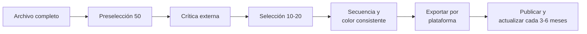

# Portafolio fotográfico y dónde publicar

Parte de: [[30-Fotografia/08 Flujo, publicación y legal/_Índice Flujo, publicación y legal|Flujo, publicación y legal]]

> [!info] Cómo avanzar
> `progreso`: **pendiente** → **viendo** (estudiando) → **visto** (contestaste la autoevaluación sin abrir las respuestas) → **dominado** (hiciste el laboratorio o lo aplicaste de verdad).

## Contenido

### Qué es
Un **portafolio fotográfico** es una **selección pequeña y cuidada** de tus mejores fotos, organizada para mostrar quién eres como fotógrafo: tu mirada, tus temas y tu nivel. No es un archivo de todo lo que has hecho. **Dónde publicar** depende de tu objetivo: compartir con amigos, recibir crítica, conseguir clientes o simplemente tener un registro de tu avance.

### Cómo funciona
**Pocas y muy buenas:** para un principiante, **10 a 20 fotos**, coherentes en estilo o tema. Una foto débil **baja el nivel del conjunto**, porque quien ve recuerda la peor. Criterios de selección:
1. **Técnica correcta** (enfoque, exposición) o un error claramente intencional.
2. **Coherencia**: mismo tratamiento de color ([[Consistencia de color en una serie]]), tema o enfoque.
3. **Secuencia**: abre con una foto fuerte, cierra con otra; alterna planos generales y detalles.
4. **Quita las favoritas emocionales** si no son buenas fotos (la de tu perro que te encanta pero está movida).

Pide a otra persona que te ayude a recortar la selección ([[Pedir y dar crítica fotográfica]]).

**Opciones gratuitas para publicar:**
- **Instagram**: gran alcance, formato vertical y cuadrado; compresión fuerte.
- **Flickr**: comunidad de fotógrafos, grupos temáticos y licencias Creative Commons; la cuenta gratuita ha tenido límite de 1,000 fotos (Pendiente de confirmar condiciones vigentes).
- **Pixelfed**: red federada, sin algoritmo publicitario.
- **Álbum compartido** (iCloud, Google Fotos) para familia y amigos.
- **Página propia gratuita**: como eres desarrollador, un sitio estático en **GitHub Pages** o en **Azure Static Web Apps** (plan gratuito) con tu propia galería en React + Vite te da control total y te sirve de proyecto de práctica.

Elige según tu público: clientes potenciales miran una página limpia; la comunidad fotográfica está en Flickr y redes.

**Cuidados al publicar en redes:**
- **Exportar al tamaño y formato correctos** para cada plataforma ([[Tamaños para web y redes sociales]], [[Formatos de exportación de imagen (JPEG, PNG, TIFF, HEIC, WebP y AVIF)]]) y en sRGB.
- **Quitar ubicación** de los metadatos ([[Metadatos EXIF e IPTC]]).
- **Respetar a las personas fotografiadas**: permiso cuando corresponda, nada que las humille o exponga ([[Permiso de modelo y fotografía en espacios públicos en México]]).
- Tu autoría en metadatos y, si quieres, una [[Marca de agua]] discreta.

### Ejemplo
Proyecto de fin de mes:
1. De todas tus fotos del año (a6700, iPhone 15 Pro, Pocket 4P y aéreas del Mini 4K), marca 50 candidatas con 3+ estrellas.
2. Agrúpalas por tema: calle, paisaje aéreo, retrato.
3. Elige **un tema** para tu primer portafolio (por ejemplo, "Ciudad desde arriba y desde abajo", combinando dron y calle) y reduce a 15.
4. Exporta en JPEG sRGB a 2048 px del lado largo para la web; versión vertical 4:5 para Instagram.
5. Publica un sitio sencillo en GitHub Pages: una página con una cuadrícula responsiva, imágenes con `loading="lazy"` y texto alternativo descriptivo en cada foto (accesibilidad).
6. Comparte el enlace con dos personas que sepan de fotografía y pide crítica concreta.

### Cuándo usarlo y cuándo no
Ten un portafolio desde que tengas 10 fotos de las que estés orgulloso; actualízalo cada pocos meses quitando lo más débil. No lo uses como archivo ni como respaldo. Si buscas clientes de un tipo (eventos, producto), el portafolio debe mostrar **ese** tipo de trabajo, no todo.

### Errores comunes
- **Demasiadas fotos** o fotos repetidas del mismo lugar.
- **Mezcla de estilos** sin hilo conductor.
- **Subir archivos enormes** o en Display P3 sin convertir: colores raros y carga lenta.
- **Publicar con GPS** o sin permiso de las personas.
- **No actualizar** en años.

### Para profundizar
- [GitHub Pages: documentación](https://docs.github.com/en/pages).
- [Azure Static Web Apps: planes de hospedaje](https://learn.microsoft.com/azure/static-web-apps/plans).
- [[Educar el ojo (analizar fotos y fotógrafos)]].
- Laboratorio: [[Práctica Foto 12 - Reto 52 semanas y portafolio]].

## Autoevaluación

Contesta primero en voz alta o en papel; luego despliega la respuesta.

> [!question]- ¿Cuántas fotos debe tener un portafolio de principiante?
> Pocas y muy buenas: 10 a 20, coherentes en estilo o tema. Una foto débil baja el nivel del conjunto.

> [!question]- ¿Qué opciones gratuitas hay para publicar?
> Instagram, Flickr, Pixelfed, un álbum compartido o una página propia gratuita. Elige según tu público.

> [!question]- ¿Qué cuidas al publicar en redes?
> Exportar al tamaño correcto (ver [[Tamaños para web y redes sociales]]), quitar ubicación y pensar si el contenido respeta a las personas fotografiadas.

## Práctica

- [[Práctica Foto 12 - Reto 52 semanas y portafolio]]

