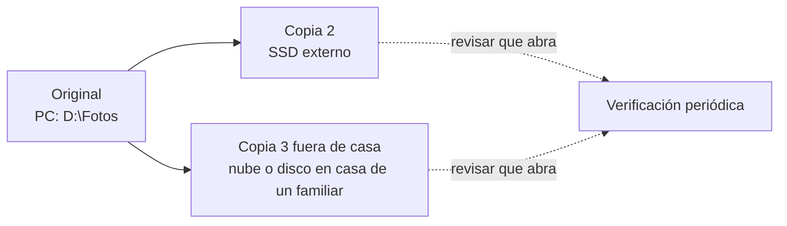

# Respaldo 3-2-1 de fotos y videos

Parte de: [[30-Fotografia/08 Flujo, publicación y legal/_Índice Flujo, publicación y legal|Flujo, publicación y legal]]

> [!info] Cómo avanzar
> `progreso`: **pendiente** → **viendo** (estudiando) → **visto** (contestaste la autoevaluación sin abrir las respuestas) → **dominado** (hiciste el laboratorio o lo aplicaste de verdad).

## Contenido

### Qué es
La **regla 3-2-1** es la estrategia básica para no perder tus archivos: **3 copias** de tus fotos y videos, en **2 medios distintos** (por ejemplo, el disco de la PC y un SSD externo), y **1 copia fuera de casa** (en la nube o en un disco guardado en otro lugar). Protege contra fallas de disco, borrados accidentales, robo, incendio o ransomware.

### Cómo funciona


**Por qué cada número:**
- **3 copias**: si una falla, quedan dos; la probabilidad de que fallen todas a la vez es muy baja.
- **2 medios**: evitar que el mismo tipo de falla afecte a todas (un lote defectuoso, un pico de voltaje en la misma PC).
- **1 fuera de casa**: un robo o un incendio se lleva todo lo que está en la misma ubicación.

**Sincronización no es respaldo.** **iCloud Fotos** (o Google Fotos, OneDrive) con sincronización mantiene **la misma** fototeca en todos lados: si borras en el teléfono, se borra en la nube (con una papelera temporal). Es una copia sincronizada, no un **respaldo con historial**. Necesitas al menos otra copia **independiente** que no refleje automáticamente tus borrados.

**Calcula el espacio:** con ProRAW de unos 75 MB por foto, 2000 fotos al año ocupan 2000 × 75 MB = 150 GB **por copia** (450 GB con las tres). Si guardas solo 300 ProRAW importantes y el resto (1700) en HEIF de ~3 MB: 22.5 GB + 5.1 GB ≈ **27.6 GB**. Decidir qué formato usar cambia mucho el costo del respaldo ([[RAW vs JPEG y HEIF]]). Suma el video de la Osmo Pocket 4P y el dron, que suele pesar mucho más que las fotos.

**El error que deja todo en riesgo:** tener **un solo disco externo** con todo y **borrar el teléfono o la tarjeta**. Ese disco se vuelve la única copia; si falla, pierdes todo. Y otro error silencioso: **nunca verificar** que los respaldos abran.

### Ejemplo
Plan 3-2-1 con lo que ya tienes (PC con Windows):
1. **Copia 1**: `D:\Fotos` en el disco interno de la PC (organizada como en [[Importar, nombrar y organizar fotos]]).
2. **Copia 2**: SSD o disco externo ([[SSD externo para grabar y respaldar]]). Usa `robocopy` en modo espejo con registro:

```bash
# Windows (cmd o PowerShell): copia incremental de D:\Fotos al disco E:
robocopy "D:\Fotos" "E:\Respaldo\Fotos" /E /XO /R:2 /W:5 /LOG+:"E:\Respaldo\robocopy.log"
```

`/E` copia subcarpetas; `/XO` evita sobrescribir con archivos más viejos. Evita `/MIR` en el respaldo principal: si borras algo por error en D:, `/MIR` también lo borra en el respaldo.
3. **Copia 3, fuera de casa**: un segundo disco que dejas en casa de un familiar y rotas cada mes, o un servicio de almacenamiento en la nube con versiones (revisa el precio y límites al contratarlo; Pendiente de confirmar según el proveedor que elijas).
4. **Verificación**: cada tres meses abre al azar 10 fotos de cada copia y un video. Para algo más riguroso, compara hashes:

```bash
# PowerShell: hash de un archivo original y su copia
Get-FileHash "D:\Fotos\2026\2026-11-09 Centro Histórico\RAW\DSC00001.ARW"
Get-FileHash "E:\Respaldo\Fotos\2026\2026-11-09 Centro Histórico\RAW\DSC00001.ARW"
```

En viaje: cada noche, tarjeta → SSD y celular → nube; no formatees tarjetas hasta tener dos copias.

### Cuándo usarlo y cuándo no
Aplícalo a todo lo que te dolería perder: fotos familiares, proyectos, trabajos entregados. Para pruebas sin valor no hace falta triple copia. Si trabajas para clientes, acuerda cuánto tiempo guardarás sus archivos y respáldalos igual.

### Errores comunes
- **Confundir sincronización con respaldo**.
- **Un solo disco externo** como única copia tras borrar el original.
- **Respaldo en el mismo lugar físico** que la PC (todo se pierde en un robo).
- **No verificar** que los archivos abran.
- **Usar espejo (`/MIR`)** sin entender que replica borrados.

### Para profundizar
- [Backblaze: la estrategia de respaldo 3-2-1](https://www.backblaze.com/learning-center/3-2-1-backup-strategy).
- [Apple: transferir fotos y videos del iPhone a una Mac o PC](https://support.apple.com/es-lamr/120267).
- [[SSD externo para grabar y respaldar]].
- Laboratorio: [[Práctica Foto 11 - Importar, organizar y respaldar]].

## Ejercicios

Resuélvelos en papel o en la herramienta; la solución está plegada.

> [!question]- Tomas 2000 fotos ProRAW al año y cada una pesa unos 75 MB. ¿Cuánto espacio necesitas por copia?
> 2000 × 75 MB = 150 000 MB ≈ **150 GB** por copia (×3 para la regla 3-2-1).

> [!question]- Si en lugar de eso guardas solo 300 ProRAW y el resto en HEIF de ~3 MB, ¿cuánto ocupan?
> 300 × 75 = 22.5 GB + 1700 × 3 = 5.1 GB → **≈27.6 GB**.

## Autoevaluación

Contesta primero en voz alta o en papel; luego despliega la respuesta.

> [!question]- ¿Qué significa la regla 3-2-1?
> **3** copias de tus archivos, en **2** medios distintos, y **1** fuera de casa (nube o disco en otro lugar).

> [!question]- ¿iCloud con sincronización cuenta como respaldo?
> No del todo: si borras en el teléfono, se borra en iCloud. Es una copia sincronizada, no un respaldo con historial; necesitas otra copia independiente.

> [!question]- ¿Qué error común deja todo en riesgo?
> Tener solo un disco externo con todo y borrar el teléfono. Si ese disco falla, pierdes todo. Revisa que los respaldos abran de verdad.

## Práctica

- [[Práctica Foto 11 - Importar, organizar y respaldar]]

