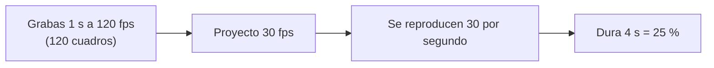

# Cámara lenta (high frame rate)

Parte de: [[31-Video-Audio/01 Técnica de video/_Índice Técnica de video|Técnica de video]]

> [!info] Cómo avanzar
> `progreso`: **pendiente** → **viendo** (estudiando) → **visto** (contestaste la autoevaluación sin abrir las respuestas) → **dominado** (hiciste el laboratorio o lo aplicaste de verdad).

## Contenido

### Qué es
La **cámara lenta limpia** se obtiene grabando a una cadencia **mayor** que la de tu proyecto (60, 120 o 240 fps) y reproduciendo esos cuadros a la cadencia normal (24 o 30 fps). Como hay cuadros reales de sobra, el movimiento se estira sin inventar imágenes. A esto se le llama *high frame rate* (HFR) o alta cadencia.

### Cómo funciona
La fórmula clave:

**velocidad = fps del proyecto / fps de grabación**  ·  **duración final = duración grabada × fps de grabación / fps del proyecto**

| Grabas a | Proyecto | Velocidad | 1 s real dura |
|---|---|---|---|
| 60 fps | 30 fps | 50 % | 2 s |
| 60 fps | 24 fps | 40 % | 2.5 s |
| 120 fps | 30 fps | 25 % | 4 s |
| 240 fps | 30 fps | 12.5 % | 8 s |
| 240 fps | 24 fps | 10 % | 10 s |

Ejemplos:
- 3 s grabados a 240 fps = 720 cuadros; en un proyecto de 30 fps duran 720 / 30 = **24 s**, al **12.5 %**.
- Quieres que un salto de 2 s dure 5 s en 24 fps: necesitas 5 × 24 = 120 cuadros en 2 s → mínimo **60 fps**.

**¿Y si ralentizas un clip de 30 fps?** El editor no tiene cuadros extra: o **repite** cuadros (movimiento a saltos) o los **interpola** (inventa cuadros intermedios con *optical flow*), lo que puede dar deformaciones en bordes, manos o agua. Funciona para un 80 %, no para un 25 %.

**Obturación y luz.** La [[Regla de los 180 grados del obturador]] se aplica a la cadencia de grabación: a 120 fps usas **1/240**; a 240 fps, **1/480**. Eso es 2 o 3 pasos menos de luz que a 30 fps (1/60), así que la cámara lenta pide exteriores de día o mucha luz artificial. En interiores verás ruido y, con lámparas de 60 Hz, parpadeo.

### Ejemplo
Con tu equipo:
- **[[iPhone 15 Pro para foto y video]]**: el modo **Cámara lenta** graba 1080p a 120 o 240 fps (según la ficha técnica de Apple). Al verlo en Fotos el iPhone aplica la ralentización solo en un tramo que puedes ajustar; al importarlo a [[DaVinci Resolve (versión gratuita)]] puede venir con la velocidad ya marcada o como clip de alta cadencia, revisa en las propiedades del clip. Para 4K usa el modo Video a 60 fps.
- **[[Sony a6700]]**: el modo **S&Q** (Slow & Quick) graba ya conformado; 4K hasta 120p (con recorte del sensor) y Full HD hasta 240 fps. También puedes grabar 120p normal y conformar tú en el editor.
- **[[DJI Osmo Pocket 4P]]**: DJI anuncia hasta 4K a 240 fps (cámara lenta de hasta 8×) en ciertos modos.

Ejercicio rápido: graba a tu perro corriendo a 30, 60 y 120 fps con la obturación correcta, ponlos en un proyecto de 30 fps al 100 %, 50 % y 25 % y compara bordes y fluidez.

### Cuándo usarlo y cuándo no
- **Sí**: agua, cabello con viento, deportes, salpicaduras, momentos emotivos breves, b-roll de producto.
- **No**: diálogos (el audio no sirve ralentizado), escenas con poca luz, o cuando la acción ya es lenta (un 25 % de alguien caminando aburre).
- Combínala con [[Rampas de velocidad]] en edición para pasar de normal a lento en el momento clave.

### Errores comunes
1. **Ralentizar en el editor un clip de 30 fps**: tirones o artefactos de interpolación. Graba en alta cadencia desde el principio.
2. **Olvidar subir la obturación** a 1/240 o más: el movimiento lento se ve borroso.
3. **Grabar en interiores** a 240 fps: ruido y flicker de las lámparas.
4. **No conformar el clip**: lo pones en la línea de tiempo y se ve a velocidad normal; tienes que indicarle al editor la cadencia de reproducción o cambiar la velocidad.
5. **Abusar**: si todo está en cámara lenta, ningún momento destaca.

### Para profundizar
- [Especificaciones técnicas del iPhone 15 Pro (Apple)](https://support.apple.com/en-us/111829)
- [Especificaciones de la Sony a6700 (Sony)](https://www.sony.co.in/interchangeable-lens-cameras/products/ilce-6700/spec)
- [Comunicado de lanzamiento de la Osmo Pocket 4P (DJI)](https://www.mynewsdesk.com/uk/dji/pressreleases/osmo-pocket-4p-delivers-pro-filmmaking-capabilities-advancing-the-gimbal-camera-category-dji-pioneered-3459469)

## Ejercicios

Resuélvelos en papel o en la herramienta; la solución está plegada.

> [!question]- Grabas 3 s a 240 fps y lo pones en un proyecto de 30 fps. ¿Cuánto dura y a qué porcentaje de velocidad?
> 3 × 240 = 720 cuadros / 30 = **24 s**; velocidad **12.5 %** (30/240).

> [!question]- Quieres que un salto de 2 s dure 5 s en un proyecto de 24 fps sin interpolar. ¿A cuántos fps mínimos debes grabar?
> Necesitas 5 × 24 = 120 cuadros en 2 s → **60 fps** mínimos (60 × 2 = 120). Con 60 fps la velocidad será 40 %.

> [!question]- ¿Qué porcentaje de velocidad da un clip de 60 fps en un proyecto de 24 fps?
> 24 / 60 = **40 %**.

## Autoevaluación

Contesta primero en voz alta o en papel; luego despliega la respuesta.

> [!question]- ¿Cómo se consigue una cámara lenta limpia?
> Grabando a más cuadros por segundo de los que tendrá el proyecto (60, 120 o 240 fps) y reproduciéndolos a la cadencia del proyecto. Así cada segundo real se estira sin inventar cuadros.

> [!question]- ¿Qué hace el modo "Cámara lenta" del iPhone 15 Pro?
> Graba en **1080p a 120 o 240 fps** y la app Fotos lo reproduce desacelerado. Puedes ajustar en Fotos qué parte va lenta. Revisa las opciones exactas en Ajustes > Cámara > Grabar cámara lenta (ver [[iPhone 15 Pro para foto y video]]).

> [!question]- ¿Qué obturación usas a 120 fps y qué implica en luz?
> Por 180°, **1/240**. Es mucha velocidad: necesitas bastante luz; en interiores con poca luz el ISO sube y aparece ruido. La cámara lenta funciona mejor de día o con buena iluminación.

> [!question]- Error común: ralentizar en el editor un clip grabado a 30 fps. ¿Qué pasa?
> El editor no tiene cuadros extra: repite cuadros (se ve a saltos) o los inventa con interpolación (pueden salir artefactos raros en bordes). Para cámara lenta, decide antes de grabar.

## Práctica

- [[Lab 1 - Obturación a 180 grados y cámara lenta]]

