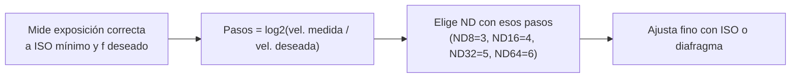

# Filtros ND en video

Parte de: [[31-Video-Audio/01 Técnica de video/_Índice Técnica de video|Técnica de video]]

> [!info] Cómo avanzar
> `progreso`: **pendiente** → **viendo** (estudiando) → **visto** (contestaste la autoevaluación sin abrir las respuestas) → **dominado** (hiciste el laboratorio o lo aplicaste de verdad).

## Contenido

### Qué es
Un **filtro ND** (*neutral density*, densidad neutra) es un "lente de sol" para la cámara: reduce la cantidad de luz que entra **sin cambiar el color**. En video sirve para poder mantener la velocidad de obturación de la [[Regla de los 180 grados del obturador]] (1/50, 1/60) y un diafragma abierto en días soleados, sin que la imagen se queme.

### Cómo funciona
**Pasos (stops).** Cada paso de luz reduce la luz a la mitad. El número del filtro es el **factor**: un ND8 deja pasar 1/8 de la luz. Los pasos se calculan como **log₂(factor)**:

| Filtro | Factor | Pasos | Densidad óptica |
|---|---|---|---|
| ND8 | 8 | 3 | 0.9 |
| ND16 | 16 | 4 | 1.2 |
| ND32 | 32 | 5 | 1.5 |
| ND64 | 64 | 6 | 1.8 |
| ND1000 | 1000 | ~10 | 3.0 |

**Cuánto ND necesitas:** calcula cuántos pasos hay entre la velocidad que te da la exposición correcta y la que quieres usar.
- Mides 1/500 a ISO mínimo y quieres 1/50 (24 fps): 500 / 50 = 10× → log₂(10) ≈ **3.3 pasos** → un ND8 (3 pasos) y ajustas el tercio restante con el diafragma o el ISO, o un ND10 si lo tienes.
- A 30 fps, la correcta es 1/1000 y quieres 1/60: 1000 / 60 ≈ 16.7× → **~4 pasos** → **ND16**.
- Con un ND16, una exposición de 1/2000 pasa a 1/2000 × 16 = **1/125**.

**ND fijo vs. ND variable.** El **fijo** tiene un solo valor y da la mejor calidad. El **variable** (dos polarizadores que giran) cubre un rango, por ejemplo 2–5 pasos, y es muy cómodo en video porque ajustas sobre la marcha. Su defecto: **al máximo** aparece una **cruz o "X" oscura** y manchas de color, sobre todo con lentes gran angular; además, muchos variables baratos dominan el color (tiñen de magenta o verde).

### Ejemplo
- **[[Sony a6700]]**: rosca un ND variable de buena calidad al diámetro de tu lente (o usa anillos adaptadores para compartirlo entre lentes). Ejemplo en la playa a 24 fps: 1/50, ISO 100, f/2.8 para desenfocar el fondo → probablemente necesites 5–6 pasos (ND32–ND64).
- **[[iPhone 15 Pro para foto y video]]**: como la apertura es fija, el ND es la **única** forma de bajar la obturación al sol. Hay ND de clip, de funda magnética o integrados en *cages*. Fija la obturación con [[Blackmagic Camera (app)]] y elige el ND para que el ISO quede en su mínimo.
- **[[DJI Osmo Pocket 4P]]**: DJI vende sets de filtros ND magnéticos para su línea Pocket; confirma cuáles son compatibles con el 4P (Pendiente de confirmar).
- Para el dron, la misma lógica está en [[Exposición en video aéreo (ND y 180 grados)]].

### Cuándo usarlo y cuándo no
- **Sí**: exteriores de día, cuando quieres obturación a 180° y/o diafragma abierto; en Log, donde el ISO mínimo suele ser alto.
- **No**: interiores con poca luz, de noche, o si grabas en cámara lenta a 240 fps (ya necesitas velocidades rápidas).
- **Alternativa sin ND**: subir la velocidad aceptando movimiento más entrecortado, o cerrar el diafragma (en cámara; no en el iPhone).

### Errores comunes
1. **Usar el ND variable al máximo**: aparece la cruz oscura y viñeteo. Usa uno con más rango o combina con un fijo.
2. **Comprar un ND barato**: tinte de color, pérdida de nitidez y reflejos. Haz balance de blancos con el filtro puesto.
3. **Olvidar quitarlo al entrar a la sombra o a un interior**: la imagen se va a negro y subes ISO sin darte cuenta.
4. **Rayarlo o ensuciarlo**: un ND sucio baja el contraste y crea destellos; límpialo como un lente.
5. **Confundir ND con polarizador**: el polarizador quita reflejos y cambia el cielo, además de restar 1–2 pasos. No son lo mismo (ver [[Filtros ND y Black Mist para video]]).

### Para profundizar
- [ND filters for filmmaking (B&H)](https://www.bhphotovideo.com/insights/nd-filters-filmmaking)
- [Shutter Angles & Creative Control (RED 101)](https://www.red.com/red-101/shutter-angle-tutorial)
- Relación con foto: [[Filtros (ND, polarizador y degradado)]]

## Ejercicios

Resuélvelos en papel o en la herramienta; la solución está plegada.

> [!question]- ¿Cuántos pasos reduce un ND32? ¿Y un ND1000?
> ND32: log2(32) = **5 pasos**. ND1000: log2(1000) ≈ **10 pasos**.

> [!question]- Al aire libre mides 1/500 a ISO mínimo y grabas a 24 fps (quieres 1/50). ¿Qué ND?
> 1/500→1/250→1/125→1/60→1/30: entre 1/500 y 1/50 hay ≈ 3.3 pasos → **ND8** (3 pasos, ~1/60) o ND10/ND16 si quieres margen ajustando ISO.

> [!question]- Pones un ND16 y la exposición pasa de 1/2000 a…
> 4 pasos más lento: 1/2000 → 1/1000 → 1/500 → 1/250 → **1/125**.

## Autoevaluación

Contesta primero en voz alta o en papel; luego despliega la respuesta.

> [!question]- ¿Qué hace un filtro ND?
> Es un "lente de sol" neutro: reduce la luz que entra sin cambiar el color, para poder usar obturación de 180° (y en cámaras con diafragma, aperturas abiertas) a plena luz del día.

> [!question]- ¿Qué significan ND8, ND16, ND64?
> Cuánto reducen la luz: ND8 = 3 pasos (1/8), ND16 = 4 pasos, ND64 = 6 pasos. Cada paso es la mitad de la luz.

> [!question]- Caso: a 30 fps, la exposición correcta a pleno sol es 1/1000 con el ISO mínimo. ¿Qué ND necesitas para llegar a 1/60?
> De 1/1000 a 1/60 hay ≈ 4 pasos (1/1000→1/500→1/250→1/125→1/60). Necesitas un **ND16**.

> [!question]- Error común: usar un ND variable al máximo. ¿Qué puede salir mal?
> Muchos ND variables en su extremo producen una mancha en forma de **X** oscura o cambios de color. Úsalo en su rango útil o con ND fijos.

## Práctica

- [[Lab 2 - Exposición de Apple Log con zebras y false color]]

