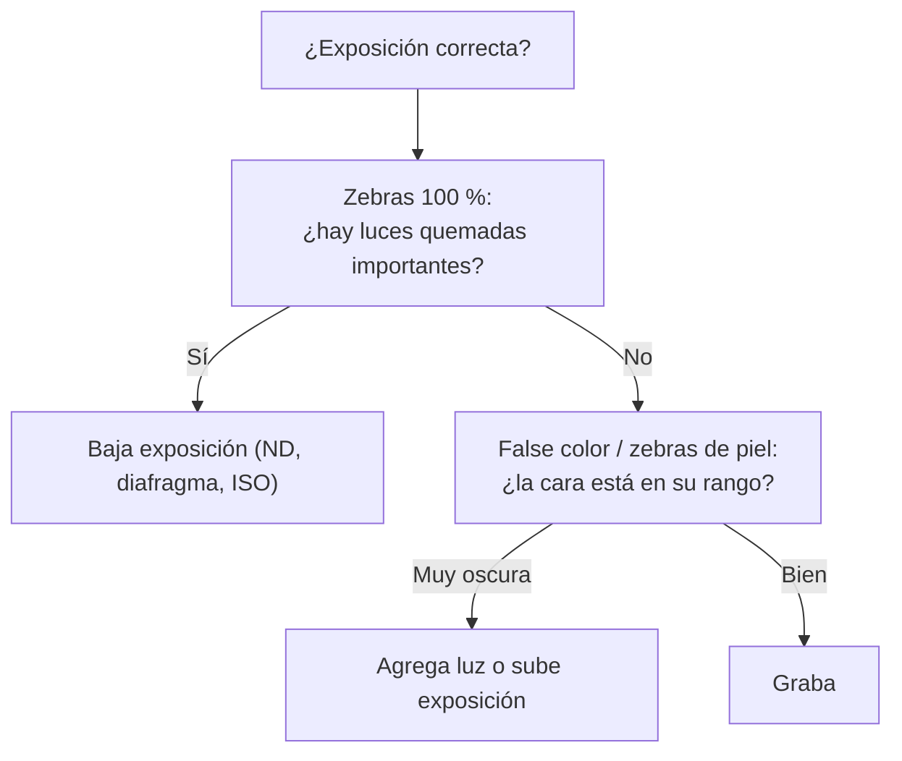

# Herramientas de exposición en video (zebras, waveform y false color)

Parte de: [[31-Video-Audio/01 Técnica de video/_Índice Técnica de video|Técnica de video]]

> [!info] Cómo avanzar
> `progreso`: **pendiente** → **viendo** (estudiando) → **visto** (contestaste la autoevaluación sin abrir las respuestas) → **dominado** (hiciste el laboratorio o lo aplicaste de verdad).

## Contenido

### Qué es
Son ayudas que muestran el **brillo real** de la imagen en lugar de que lo juzgues a ojo en una pantalla. Las tres principales:
- **Zebras**: rayas diagonales sobre las zonas que superan (o están en) un nivel de brillo que tú eliges.
- **Waveform** (forma de onda): gráfica que muestra el brillo de cada columna de la imagen, de 0 % (negro) a 100 % (blanco).
- **False color** (falso color): pinta la imagen con colores según su nivel de exposición (por ejemplo, azul para sombras, verde para tono medio, rosa para piel, rojo para luces quemadas).

### Cómo funciona
La pantalla del celular o de la cámara **miente**: cambia con el brillo, el reflejo del sol y el perfil de color. Estas herramientas leen la **señal**, no la pantalla.

**Zebras.** Configuras un umbral, por ejemplo **100 %** (o "100+") para avisar de luces quemadas, o un rango como **70 %** para comprobar la piel. Si aparecen rayas sobre el cielo con umbral 100, está quemado: cierra o baja exposición. Con umbral de piel, buscas que salgan rayas suaves en las mejillas iluminadas.

**Waveform.** El eje horizontal es la imagen de izquierda a derecha; el vertical, el brillo. Una persona en el centro aparece como una "montaña" en el centro de la gráfica. Si una zona se pega arriba en 100 % de forma plana, está recortada; si se pega en 0 %, las sombras se perdieron. Es la herramienta más precisa para ver **dónde** está el problema. Se estudia a fondo en [[Scopes (waveform, vectorscopio y parade)]].

**False color.** Es la forma más rápida de leer la exposición de un vistazo: no tienes que interpretar una gráfica. Cada app o cámara usa su propia escala de colores; aprende la de tu herramienta.

**Histograma.** Muestra *cuántos* píxeles hay en cada nivel de brillo, pero no *dónde* están; es útil pero menos preciso que el waveform (ver [[Histograma y rango dinámico]]).

### Ejemplo
Qué tiene cada equipo:
- **[[Sony a6700]]**: **zebras** con umbral configurable, histograma y **Gamma Display Assist** (muestra el S-Log3 con contraste normal en la pantalla, sin afectar la grabación). No tiene waveform de fábrica. Configura dos zebras: una en 100+ para luces y otra cerca de 70 % para piel en perfil estándar.
- **[[iPhone 15 Pro para foto y video]]**: la app Cámara no trae estas ayudas. **[[Blackmagic Camera (app)]]** (gratuita) muestra histograma, *focus peaking*, zebras y false color.
- **[[DJI Osmo Pocket 4P]]**: revisa en el modo Pro qué ayudas trae (histograma, zebras) (Pendiente de confirmar).

Ejercicio: en un cuarto con ventana, graba a una persona con el iPhone en Blackmagic Camera, activa false color y ajusta ISO hasta que la cara quede en el color de "piel" de la escala de la app, mientras la ventana no se pinta de rojo en lo importante. Luego compara con lo que hubieras elegido a ojo con el brillo de la pantalla al máximo.

### Cuándo usarlo y cuándo no
- **Zebras**: siempre en exteriores y cuando grabas Log (con la pantalla plana es casi imposible juzgar a ojo).
- **False color**: entrevistas y caras; da una lectura rápida y consistente entre tomas.
- **Waveform**: escenas complejas con muchas zonas de luz, y en edición para igualar tomas.
- Cuando todo está en automático y no hay tiempo, al menos activa zebras al 100 %.

### Errores comunes
1. **Exponer guiándote por la pantalla del iPhone con el brillo al máximo**: se ve brillante, pero el video queda subexpuesto (o al revés en la sombra).
2. **Dejar las zebras en un umbral que no entiendes**: aprende qué significa 70 % y 100 % en tu perfil.
3. **Usar los mismos números en Log y en estándar**: los niveles correctos de piel cambian según el perfil.
4. **Querer cero zebras en todo**: una lámpara o el sol pueden quemarse; importa que no se queme lo importante (cara, cielo, producto).

### Para profundizar
- [Guía de ayuda de la Sony a6700 (Sony)](https://helpguide.sony.net/ilc/2320/v1/en/)
- [Blackmagic Camera en el App Store](https://apps.apple.com/gb/app/id6449580241)
- [Manual para principiantes de DaVinci Resolve 20 (Blackmagic Design)](https://documents.blackmagicdesign.com/UserManuals/DaVinci-Resolve-20-Beginners-Guide.pdf)

## Autoevaluación

Contesta primero en voz alta o en papel; luego despliega la respuesta.

> [!question]- ¿Qué hacen las zebras?
> Dibujan franjas sobre las zonas que superan un nivel de brillo que tú defines (p. ej. 95-100 %), para avisarte que se van a quemar.

> [!question]- ¿Qué te muestra un waveform?
> El brillo de la imagen de izquierda a derecha: abajo los negros (0), arriba los blancos (100). Si la traza se aplana arriba, hay altas luces recortadas; si se aplasta abajo, sombras sin detalle.

> [!question]- ¿Qué es false color y para qué sirve?
> Pinta la imagen con colores según su nivel de exposición (p. ej. morado = negro recortado, rojo = quemado, verde/rosa = tono medio o piel). Sirve para exponer caras con precisión de un vistazo.

> [!question]- Error común: exponer guiándote solo por la pantalla del iPhone con el brillo al máximo. ¿Qué pasa?
> La pantalla brillante (y en HDR) hace que la imagen parezca bien expuesta cuando está oscura, o al revés. Usa zebras/false color/waveform de [[Blackmagic Camera (app)]] para medir.

## Práctica

- [[Lab 2 - Exposición de Apple Log con zebras y false color]]

