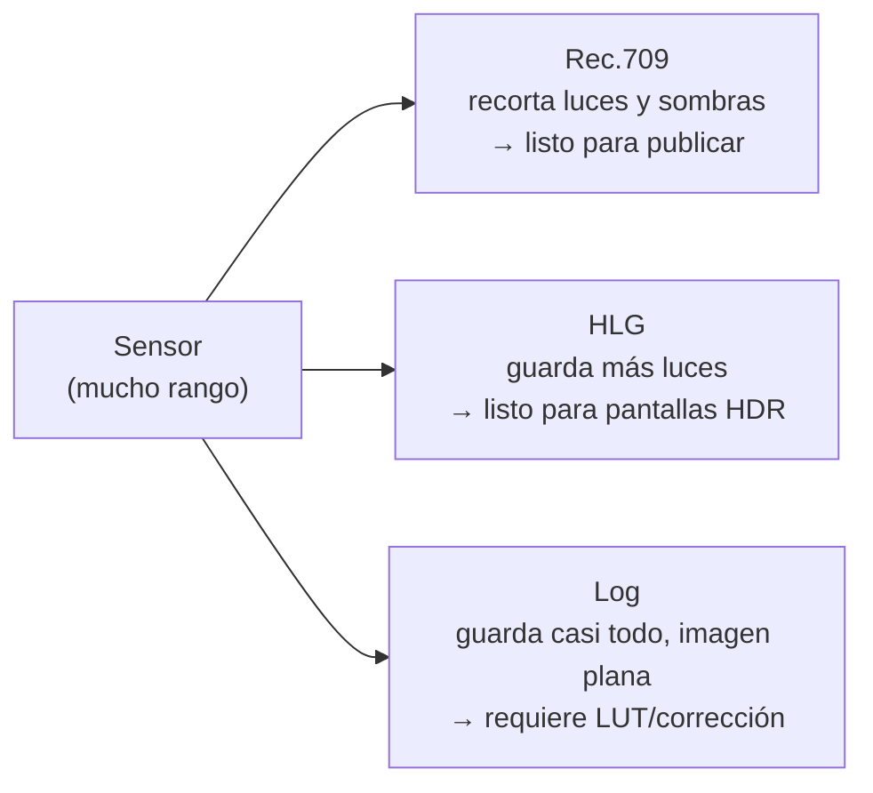

# Perfiles de color en video (estándar, Log y HLG)

Parte de: [[31-Video-Audio/01 Técnica de video/_Índice Técnica de video|Técnica de video]]

> [!info] Cómo avanzar
> `progreso`: **pendiente** → **viendo** (estudiando) → **visto** (contestaste la autoevaluación sin abrir las respuestas) → **dominado** (hiciste el laboratorio o lo aplicaste de verdad).

## Contenido

### Qué es
Un **perfil de color** (o perfil de imagen, *picture profile*) define cómo la cámara convierte la luz que captó el sensor en valores de video: qué curva de brillo (gamma) usa y en qué espacio de color guarda. Hay tres grandes familias:
- **Estándar (Rec.709 / SDR)**: imagen lista para ver, con contraste y color "terminados".
- **HLG** (*Hybrid Log-Gamma*): curva HDR pensada para verse directamente en pantallas HDR, con más rango en las luces.
- **Log**: curva **plana** y lavada que guarda el máximo rango dinámico para corregirlo en posproducción.

### Cómo funciona
El sensor capta más rango dinámico del que cabe en un video estándar. Cada perfil decide qué hacer con ese exceso:

- **Rec.709** aplica contraste y saturación en cámara. Lo que ves es lo que publicas; tiene menos margen para rescatar un cielo quemado.
- **HLG** (definido en la norma ITU-R BT.2100) es compatible con pantallas HDR y razonablemente visible en SDR, pero el resultado varía según el dispositivo que lo reproduce.
- **Log** distribuye los niveles de forma logarítmica: más información en sombras y luces, a costa de una imagen gris que **siempre** hay que transformar (con una LUT de conversión a Rec.709 y luego tus ajustes). Por su curva plana, necesita **10 bits** ([[Profundidad de bits y submuestreo de croma]]).

**Cómo exponer Log.** No te guíes por cómo se ve la pantalla (todo parece lavado). Usa herramientas ([[Herramientas de exposición en video (zebras, waveform y false color)]]) y una **LUT de vista previa** en el monitor. La regla general es **proteger las luces** sin dejar las sombras demasiado oscuras; muchos fabricantes recomiendan exponer un poco por encima de lo normal (+1 paso, por ejemplo) para limpiar ruido en sombras y bajarlo luego. El ISO mínimo en Log suele ser más alto que en estándar.

### Ejemplo
Perfiles de tu equipo:
- **[[Sony a6700]]**: **S-Cinetone** (look cinematográfico listo para usar, sin corrección), **S-Log3** (más de 14 pasos de latitud según Sony), **HLG** y Creative Looks. Puedes cargar **LUT de usuario (.cube)** para ver el S-Log3 corregido en la pantalla mientras grabas. Detalle en [[Sony S-Cinetone y S-Log3]].
- **[[iPhone 15 Pro para foto y video]]**: video estándar SDR, **HDR Dolby Vision** (basado en HLG, hasta 4K a 60 fps) y **Apple Log**. En la app Cámara, Log es una opción de codificación de ProRes; con [[Blackmagic Camera (app)]] tienes además LUT de vista previa para Apple Log.
- **[[DJI Osmo Pocket 4P]]**: perfil Normal y **D-Log 2 de 10 bits** en la cámara principal (DJI anuncia hasta 17 pasos de rango dinámico); la cámara teleobjetivo usa D-Log según reseñas. HLG en el 4P: (Pendiente de confirmar).

**Caso: el cumpleaños de tu sobrino que quieres subir esa noche.** Usa **estándar** (o S-Cinetone en la Sony). Log te obliga a corregir cada clip y no ganas nada en una fiesta con luz controlada.

**Caso: paisaje al atardecer con cielo brillante y sombras profundas.** Aquí **Log** sí vale la pena: podrás recuperar el cielo y abrir sombras en [[DaVinci Resolve (versión gratuita)]] (ver [[Material Log y LUTs]]).

### Cuándo usarlo y cuándo no
| Situación | Perfil |
|---|---|
| Entrega rápida, eventos familiares, redes | Estándar / S-Cinetone |
| Escenas de alto contraste, proyecto con corrección de color | Log (10 bits) |
| Quieres publicar HDR sin corregir mucho | HLG / Dolby Vision |
| Mezclas cámaras y quieres igualarlas | Log en todas, o estándar en todas |

### Errores comunes
1. **Subir Log sin corregir**: el público ve una imagen gris, sin contraste ni color.
2. **Subexponer Log**: las sombras se llenan de ruido al levantarlas; protege luces pero no te quedes corto.
3. **Grabar Log en 8 bits**: bandas en cielos y paredes.
4. **Aplicar una LUT creativa directa sobre Log** sin la conversión correcta: colores raros y tonos de piel naranjas.
5. **Mezclar HDR y SDR en el mismo proyecto** sin gestionarlo: unos clips se ven deslavados y otros sobresaturados.

### Para profundizar
- [Sony a6700: lista de funciones (Sony)](https://www.sony.com.tw/en/interchangeable-lens-cameras/products/ilce-6700/feature-list)
- [Acerca de Apple ProRes en el iPhone (Apple)](https://support.apple.com/es-lamr/109041)
- [Recomendación ITU-R BT.2100 (HDR, PQ y HLG)](https://www.itu.int/dms_pubrec/itu-r/rec/bt/R-REC-BT.2100-3-202502-I!!PDF-E.pdf)

## Autoevaluación

Contesta primero en voz alta o en papel; luego despliega la respuesta.

> [!question]- ¿Qué diferencia hay entre un perfil estándar (Rec.709), HLG y Log?
> **Estándar/Rec.709**: listo para ver, contraste y color ya aplicados (SDR). **HLG**: un formato HDR que se ve bien en pantallas HDR y razonable en SDR. **Log**: curva plana que guarda el máximo rango dinámico; se ve gris y **siempre** necesita corrección o LUT.

> [!question]- ¿Qué perfiles tendrás en tu equipo?
> iPhone 15 Pro: HDR Dolby Vision (HLG) por defecto y **Apple Log** (con ProRes). DJI Osmo Pocket 4P: **D-Log 2**. Sony a6700: **S-Cinetone** (listo para usar, con look cinematográfico) y **S-Log3**. Detalles en el área de Equipo.

> [!question]- Caso: vas a grabar el cumpleaños de tu sobrino y quieres subirlo esa noche. ¿Log o estándar?
> **Estándar** (o S-Cinetone en la Sony). Log solo vale la pena si vas a corregir color y la escena tiene mucho contraste. Para algo rápido, te ahorra trabajo.

> [!question]- ¿Cómo expones Log correctamente?
> Usa zebras, waveform o false color (no la pantalla, que engaña). Con Log se suele exponer un poco más brillante, protegiendo las altas luces importantes. Revisa la vista previa con LUT si la app lo permite (Blackmagic Camera puede mostrar una LUT de monitoreo).

> [!question]- Error común: subir un video Log sin corregir. ¿Qué ve el público?
> Una imagen gris, sin contraste ni saturación. El Log es un "negativo digital": hay que convertirlo (LUT o Color Space Transform) antes de entregar.

## Práctica

- [[Lab 2 - Exposición de Apple Log con zebras y false color]]

